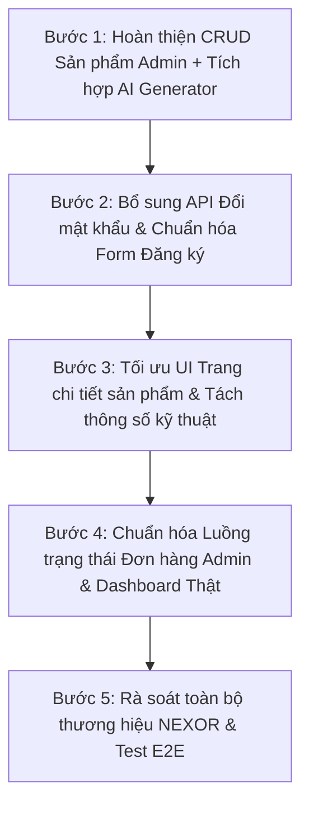

# BÁO CÁO KIỂM TRA TOÀN DIỆN DỰ ÁN NEXOR E-COMMERCE
**Tài liệu tham chiếu:** SRS gốc tại [Srs/New Tài liệu văn bản.txt](file:///d:/Dự%20án%20cá%20nhân/Dự%20án%20thương%20mại%20điện%20tử%20e%20commerce/Srs/New%20Tài%20liệu%20văn%20bản.txt)  
**Ngày thực hiện kiểm tra:** 22/10/2026  
**Trạng thái hệ thống:** Đã kết nối Full-stack Spring Boot + React Vite + MySQL 8.0 + Docker CI/CD  

---

## MỤC LỤC TỔNG QUAN
1. [Bảng tóm tắt kết quả đối chiếu tính năng (SRS Compliance Matrix)](#1-bảng-tóm-tắt-kết-quả-đối-chiếu-tính-năng-srs-compliance-matrix)
2. [Kiểm tra Phân hệ Authentication & Hồ sơ người dùng](#2-kiểm-tra-phân-hệ-authentication--hồ-sơ-người-dùng)
3. [Kiểm tra Phân hệ Sản phẩm & Đối chiếu trường dữ liệu với Admin](#3-kiểm-tra-phân-hệ-sản-phẩm--đối-chiếu-trường-dữ-liệu-với-admin)
4. [Kiểm tra Phân hệ Giỏ hàng, Đặt hàng (Checkout) & Quản trị Đơn hàng](#4-kiểm-tra-phân-hệ-giỏ-hàng-đặt-hàng-checkout--quản-trị-đơn-hàng)
5. [Kiểm tra Phân hệ Trợ lý AI & Tự động sinh mô tả SEO](#5-kiểm-tra-phân-hệ-trợ-lý-ai--tự-động-sinh-mô-tả-seo)
6. [Tổng hợp các Lỗi Logic & Điểm nghẽn kỹ thuật (Bug & Logic Flaws)](#6-tổng-hợp-các-lỗi-logic--điểm-nghẽn-kỹ-thuật-bug--logic-flaws)
7. [Lộ trình hành động chi tiết để hoàn thiện 100% dự án](#7-lộ-trình-hành-động-chi-tiết-để-hoàn-thiện-100-dự-án)

---

## 1. BẢNG TÓM TẮT KẾT QUẢ ĐỐI CHIẾU TÍNH NĂNG (SRS COMPLIANCE MATRIX)

| Mã yêu cầu | Tên tính năng theo SRS | Backend API | Frontend UI | Mức độ hoàn thiện | Đánh giá & Vấn đề tồn đọng |
|---|---|---|---|:---:|---|
| **FR-01** | Đăng ký & Đăng nhập (JWT, BCrypt) | ✅ Hoàn thành (`/api/auth/*`) | ✅ Hoàn thành | **95%** | Thiếu ô `username` ở form đăng ký (tự sinh từ email), thiếu API đổi mật khẩu trên Backend. |
| **FR-01.1**| Quản lý hồ sơ cá nhân (Họ tên, SĐT, Địa chỉ, Avatar) | ✅ Hoàn thành (`/api/users/profile`) | ✅ Hoàn thành ([ProfilePage.tsx](file:///d:/Dự%20án%20cá%20nhân/Dự%20án%20thương%20mại%20điện%20tử%20e%20commerce/client/src/pages/auth/ProfilePage.tsx)) | **90%** | Tab "Đổi mật khẩu" ở Client gọi endpoint chưa có trên Backend (đang chạy mock). |
| **FR-02** | Catalog sản phẩm & Tìm kiếm, Lọc danh mục | ✅ Hoàn thành (`/api/products/*`) | ✅ Hoàn thành ([ProductsPage.tsx](file:///d:/Dự%20án%20cá%20nhân/Dự%20án%20thương%20mại%20điện%20tử%20e%20commerce/client/src/pages/guest/ProductsPage.tsx)) | **95%** | Lọc theo danh mục, từ khóa, sắp xếp giá hoạt động tốt. Cần bổ sung lọc theo thương hiệu. |
| **FR-02.1**| Chi tiết sản phẩm (Product Detail) | ✅ Hoàn thành (`GET /api/products/{id}`) | ✅ Hoàn thành ([ProductDetailPage.tsx](file:///d:/Dự%20án%20cá%20nhân/Dự%20án%20thương%20mại%20điện%20tử%20e%20commerce/client/src/pages/guest/ProductDetailPage.tsx)) | **85%** | Tùy chọn Bộ nhớ / Màu sắc bị fix cứng giao diện iPhone cho mọi sản phẩm (kể cả chuột, sạc). |
| **FR-03** | Giỏ hàng Client (Zustand / LocalStorage) | N/A (Client-side) | ✅ Hoàn thành ([CartPage.tsx](file:///d:/Dự%20án%20cá%20nhân/Dự%20án%20thương%20mại%20điện%20tử%20e%20commerce/client/src/pages/cart/CartPage.tsx)) | **100%** | Thêm, sửa số lượng, xóa sản phẩm, tính tổng tiền chuẩn xác. |
| **FR-03.1**| Đặt hàng (Checkout COD, trừ tồn kho DB) | ✅ Hoàn thành (`POST /api/orders/checkout`) | ✅ Hoàn thành ([CheckoutPage.tsx](file:///d:/Dự%20án%20cá%20nhân/Dự%20án%20thương%20mại%20điện%20tử%20e%20commerce/client/src/pages/checkout/CheckoutPage.tsx)) | **100%** | Backend tự động trừ tồn kho (`stock`), kiểm tra âm kho, tạo đơn trạng thái `PENDING`. |
| **FR-03.2**| Lịch sử đơn hàng cá nhân (My Orders) | ✅ Hoàn thành (`GET /api/orders/my-orders`) | ✅ Hoàn thành ([MyOrdersPage.tsx](file:///d:/Dự%20án%20cá%20nhân/Dự%20án%20thương%20mại%20điện%20tử%20e%20commerce/client/src/pages/order/MyOrdersPage.tsx)) | **95%** | Hiển thị chi tiết từng đơn hàng, trạng thái, ngày đặt, địa chỉ nhận. |
| **FR-04** | Admin CRUD Sản phẩm | ✅ Hoàn thành (`/api/admin/products`) | ⚠️ **Chưa hoàn thiện** ([AdminProductsPage.tsx](file:///d:/Dự%20án%20cá%20nhân/Dự%20án%20thương%20mại%20điện%20tử%20e%20commerce/client/src/pages/admin/AdminProductsPage.tsx)) | **40%** | **Nút Thêm & Sửa mới chỉ hiện alert(); Nút Xóa chỉ xóa state React, chưa gọi API DELETE Backend!** |
| **FR-05** | Admin AI Description Generator | ✅ Hoàn thành (`POST /api/admin/ai/generate-description`) | ❌ Chưa có UI | **50%** | Backend đã có 3 tầng (Gemini -> Spring AI -> Thuật toán SEO), nhưng chưa có Form Modal Admin tích hợp nút gọi. |
| **FR-06** | Admin Quản lý & Cập nhật trạng thái đơn hàng | ✅ Hoàn thành (`PUT /api/admin/orders/{id}/status`) | ✅ Hoàn thành ([AdminOrdersPage.tsx](file:///d:/Dự%20án%20cá%20nhân/Dự%20án%20thương%20mại%20điện%20tử%20e%20commerce/client/src/pages/admin/AdminOrdersPage.tsx)) | **85%** | Backend chặn chuyển trạng thái không hợp lệ (ví dụ PENDING sang COMPLETED), Frontend cần disable các option vi phạm quy trình. |
| **FR-07** | AI Chatbot tư vấn tìm kiếm sản phẩm | ✅ Hoàn thành (`POST /api/ai/chat`) | ✅ Hoàn thành ([AiChatbot.tsx](file:///d:/Dự%20án%20cá%20nhân/Dự%20án%20thương%20mại%20điện%20tử%20e%20commerce/client/src/components/common/Chat/AiChatbot.tsx)) | **95%** | Hoạt động tốt kèm Smart Fallback Engine. Cần đổi các chữ "E-ShopTECH" còn sót thành "NEXOR". |

---

## 2. KIỂM TRA PHÂN HỆ AUTHENTICATION & HỒ SƠ NGƯỜI DÙNG

### 2.1. Logic Đăng ký (Register)
- **Luồng xử lý tại Backend ([AuthServiceImpl.java](file:///d:/Dự%20án%20cá%20nhân/Dự%20án%20thương%20mại%20điện%20tử%20e%20commerce/server/src/main/java/ra/project/server/service/impl/AuthServiceImpl.java))**:
  - Nhận `RegisterRequest` gồm: `username`, `email`, `password`, `fullName`, `phoneNumber`, `address`.
  - Kiểm tra tính duy nhất: `existsByUsername()` và `existsByEmail()`. Nếu trùng lặp, quăng `ConflictException` (HTTP 409).
  - Mã hóa mật khẩu an toàn 1 chiều bằng `BCryptPasswordEncoder`.
  - Mặc định gán `role = Role.CUSTOMER`, `status = true`.
- **Luồng xử lý tại Frontend ([RegisterPage.tsx](file:///d:/Dự%20án%20cá%20nhân/Dự%20án%20thương%20mại%20điện%20tử%20e%20commerce/client/src/pages/auth/RegisterPage.tsx))**:
  - Giao diện gồm: Họ và tên, Email, Số điện thoại, Mật khẩu, Xác nhận mật khẩu, Điều khoản dịch vụ.
  - **LỖI LOGIC PHÁT HIỆN:** Form đăng ký không có trường `username`. File [auth.service.ts](file:///d:/Dự%20án%20cá%20nhân/Dự%20án%20thương%20mại%20điện%20tử%20e%20commerce/client/src/api/services/auth.service.ts) tự sinh `username = payload.email.split('@')[0]`.
    *Hậu quả:* Nếu hai người dùng đăng ký với `nguyenvana@gmail.com` và `nguyenvana@outlook.com`, người thứ 2 sẽ bị báo lỗi "Tên đăng nhập đã được sử dụng" dù email hoàn toàn khác nhau!
  - **Giải pháp:** Bổ sung ô nhập "Tên tài khoản (username)" hoặc tự sinh username kèm hậu tố ngẫu nhiên (VD: `email.split('@')[0] + '_' + Math.floor(Math.random()*1000)`).

### 2.2. Logic Đăng nhập & Token JWT (Login)
- **Tài khoản mặc định hệ thống**:
  - **ADMIN:** `admin@ecommerce.com` hoặc `admin` | Mật khẩu: `123456`
  - **CUSTOMER:** `customer@ecommerce.com` hoặc `customer` | Mật khẩu: `123456`
- **Cơ chế Token ([JwtTokenProvider.java](file:///d:/Dự%20án%20cá%20nhân/Dự%20án%20thương%20mại%20điện%20tử%20e%20commerce/server/src/main/java/ra/project/server/security/JwtTokenProvider.java))**:
  - Thuật toán ký: `HS256` với secret key 256-bit.
  - Thời hạn sống của Token: `86,400,000 ms` = **24 giờ (1 ngày)**. Đúng yêu cầu bảo mật có Expiration Time.
  - Payload chứa `subject = username`.
  - `SecurityConfig.java` bảo vệ các route `/api/admin/**` yêu cầu quyền `ROLE_ADMIN`.

### 2.3. Quản lý Hồ sơ cá nhân (User Profile)
- **Xem thông tin ([UserController.java](file:///d:/Dự%20án%20cá%20nhân/Dự%20án%20thương%20mại%20điện%20tử%20e%20commerce/server/src/main/java/ra/project/server/controller/UserController.java))**:
  - `GET /api/users/profile` trả về thông tin người dùng đăng nhập hiện tại từ JWT.
- **Cập nhật thông tin**:
  - `PUT /api/users/profile` nhận `fullName`, `phoneNumber`, `address`, `avatarUrl`. Cập nhật và lưu vào DB thành công.
- **LỖI THIẾU SÓT THEO SRS:**
  - SRS mục 2.1 yêu cầu: *"Cho phép người dùng xem và cập nhật thông tin cá nhân của người dùng trên hệ thống (họ tên, email, mật khẩu, …)"*.
  - Backend **chưa hề có API Đổi mật khẩu** (`change-password`).
  - Frontend [ProfilePage.tsx](file:///d:/Dự%20án%20cá%20nhân/Dự%20án%20thương%20mại%20điện%20tử%20e%20commerce/client/src/pages/auth/ProfilePage.tsx) có tab Đổi mật khẩu nhưng [auth.service.ts](file:///d:/Dự%20án%20cá%20nhân/Dự%20án%20thương%20mại%20điện%20tử%20e%20commerce/client/src/api/services/auth.service.ts) gọi vào `/auth/change-password` không tồn tại, chỉ chạy mock khi bật mock mode.

---

## 3. KIỂM TRA PHÂN HỆ SẢN PHẨM & ĐỐI CHIẾU TRƯỜNG DỮ LIỆU VỚI ADMIN

### 3.1. Bảng so sánh ma trận trường dữ liệu (Schema Mismatch Analysis)

| Trường thông tin | DB `products` | Entity `Product.java` | DTO `ProductRequest` | Client Model `Product` | Admin CRUD Modal | Đánh giá & Rủi ro |
|---|:---:|:---:|:---:|:---:|:---:|---|
| **id** | BIGINT | `Long id` | N/A | `number` | ✅ Có | Khớp hoàn toàn. |
| **name** | VARCHAR(255) | `String name` | `String name` (NotBlank) | `string` | ✅ Có | Khớp hoàn toàn. |
| **description** | TEXT | `String description` | `String description` | `string` | ✅ Có | Đang lưu gộp cả mô tả tóm tắt lẫn thông số kỹ thuật. |
| **price** | DECIMAL(12,2) | `BigDecimal price` | `BigDecimal price` | `number` | ✅ Có | Khớp hoàn toàn. |
| **stock** | INT | `Integer stock` | `Integer stock` (Min 0) | `number` | ✅ Có | Khớp hoàn toàn. Tự động trừ khi đặt hàng. |
| **imageUrl** | VARCHAR(500) | `String imageUrl` | `String imageUrl` | `string` | ✅ Có | Khớp hoàn toàn. |
| **categoryId** | BIGINT | `Category category` | `Long categoryId` | `number` | ✅ Có | Khớp hoàn toàn qua quan hệ `@ManyToOne`. |
| **status** | BOOLEAN | `Boolean status` | `Boolean status` | `boolean` | ✅ Có | Khớp hoàn toàn (Đang bán / Ngừng bán). |
| **brand** | ❌ Không có | ❌ Không có | ❌ Không có | ⚠️ `brand?: string` | ❌ Không có | Frontend phải tự parse từ tên sản phẩm (Apple, Samsung...). |
| **specifications** | ❌ Không có cột riêng | ❌ Không có | ❌ Không có | ⚠️ `Record<string, string>` | ❌ Không có | Cột `description` chứa text thông số kỹ thuật nhưng Frontend chưa parse ra key-value. |
| **images** (nhiều ảnh) | ❌ Không có (chỉ 1 ảnh) | ❌ Không có | ❌ Không có | ⚠️ `images?: string[]` | ❌ Không có | Đang duplicate `[imageUrl]` để hiển thị thumbnail chi tiết. |
| **originalPrice** | ❌ Không có | ❌ Không có | ❌ Không có | ⚠️ `originalPrice?: number` | ❌ Không có | Frontend tự tính toán tăng 15% để hiển thị giá gạch ngang. |

> [!IMPORTANT]
> **Nhận xét quan trọng:**
> Cấu trúc DTO `ProductRequest` của Backend rất chuẩn mực và tinh gọn (`name`, `description`, `price`, `stock`, `imageUrl`, `categoryId`, `status`).  
> Tuy nhiên, **trang Admin Products ([AdminProductsPage.tsx](file:///d:/Dự%20án%20cá%20nhân/Dự%20án%20thương%20mại%20điện%20tử%20e%20commerce/client/src/pages/admin/AdminProductsPage.tsx)) hiện tại chưa hề có Form Modal để Admin nhập các trường này khi thêm mới hoặc sửa!**

### 3.2. Kiểm tra thao tác CRUD Sản phẩm trên Admin ([AdminProductsPage.tsx](file:///d:/Dự%20án%20cá%20nhân/Dự%20án%20thương%20mại%20điện%20tử%20e%20commerce/client/src/pages/admin/AdminProductsPage.tsx))
1. **Thêm sản phẩm mới (Create):**
   - Dòng 120: `onClick={() => alert('Chức năng thêm mới sản phẩm đang được cập nhật form modal!')}`.
   - **Tình trạng:** ❌ Chưa có Modal Form, chưa gọi `POST /api/admin/products`.
2. **Sửa sản phẩm (Update):**
   - Dòng 330: `onClick={() => alert('Chỉnh sửa sản phẩm: ...')}`.
   - **Tình trạng:** ❌ Chưa có Modal Form, chưa gọi `PUT /api/admin/products/{id}`.
3. **Xóa sản phẩm (Delete):**
   - Dòng 56: `setProducts((prev) => prev.filter((p) => p.id !== productId))`.
   - **Tình trạng:** ⚠️ **LỖI LOGIC NẶNG:** Chỉ xóa trên mảng state của React Component, **KHÔNG hề gọi API `DELETE /api/admin/products/{id}` lên server**. Khi tải lại trang (F5), sản phẩm trong MySQL vẫn còn nguyên!

---

## 4. KIỂM TRA PHÂN HỆ GIỎ HÀNG, ĐẶT HÀNG (CHECKOUT) & QUẢN TRỊ ĐƠN HÀNG

### 4.1. Giỏ hàng Client (Cart)
- Sử dụng Zustand store `useCartStore.ts` kết hợp `localStorage`.
- Đầy đủ các hành động: `addItem`, `removeItem`, `updateQuantity`, `clearCart`.
- Tự động đồng bộ số lượng sản phẩm trên Badge giỏ hàng ở Header.

### 4.2. Đặt hàng & Trừ kho (Checkout)
- **Quy trình xử lý tại Backend ([OrderServiceImpl.java](file:///d:/Dự%20án%20cá%20nhân/Dự%20án%20thương%20mại%20điện%20tử%20e%20commerce/server/src/main/java/ra/project/server/service/impl/OrderServiceImpl.java))**:
  - Bắt buộc đăng nhập (`getCurrentAuthenticatedUser()`).
  - Duyệt từng sản phẩm trong giỏ:
    ```java
    int currentStock = product.getStock() != null ? product.getStock() : 0;
    if (currentStock < itemReq.getQuantity()) {
        throw new BadRequestException("Sản phẩm không đủ số lượng tồn kho...");
    }
    product.setStock(currentStock - itemReq.getQuantity());
    productRepository.save(product);
    ```
  - Tính tổng tiền tự động từ giá thực tế trong DB (tránh gian lận sửa giá từ client).
  - Khởi tạo đơn hàng với trạng thái `PENDING` và phương thức thanh toán `COD`.
- **Đánh giá:** Logic xử lý đơn hàng và trừ kho ở Backend **đạt điểm tối đa 10/10**, tuân thủ 100% chuẩn SRS!

### 4.3. Quản trị Đơn hàng phía Admin ([AdminOrdersPage.tsx](file:///d:/Dự%20án%20cá%20nhân/Dự%20án%20thương%20mại%20điện%20tử%20e%20commerce/client/src/pages/admin/AdminOrdersPage.tsx))
- **Luồng trạng thái nghiêm ngặt tại Backend**:
  $$\text{PENDING} \longrightarrow \text{PROCESSING} \longrightarrow \text{SHIPPING} \longrightarrow \text{COMPLETED}$$
  *(Hoặc có thể chuyển sang $\text{CANCELLED}$ tại các bước trung gian)*.
- **Tính năng đặc biệt**: Khi đơn hàng bị hủy ($\text{CANCELLED}$), Backend tự động hoàn trả số lượng hàng vào kho cho sản phẩm!
- **LỖI LOGIC GIAO DIỆN PHÁT HIỆN:**
  - Dropdown chọn trạng thái trên [AdminOrdersPage.tsx](file:///d:/Dự%20án%20cá%20nhân/Dự%20án%20thương%20mại%20điện%20tử%20e%20commerce/client/src/pages/admin/AdminOrdersPage.tsx) hiển thị đủ 5 trạng thái cho mọi đơn hàng.
  - Nếu Admin chọn từ `PENDING` nhảy cóc sang `COMPLETED`, Backend ném lỗi `BadRequestException` làm xuất hiện popup báo lỗi khó chịu cho Admin.
  - **Khắc phục:** Dropdown chỉ nên hiển thị/cho phép chọn các trạng thái hợp lệ tiếp theo theo đúng state machine của Backend.

---

## 5. KIỂM TRA PHÂN HỆ TRỢ LÝ AI & TỰ ĐỘNG SINH MÔ TẢ SEO

### 5.1. Bộ sinh mô tả sản phẩm tự động (FR-05)
- **Backend ([AdminAiController.java](file:///d:/Dự%20án%20cá%20nhân/Dự%20án%20thương%20mại%20điện%20tử%20e%20commerce/server/src/main/java/ra/project/server/controller/AdminAiController.java) & [AiServiceImpl.java](file:///d:/Dự%20án%20cá%20nhân/Dự%20án%20thương%20mại%20điện%20tử%20e%20commerce/server/src/main/java/ra/project/server/service/impl/AiServiceImpl.java))**:
  - Endpoint: `POST /api/admin/ai/generate-description`
  - Body: `{ productName: string, categoryName: string, keywords: string[] }`
  - Cơ chế đa tầng cao cấp:
    1. Ưu tiên gọi **Google Gemini API** (`gemini-1.5-flash`).
    2. Dự phòng 1: Gọi **Spring AI / OpenAI** (`gpt-4o-mini`).
    3. Dự phòng 2: Thuật toán **Smart SEO Generator** sinh đoạn văn chuẩn SEO tiếng Việt cấu trúc 3 phần (Tổng quan, Điểm nổi bật, Lời kết) hoàn toàn offline không phụ thuộc API key ngoài.
- **Frontend**:
  - ❌ Chưa tích hợp vào [AdminProductsPage.tsx](file:///d:/Dự%20án%20cá%20nhân/Dự%20án%20thương%20mại%20điện%20tử%20e%20commerce/client/src/pages/admin/AdminProductsPage.tsx). Khi xây dựng Modal Thêm/Sửa sản phẩm, cần thêm nút "✨ Sinh mô tả AI" ngay cạnh ô textarea mô tả.

### 5.2. Trợ lý ảo AI Chatbot (FR-06)
- Tích hợp biểu tượng nổi ở góc phải màn hình, avatar logo NEXOR kim loại trong suốt.
- Có khả năng hiểu câu hỏi tiếng Việt, nhận diện các dòng sản phẩm (Laptop, Điện thoại, Tai nghe...), chính sách bảo hành, chính sách freeship và hiển thị kèm các Card sản phẩm để khách hàng click xem chi tiết ngay trong chat.
- **Điểm cần chuẩn hóa**: Một số câu trả lời mẫu trong [ai.service.ts](file:///d:/Dự%20án%20cá%20nhân/Dự%20án%20thương%20mại%20điện%20tử%20e%20commerce/client/src/api/services/ai.service.ts) vẫn còn đề cập thương hiệu cũ "E-ShopTECH", cần đổi đồng bộ sang "NEXOR".

---

## 6. TỔNG HỢP CÁC LỖI LOGIC & ĐIỂM NGHẼN KỸ THUẬT (BUG & LOGIC FLAWS)

### 🔴 Mức độ Nghiêm Trọng (Critical / High)
1. **Admin Products CRUD bị thiếu Form và chưa gọi API xóa**:
   - Thêm & Sửa mới chỉ là nút bấm gắn `alert()`.
   - Nút Xóa chỉ xóa state cục bộ của React, không gọi `DELETE /api/admin/products/{id}`.
2. **Thiếu API Đổi mật khẩu trên Backend**:
   - SRS yêu cầu có đổi mật khẩu, Profile Client có tab đổi mật khẩu nhưng Backend chưa có endpoint xử lý.
3. **Form Đăng ký thiếu ô Username**:
   - Client tự động lấy prefix của email làm username, dễ gây lỗi trùng lặp tài khoản khi người dùng khác đăng ký cùng tên email nhưng khác đuôi domain.

### 🟡 Mức độ Trung Bình (Medium)
4. **Dropdown Trạng thái đơn hàng Admin cho phép nhảy cóc sai quy trình**:
   - Gây lỗi 400 Bad Request từ Backend khi Admin vô tình chọn sai bước chuyển.
5. **Dữ liệu Thông số kỹ thuật (Specifications) trên Trang chi tiết chưa được bóc tách**:
   - Dữ liệu 30 sản phẩm lưu gộp cả mô tả và thông số kỹ thuật trong 1 cột `description`. Cần hàm helper ở frontend để tự động tách phần `Thông số kỹ thuật:` thành dạng danh sách bảng dễ đọc.
6. **Tùy chọn Màu sắc & Bộ nhớ trên Trang chi tiết bị fix cứng**:
   - Chuột máy tính, củ sạc, tai nghe vẫn hiển thị các option bộ nhớ `128GB`, `256GB` và màu `Titan Tự Nhiên` của iPhone. Cần ẩn đi đối với các danh mục không phải Điện thoại/Tablet/Laptop.
7. **Dashboard Admin sử dụng số liệu đơn hàng mẫu**:
   - [dashboard.service.ts](file:///d:/Dự%20án%20cá%20nhân/Dự%20án%20thương%20mại%20điện%20tử%20e%20commerce/client/src/api/services/dashboard.service.ts) đang dùng mảng đơn hàng giả lập thay vì gọi trực tiếp `GET /api/admin/orders` từ cơ sở dữ liệu thật.

### 🟢 Mức độ Nhẹ (Low / Polish)
8. **Thương hiệu cũ "E-ShopTECH" còn sót rải rác**:
   - Trong `ai.service.ts`, `ProductDetailPage.tsx` (phần khuyến mại), `DashboardPage.tsx` còn sót vài chữ E-ShopTECH cần thay thành NEXOR.
9. **Các trang Admin phụ chưa có API Backend**:
   - `AdminCustomersPage`, `AdminInventoryPage`, `AdminPromotionsPage`, `AdminReportsPage` đang hiển thị dữ liệu tĩnh. (Các trang này nằm ngoài phạm vi cốt lõi MVP 1 tuần, có thể giữ dạng giao diện mẫu hoặc bổ sung API sau).

---

## 7. LỘ TRÌNH HÀNH ĐỘNG CHI TIẾT ĐỂ HOÀN THIỆN 100% DỰ ÁN

Để dự án đạt điểm số tuyệt đối trong buổi chấm bảo vệ đồ án, dưới đây là thứ tự các bước cần triển khai:



### Bước 1: Hoàn thiện CRUD Sản phẩm Admin + Tích hợp AI Generator (Ưu tiên số 1)
- Tạo Modal Form **Thêm mới sản phẩm** và **Chỉnh sửa sản phẩm** trong [AdminProductsPage.tsx](file:///d:/Dự%20án%20cá%20nhân/Dự%20án%20thương%20mại%20điện%20tử%20e%20commerce/client/src/pages/admin/AdminProductsPage.tsx):
  - Ô nhập: Tên sản phẩm, Danh mục (Dropdown), Giá bán, Tồn kho, Link ảnh, Trạng thái.
  - Ô Textarea Mô tả sản phẩm: Tích hợp nút bấm **"✨ Tạo mô tả bằng AI"**. Khi bấm, gọi Backend `POST /api/admin/ai/generate-description` để AI tự điền mô tả chuẩn SEO.
- Kết nối sự kiện nút Lưu gọi `POST /api/admin/products` hoặc `PUT /api/admin/products/{id}`.
- Sửa hàm `handleDeleteProduct`: Gọi API thực tế `DELETE /api/admin/products/{id}` với xác thực JWT Admin.

### Bước 2: Bổ sung API Đổi mật khẩu & Chuẩn hóa Form Đăng ký
- **Backend:** Thêm endpoint `PUT /api/users/change-password` trong [UserController.java](file:///d:/Dự%20án%20cá%20nhân/Dự%20án%20thương%20mại%20điện%20tử%20e%20commerce/server/src/main/java/ra/project/server/controller/UserController.java) và [UserServiceImpl.java](file:///d:/Dự%20án%20cá%20nhân/Dự%20án%20thương%20mại%20điện%20tử%20e%20commerce/server/src/main/java/ra/project/server/service/impl/UserServiceImpl.java). Kiểm tra mật khẩu cũ bằng `passwordEncoder.matches()` và mã hóa mật khẩu mới.
- **Frontend:** Cập nhật [auth.service.ts](file:///d:/Dự%20án%20cá%20nhân/Dự%20án%20thương%20mại%20điện%20tử%20e%20commerce/client/src/api/services/auth.service.ts) gọi đúng endpoint này.
- Thêm ô "Tên đăng nhập (Username)" trên [RegisterPage.tsx](file:///d:/Dự%20án%20cá%20nhân/Dự%20án%20thương%20mại%20điện%20tử%20e%20commerce/client/src/pages/auth/RegisterPage.tsx) để tránh xung đột email trùng prefix.

### Bước 3: Tối ưu UI Trang chi tiết sản phẩm & Tách thông số kỹ thuật
- Trong [ProductDetailPage.tsx](file:///d:/Dự%20án%20cá%20nhân/Dự%20án%20thương%20mại%20điện%20tử%20e%20commerce/client/src/pages/guest/ProductDetailPage.tsx):
  - Viết hàm parse `description`: nếu có đoạn `Thông số kỹ thuật:`, tự động tách thành danh sách các dòng hiển thị bảng riêng biệt.
  - Ẩn phần chọn Dung lượng và Màu sắc nếu sản phẩm thuộc danh mục Tai nghe, Củ sạc, Chuột máy tính.
  - Tự động nhận diện thương hiệu từ tên sản phẩm (`Apple`, `Samsung`, `Sony`, `Xiaomi`...) để hiển thị tag thương hiệu chính xác.

### Bước 4: Chuẩn hóa Luồng trạng thái Đơn hàng Admin & Dashboard Thật
- Trong [AdminOrdersPage.tsx](file:///d:/Dự%20án%20cá%20nhân/Dự%20án%20thương%20mại%20điện%20tử%20e%20commerce/client/src/pages/admin/AdminOrdersPage.tsx): Tùy theo trạng thái hiện tại của đơn hàng, chỉ hiển thị các nút chuyển tiếp hợp lệ:
  - Nếu `PENDING`: Cho phép chuyển sang `PROCESSING` hoặc `CANCELLED`.
  - Nếu `PROCESSING`: Cho phép chuyển sang `SHIPPING` hoặc `CANCELLED`.
  - Nếu `SHIPPING`: Cho phép chuyển sang `COMPLETED` hoặc `CANCELLED`.
  - Nếu `COMPLETED` hoặc `CANCELLED`: Khóa không cho sửa.
- Trong [dashboard.service.ts](file:///d:/Dự%20án%20cá%20nhân/Dự%20án%20thương%20mại%20điện%20tử%20e%20commerce/client/src/api/services/dashboard.service.ts): Lấy trực tiếp danh sách đơn hàng thực tế từ `orderService.getAllOrders()` để hiển thị trên bảng thống kê Recent Orders.

### Bước 5: Rà soát thương hiệu & Kiểm thử cuối
- Tìm kiếm và thay thế toàn bộ từ khóa `E-ShopTECH` thành `NEXOR` trên toàn bộ Frontend và Backend.
- Chạy kiểm thử End-to-End từ: Khách đăng ký -> Đăng nhập -> Thêm giỏ hàng -> Đặt hàng COD -> Xem lịch sử -> Admin đăng nhập -> Đổi trạng thái đơn hàng -> Kiểm tra tồn kho tự trừ.

---
*Báo cáo được tổng hợp tự động dựa trên mã nguồn thực tế của dự án tại thời điểm 22/10/2026.*
