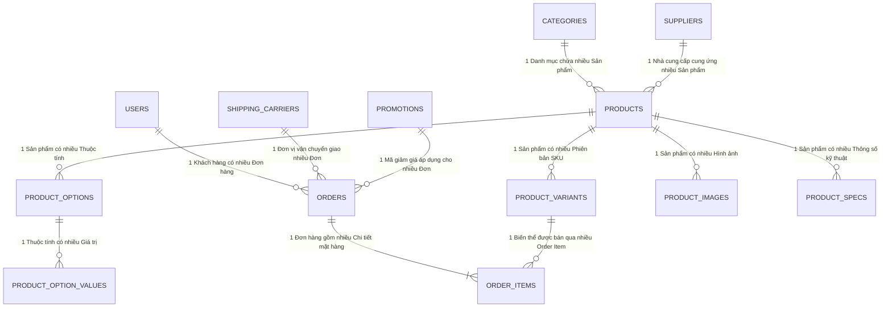

# TÀI LIỆU ĐẶC TẢ YÊU CẦU PHẦN MỀM (SOFTWARE REQUIREMENTS SPECIFICATION - SRS)
## DỰ ÁN: HỆ THỐNG THƯƠNG MẠI ĐIỆN TỬ THIẾT BỊ CÔNG NGHỆ NEXOR

---

| Thông tin dự án | Chi tiết |
| :--- | :--- |
| **Tên dự án:** | NEXOR E-Commerce Platform |
| **Loại tài liệu:** | Đặc tả yêu cầu kỹ thuật & Bảng phân chia công việc nội bộ (Internal Technical Specification & WBS) |
| **Phiên bản:** | 2.1 - Working & Implementation Baseline |
| **Trạng thái:** | Đã phê duyệt phát triển (Approved for Sprint Execution) |
| **Đối tượng sử dụng:** | Toàn bộ thành viên đội dự án (Frontend, Backend, DevOps, Tester) |
| **Công nghệ chủ đạo:** | Spring Boot 4 (Java 21), React 19 (TypeScript), MySQL 8.0, Docker, Vite, Tailwind CSS |

---

# MỤC LỤC TỔNG QUAN

- [CHƯƠNG 1: TỔNG QUAN VÀ MỤC TIÊU DỰ ÁN](#chương-1-tổng-quan-và-mục-tiêu-dự-án)
  - [1.1 Mục đích tài liệu](#11-mục-đích-tài-liệu)
  - [1.2 Phạm vi hệ thống](#12-phạm-vi-hệ-thống)
  - [1.3 Quy ước mã định danh (Task & Requirement Identifiers)](#13-quy-ước-mã-định-danh-task--requirement-identifiers)
  - [1.4 Các thuật ngữ và từ viết tắt](#14-các-thuật-ngữ-và-từ-viết-tắt)
- [CHƯƠNG 2: KIẾN TRÚC HỆ THỐNG & MÔI TRƯỜNG KỸ THUẬT](#chương-2-kiến-trúc-hệ-thống--môi-trường-kỹ-thuật)
  - [2.1 Sơ đồ kiến trúc phân tầng (Layered Architecture)](#21-sơ-đồ-kiến-trúc-phân-tầng-layered-architecture)
  - [2.2 Sơ đồ mạng và luồng giao tiếp Docker](#22-sơ-đồ-mạng-và-luồng-giao-tiếp-docker)
  - [2.3 Danh mục vai trò và tác nhân (Actors)](#23-danh-mục-vai-trò-và-tác-nhân-actors)
- [CHƯƠNG 3: MÔ HÌNH VÀ THIẾT KẾ CƠ SỞ DỮ LIỆU](#chương-3-mô-hình-và-thiết-kế-cơ-sở-dữ-liệu)
  - [3.1 Sơ đồ quan hệ thực thể (ERD)](#31-sơ-đồ-quan-hệ-thực-thể-erd)
  - [3.2 Chi tiết các bảng dữ liệu cốt lõi](#32-chi-tiết-các-bảng-dữ-liệu-cốt-lõi)
  - [3.3 Nguyên tắc toàn vẹn giao dịch kho hàng (Transactional ACID)](#33-nguyên-tắc-toàn-vẹn-giao-dịch-kho-hàng-transactional-acid)
- [CHƯƠNG 4: ĐẶC TẢ CHI TIẾT YÊU CẦU CHỨC NĂNG CỐT LÕI (CORE FUNCTIONAL REQUIREMENTS)](#chương-4-đặc-tả-chi-tiết-yêu-cầu-chức-năng-cốt-lõi-core-functional-requirements)
  - [PHÂN HỆ 1: XÁC THỰC VÀ QUẢN LÝ TÀI KHOẢN (AUTH & USER)](#phân-hệ-1-xác-thực-và-quản-lý-tài-khoản-auth--user)
  - [PHÂN HỆ 2: DANH MỤC & SẢN PHẨM ĐA BIẾN THỂ (CATALOG & VARIANTS)](#phân-hệ-2-danh-mục--sản-phẩm-đa-biến-thể-catalog--variants)
  - [PHÂN HỆ 3: TÌM KIẾM VÀ BỘ LỌC ĐA TIÊU CHÍ (SEARCH & FILTER)](#phân-hệ-3-tìm-kiếm-và-bộ-lọc-đa-tiêu-chí-search--filter)
  - [PHÂN HỆ 4: GIỎ HÀNG VÀ TRẠNG THÁI CLIENT (CART MANAGEMENT)](#phân-hệ-4-giỏ-hàng-và-trạng-thái-client-cart-management)
  - [PHÂN HỆ 5: KHUYẾN MÃI VÀ MÃ GIẢM GIÁ (PROMOTION & VOUCHER)](#phân-hệ-5-khuyến-mãi-và-mã-giảm-giá-promotion--voucher)
  - [PHÂN HỆ 6: ĐẶT HÀNG VÀ THANH TOÁN (CHECKOUT & TRANSACTION)](#phân-hệ-6-đặt-hàng-và-thanh-toán-checkout--transaction)
  - [PHÂN HỆ 7: LỊCH SỬ VÀ THEO DÕI ĐƠN HÀNG (MY ORDERS & TRACKING)](#phân-hệ-7-lịch-sử-và-theo-dõi-đơn-hàng-my-orders--tracking)
  - [PHÂN HỆ 8: TÍCH HỢP TRÍ TUỆ NHÂN TẠO CỐT LÕI (AI CORE)](#phân-hệ-8-tích-hợp-trí-tuệ-nhân-tạo-cốt-lõi-ai-core)
  - [PHÂN HỆ 9: TRUNG TÂM ĐIỀU HÀNH QUẢN TRỊ VIÊN (ADMIN PORTAL)](#phân-hệ-9-trung-tâm-điều-hành-quản-trị-viên-admin-portal)
- [CHƯƠNG 5: YÊU CẦU PHI CHỨC NĂNG (NON-FUNCTIONAL REQUIREMENTS - NFR)](#chương-5-yêu-cầu-phi-chức-năng-non-functional-requirements---nfr)
- [CHƯƠNG 6: BẢNG PHÂN CHIA CHI TIẾT CÔNG VIỆC THEO VAI TRÒ (WBS TASK BREAKDOWN)](#chương-6-bảng-phân-chia-chi-tiết-công-việc-theo-vai-trò-wbs-task-breakdown)
  - [6.1 Danh mục Task FRONTEND (FE_01 đến FE_18)](#61-danh-mục-task-frontend-fe_01-đến-fe_18)
  - [6.2 Danh mục Task BACKEND (BE_01 đến BE_18)](#62-danh-mục-task-backend-be_01-đến-be_18)
  - [6.3 Danh mục Task DEVOPS (DEVOPS_01 đến DEVOPS_06)](#63-danh-mục-task-devops-devops_01-đến-devops_06)
  - [6.4 Danh mục Task TESTER / QA (TEST_01 đến TEST_08)](#64-danh-mục-task-tester--qa-test_01-đến-test_08)
- [CHƯƠNG 7: PHỤ LỤC - ĐỀ XUẤT TÍNH NĂNG MỞ RỘNG (EXTENDED BACKLOG)](#chương-7-phụ-lục---đề-xuất-tính-năng-mở-rộng-extended-backlog)

---

# CHƯƠNG 1: TỔNG QUAN VÀ MỤC TIÊU DỰ ÁN

## 1.1 Mục đích tài liệu
Tài liệu Đặc tả Yêu cầu Phần mềm (SRS) này là **nguồn căn cứ kỹ thuật duy nhất (Single Source of Truth)** dùng trong nội bộ đội ngũ phát triển NEXOR.
Tài liệu quy định:
- Cấu trúc kiến trúc toàn hệ thống;
- Mô hình cơ sở dữ liệu và ràng buộc toàn vẹn;
- Đặc tả chi tiết từng luồng xử lý của các **chức năng cốt lõi**;
- Bảng phân chia công việc (Work Breakdown Structure - WBS) được gắn mã định danh rõ ràng cho 4 vai trò: **Frontend, Backend, DevOps và Tester**, làm cơ sở để các thành viên nhận task, triển khai mã nguồn và nghiệm thu chéo.

## 1.2 Phạm vi hệ thống
Hệ thống Thương mại Điện tử Thiết bị Công nghệ NEXOR tập trung giải quyết trọn vẹn vòng đời nghiệp vụ bán hàng thiết bị số:
1. **Khách hàng (Client Portal):** Duyệt danh mục phân cấp; xem chi tiết cấu hình đa biến thể (RAM, SSD, Màu sắc); tìm kiếm sản phẩm theo từ khóa và bộ lọc giá/hãng; quản lý giỏ hàng; áp dụng mã voucher; thanh toán đơn hàng với cơ chế trừ kho an toàn; theo dõi lịch sử đơn hàng; tương tác với AI Assistant tư vấn sản phẩm.
2. **Quản trị viên (Admin Portal):** Quản lý tập trung toàn bộ danh mục hàng hóa; tạo lập sản phẩm với nhiều biến thể SKU; theo dõi và cập nhật vòng đời đơn hàng (`PENDING` → `CONFIRMED` → `SHIPPING` → `COMPLETED` / `CANCELLED`); quản lý danh sách khách hàng và mã khuyến mãi; theo dõi chỉ số doanh thu và cảnh báo hàng sắp hết kho.

## 1.3 Quy ước mã định danh (Task & Requirement Identifiers)
Để quản lý tiến độ và truy vết lỗi (Traceability), dự án quy ước các tiền tố định danh như sau:
- **`FR_xxx`**: Functional Requirement (Yêu cầu chức năng của hệ thống).
- **`FE_xx`**: Frontend Task (Nhiệm vụ lập trình giao diện React / State / API Call).
- **`BE_xx`**: Backend Task (Nhiệm vụ lập trình Spring Boot / Entity / Service / Controller).
- **`DEVOPS_xx`**: DevOps Task (Nhiệm vụ cấu hình Docker, Nginx, CI/CD, Môi trường).
- **`TEST_xx`**: Tester / QA Task (Kịch bản kiểm thử Unit Test, API Test, E2E Test).

## 1.4 Các thuật ngữ và từ viết tắt
- **SKU (Stock Keeping Unit):** Mã định danh quản lý tồn kho độc lập cho từng phiên bản thuộc tính cụ thể của sản phẩm (Ví dụ: iPhone 15 Pro Max 256GB Titan Tự nhiên có SKU khác bản 512GB).
- **Master Product:** Thực thể sản phẩm cha chứa các thông tin chung (tên, hãng, danh mục, mô tả).
- **Product Variant:** Phiên bản cụ thể của Master Product gắn liền với một giá bán và một số lượng tồn kho riêng.
- **Stateless JWT:** Cơ chế xác thực không lưu phiên trên server, mọi quyền hạn và thông tin người dùng được mã hóa trong token gửi kèm HTTP Header `Authorization: Bearer <token>`.
- **RBAC (Role-Based Access Control):** Phân quyền dựa trên vai trò (`ROLE_CUSTOMER`, `ROLE_ADMIN`).

---

# CHƯƠNG 2: KIẾN TRÚC HỆ THỐNG & MÔI TRƯỜNG KỸ THUẬT

## 2.1 Sơ đồ kiến trúc phân tầng (Layered Architecture)

Hệ thống tuân thủ nghiêm ngặt mô hình kiến trúc phân tầng, phân định rõ ranh giới trách nhiệm:

```
┌────────────────────────────────────────────────────────────────────────┐
│                        FRONTEND CLIENT (React 19)                      │
│   - Quản trị giao diện: Tailwind CSS v4, Lucide Icons                  │
│   - Quản lý trạng thái Client: Zustand Store (Auth, Cart, Filter)      │
│   - Routing & Route Guard: React Router DOM v7 (Public/Protected)     │
│   - Xử lý tương tác API: Axios Client + Interceptor gắn Token         │
└───────────────────────────────────┬────────────────────────────────────┘
                                    │ HTTP Requests (JSON)
                                    │ Header: Authorization Bearer JWT
┌───────────────────────────────────▼────────────────────────────────────┐
│                    REVERSE PROXY & GATEWAY (Nginx)                     │
│   - Phục vụ Static Files Frontend (HTML/JS/CSS nén Gzip)              │
│   - Điều hướng tất cả /api/* về dịch vụ Backend nội bộ                 │
└───────────────────────────────────┬────────────────────────────────────┘
                                    │
┌───────────────────────────────────▼────────────────────────────────────┐
│                  BACKEND CORE (Spring Boot 4.1, Java 21)               │
│   - Security Filter Chain: JwtAuthenticationFilter, CorsFilter         │
│   - Controller Layer: Tiếp nhận Request, @Valid DTO, trả ApiResponse   │
│   - Service Layer: Business logic, @Transactional ACID, Validation     │
│   - AI Service: Spring AI tích hợp Google Gemini & OpenAI             │
│   - Data Access Layer: Spring Data JPA, Hibernate ORM                  │
└───────────────────────────────────┬────────────────────────────────────┘
                                    │ HikariCP Connection Pool
┌───────────────────────────────────▼────────────────────────────────────┐
│                       DATABASE (MySQL 8.0 Server)                      │
│   - Bộ mã chuẩn: utf8mb4_unicode_ci                                    │
│   - Lưu trữ Persistent Volume qua Docker: mysql_data                   │
└────────────────────────────────────────────────────────────────────────┘
```

## 2.2 Sơ đồ mạng và luồng giao tiếp Docker

Môi trường phát triển và triển khai được đóng gói toàn diện qua `docker-compose.yml` với 2 mạng cách ly an toàn:

```
[ Trình duyệt Khách hàng / Quản trị viên ]
                   │
                   │ Cổng 80 (HTTP)
                   ▼
       ┌────────────────────────┐
       │   nginx (Container)    │
       └───────────┬────────────┘
                   │
         [ Mạng proxy-net ]
                   │
                   ▼ (Cổng 8080 nội bộ)
       ┌────────────────────────┐
       │     app (Backend)      │
       └───────────┬────────────┘
                   │
           [ Mạng db-net ]  <--- Hoàn toàn cô lập, không mở cổng ra Internet!
                   │
                   ▼ (Cổng 3306 nội bộ)
       ┌────────────────────────┐
       │    mysql (Database)    │
       └────────────────────────┘
```

## 2.3 Danh mục vai trò và tác nhân (Actors)
1. **Khách vãng lai (Guest):** Người dùng chưa xác thực danh tính. Được phép xem danh mục, tìm kiếm, lọc sản phẩm, xem chi tiết và thêm sản phẩm vào giỏ hàng tạm (lưu tại LocalStorage).
2. **Khách hàng (Customer):** Người dùng đã đăng nhập tài khoản. Có quyền đặt hàng, áp dụng voucher, quản lý hồ sơ cá nhân, xem và hủy đơn hàng ở trạng thái chờ xử lý, sử dụng AI Chatbot hỗ trợ.
3. **Quản trị viên (Admin):** Người dùng nắm quyền quản trị cao nhất (`ROLE_ADMIN`). Toàn quyền quản trị danh mục, sản phẩm, phiên bản biến thể, kho bãi, cập nhật trạng thái đơn hàng, quản lý khuyến mãi và người dùng.

---

# CHƯƠNG 3: MÔ HÌNH VÀ THIẾT KẾ CƠ SỞ DỮ LIỆU

## 3.1 Sơ đồ quan hệ thực thể (ERD)



## 3.2 Chi tiết các bảng dữ liệu cốt lõi

### 1. Bảng `users`
- `id` (BIGINT, PK, Auto Increment)
- `username` (VARCHAR(100), UNIQUE, NOT NULL): Tên đăng nhập
- `email` (VARCHAR(150), UNIQUE, NOT NULL): Địa chỉ hòm thư
- `password` (VARCHAR(255), NOT NULL): Mật khẩu băm BCrypt
- `full_name` (VARCHAR(100)): Họ và tên người dùng
- `phone_number` (VARCHAR(20)): Số điện thoại nhận hàng
- `address` (VARCHAR(255)): Địa chỉ giao hàng mặc định
- `avatar_url` (VARCHAR(500)): Đường dẫn ảnh đại diện
- `role` (VARCHAR(20), NOT NULL, DEFAULT 'CUSTOMER'): `CUSTOMER`, `ADMIN`
- `status` (BOOLEAN, NOT NULL, DEFAULT TRUE): Trạng thái hoạt động
- `created_at`, `updated_at` (DATETIME): Thời gian tạo và cập nhật

### 2. Bảng `categories`
- `id` (BIGINT, PK, Auto Increment)
- `name` (VARCHAR(100), NOT NULL): Tên danh mục (Laptop, Smartphone, Tablet...)
- `slug` (VARCHAR(150), UNIQUE, NOT NULL): Đường dẫn thân thiện SEO
- `parent_id` (BIGINT, FK nullable): Danh mục cha (cho mô hình đa cấp)
- `description` (TEXT): Mô tả ngắn danh mục
- `image_url` (VARCHAR(500)): Ảnh biểu trưng danh mục
- `status` (BOOLEAN, DEFAULT TRUE)

### 3. Bảng `products` (Master Product)
- `id` (BIGINT, PK, Auto Increment)
- `name` (VARCHAR(255), NOT NULL, Index): Tên thiết bị
- `brand` (VARCHAR(100), Index): Thương hiệu (Apple, ASUS, Dell, Lenovo...)
- `category_id` (BIGINT, FK, NOT NULL): Liên kết `categories`
- `supplier_id` (BIGINT, FK, NULLABLE): Liên kết `suppliers`
- `description` (TEXT): Mô tả chi tiết kỹ thuật
- `price` (DECIMAL(12,2), NOT NULL, Index): Giá niêm yết cơ sở
- `stock` (INT, NOT NULL, DEFAULT 0): Tổng tồn kho gộp (phục vụ hiển thị nhanh)
- `image_url` (VARCHAR(500)): Ảnh đại diện chính (thumbnail)
- `status` (BOOLEAN, NOT NULL, DEFAULT TRUE): Đang bán / Tạm ngừng
- `is_deleted` (BOOLEAN, NOT NULL, DEFAULT FALSE): Xóa mềm

### 4. Bảng `product_variants` (Phiên bản cấu hình - SKU thực tế)
- `id` (BIGINT, PK, Auto Increment)
- `product_id` (BIGINT, FK, NOT NULL): Sản phẩm cha
- `sku` (VARCHAR(100), UNIQUE, NOT NULL): Mã SKU độc nhất (VD: `MBP14-M3-16-512-BLK`)
- `price` (DECIMAL(12,2), NOT NULL): Giá bán thực tế của cấu hình này
- `stock` (INT, NOT NULL, DEFAULT 0): **Số lượng tồn kho thực tế bị trừ khi mua hàng**
- `status` (BOOLEAN, NOT NULL, DEFAULT TRUE)

### 5. Bảng `product_options` & `product_option_values`
- `product_options`: `id`, `product_id` (FK), `name` (VARCHAR: Màu sắc, Dung lượng, Bộ nhớ RAM)
- `product_option_values`: `id`, `option_id` (FK), `value` (VARCHAR: Space Gray, 16GB, 512GB SSD)

### 6. Bảng `product_specs` (Thông số kỹ thuật chi tiết)
- `id`, `product_id` (FK), `spec_key` (VARCHAR: CPU, Card đồ họa, Màn hình, Pin), `spec_value` (VARCHAR: Apple M3 Pro, 14.2 inch 120Hz)

### 7. Bảng `product_images` (Thư viện hình ảnh sản phẩm)
- `id`, `product_id` (FK), `image_url` (VARCHAR(500)), `display_order` (INT)

### 8. Bảng `orders`
- `id` (BIGINT, PK, Auto Increment)
- `user_id` (BIGINT, FK, NOT NULL): Khách hàng đặt mua
- `receiver_name` (VARCHAR(100), NOT NULL): Tên người nhận hàng
- `phone_number` (VARCHAR(20), NOT NULL): Số điện thoại nhận
- `shipping_address` (VARCHAR(255), NOT NULL): Địa chỉ giao hàng
- `total_amount` (DECIMAL(12,2), NOT NULL): Tổng tiền thanh toán sau giảm giá
- `status` (VARCHAR(30), NOT NULL, DEFAULT 'PENDING'): `PENDING`, `CONFIRMED`, `SHIPPING`, `COMPLETED`, `CANCELLED`
- `payment_method` (VARCHAR(30), NOT NULL, DEFAULT 'COD'): `COD`, `BANKING`, `VNPAY`
- `shipping_carrier_id` (BIGINT, FK, NULLABLE): Đơn vị vận chuyển
- `created_at`, `updated_at` (DATETIME)

### 9. Bảng `order_items`
- `id` (BIGINT, PK, Auto Increment)
- `order_id` (BIGINT, FK, NOT NULL): Đơn hàng cha
- `product_id` (BIGINT, FK, NOT NULL): Sản phẩm
- `product_variant_id` (BIGINT, FK, NOT NULL): Phiên bản SKU cụ thể
- `product_name` (VARCHAR(255), NOT NULL): Tên sản phẩm tại thời điểm mua (Snapshot)
- `variant_name` (VARCHAR(255)): Tên biến thể tại thời điểm mua
- `price` (DECIMAL(12,2), NOT NULL): Giá tại thời điểm đặt hàng
- `quantity` (INT, NOT NULL): Số lượng mua
- `subtotal` (DECIMAL(12,2), NOT NULL): Thành tiền = price * quantity

### 10. Bảng `promotions` (Voucher giảm giá)
- `id`, `code` (VARCHAR UNIQUE), `discount_type` (`PERCENTAGE`, `FIXED_AMOUNT`), `discount_value`, `min_order_value`, `max_discount_amount`, `start_date`, `end_date`, `usage_limit`, `used_count`, `status`

### 11. Bảng `shipping_carriers` & `suppliers`
- `shipping_carriers`: `id`, `name`, `phone`, `base_fee`, `estimated_days`, `status`
- `suppliers`: `id`, `name`, `contact_name`, `email`, `phone`, `address`, `status`

## 3.3 Nguyên tắc toàn vẹn giao dịch kho hàng (Transactional ACID)
- Mọi logic tạo đơn hàng phải chạy trong `@Transactional(isolation = Isolation.READ_COMMITTED)`.
- Khi khách hàng nhấn đặt hàng:
  1. Duyệt qua từng item trong đơn;
  2. Truy vấn `ProductVariant` theo ID và kiểm tra: `if (variant.getStock() < item.getQuantity()) throw new BusinessException("Sản phẩm đã hết hàng")`;
  3. Trừ kho: `variant.setStock(variant.getStock() - item.getQuantity())`;
  4. Cập nhật tồn kho gộp tại bảng `products`: `product.setStock(product.getStock() - item.getQuantity())`;
  5. Nếu có bất kỳ lỗi nào xảy ra trong chuỗi xử lý (lỗi lưu bản ghi đơn hàng, lỗi lưu item), Hibernate tự động `Rollback` toàn bộ, tồn kho nguyên vẹn, đảm bảo không bao giờ bị overselling (bán âm kho).
- Khi hủy đơn hàng ở trạng thái `PENDING`: Hệ thống hoàn trả số lượng tương ứng về lại kho cho từng biến thể SKU.

---

# CHƯƠNG 4: ĐẶC TẢ CHI TIẾT YÊU CẦU CHỨC NĂNG CỐT LÕI (CORE FUNCTIONAL REQUIREMENTS)

---

## PHÂN HỆ 1: XÁC THỰC VÀ QUẢN LÝ TÀI KHOẢN (AUTH & USER)

### FR_AUTH_01: Đăng ký tài khoản khách hàng
- **Mô tả:** Cho phép khách vãng lai đăng ký tài khoản mới trên hệ thống.
- **Dữ liệu đầu vào:** `username`, `email`, `password`, `fullName`, `phoneNumber`, `address`.
- **Luồng xử lý:**
  1. Kiểm tra tính duy nhất của `username` và `email`. Nếu trùng lặp, trả về lỗi HTTP 400 Bad Request;
  2. Kiểm tra độ mạnh của mật khẩu (tối thiểu 6 ký tự);
  3. Mã hóa mật khẩu bằng `BCryptPasswordEncoder`;
  4. Lưu bản ghi mới vào bảng `users` với vai trò mặc định `ROLE_CUSTOMER`, trạng thái `status = true`;
  5. Trả về thông báo đăng ký thành công.
- **API Endpoint:** `POST /api/auth/register`

### FR_AUTH_02: Đăng nhập và Cấp phát Stateless JWT Token
- **Mô tả:** Xác thực danh tính người dùng và cấp token cho các request tiếp theo.
- **Dữ liệu đầu vào:** `username` (hoặc `email`) và `password`.
- **Luồng xử lý:**
  1. Tìm kiếm user theo username hoặc email trong DB;
  2. So khớp mật khẩu đã băm bằng `passwordEncoder.matches(rawPassword, encodedPassword)`;
  3. Nếu không khớp hoặc tài khoản bị khóa (`status = false`), trả về lỗi HTTP 401 Unauthorized;
  4. Nếu khớp: Sinh mã JWT chứa Claims (`userId`, `username`, `role`), ký bằng thuật toán HMAC-SHA256, thời hạn hết hạn 24 giờ;
  5. Phản hồi HTTP 200 kèm JWT Token, thông tin profile người dùng và vai trò;
  6. Phía Frontend: Lưu Token vào `useAuthStore` (đồng bộ LocalStorage), gắn token vào Axios Request Interceptor.
- **API Endpoint:** `POST /api/auth/login`

### FR_AUTH_03: Quản lý hồ sơ cá nhân và Đổi mật khẩu
- **Mô tả:** Khách hàng xem thông tin tài khoản, cập nhật số điện thoại, địa chỉ nhận hàng và đổi mật khẩu.
- **Luồng xử lý đổi mật khẩu:** Người dùng nhập mật khẩu cũ, mật khẩu mới và xác nhận mật khẩu. Backend xác minh mật khẩu cũ chính xác trước khi băm và lưu mật khẩu mới.
- **API Endpoints:**
  - `GET /api/user/profile`: Xem thông tin cá nhân (Yêu cầu Token).
  - `PUT /api/user/profile`: Cập nhật thông tin (Họ tên, SĐT, Địa chỉ, Avatar).
  - `PUT /api/user/change-password`: Đổi mật khẩu mới.

---

## PHÂN HỆ 2: DANH MỤC & SẢN PHẨM ĐA BIẾN THỂ (CATALOG & VARIANTS)

### FR_PROD_01: Hiển thị danh mục phân cấp
- **Mô tả:** Khách hàng xem danh sách các danh mục ngành hàng (Laptop, Điện thoại, Màn hình, Bàn phím...) có hỗ trợ phân cấp cha - con (`parent_id`).
- **API Endpoint:** `GET /api/categories`

### FR_PROD_02: Hiển thị danh sách sản phẩm (Grid View & Pagination)
- **Mô tả:** Hiển thị lưới sản phẩm với đầy đủ ảnh thumbnail, tên sản phẩm, hãng sản xuất, giá niêm yết, tổng tồn kho và nhãn trạng thái ("Còn hàng" / "Hết hàng"). Hỗ trợ phân trang (`page`, `size`) và sắp xếp (`sort=price,asc` hoặc `sort=id,desc`).
- **API Endpoint:** `GET /api/products?page=0&size=12&sort=id,desc`

### FR_PROD_03: Chi tiết sản phẩm chuyên sâu đa biến thể (Multi-variant SKU)
- **Mô tả:** Khi khách hàng bấm vào một sản phẩm cụ thể:
  1. Hệ thống trả về toàn bộ dữ liệu cấu trúc phức hợp: Thông tin sản phẩm cha, Thư viện ảnh (`product_images`), Các tùy chọn (`product_options` như Màu sắc, Dung lượng), Danh sách biến thể thực tế (`product_variants`), Bảng thông số kỹ thuật (`product_specs`);
  2. Giao diện Client hiển thị các nút chọn biến thể: Khi khách hàng đổi Màu sắc hoặc Dung lượng:
     - Giá bán tự động cập nhật tương ứng với SKU đó;
     - Số lượng tồn kho khả dụng tự động cập nhật;
     - Nút "Thêm vào giỏ hàng" bị vô hiệu hóa (disabled) nếu SKU đó có `stock = 0`.
- **API Endpoint:** `GET /api/products/{id}`

---

## PHÂN HỆ 3: TÌM KIẾM VÀ BỘ LỌC ĐA TIÊU CHÍ (SEARCH & FILTER)

### FR_SRCH_01: Tìm kiếm tức thì theo từ khóa (Live Search)
- **Mô tả:** Thanh tìm kiếm trên Header cho phép tìm kiếm theo tên sản phẩm, thương hiệu hoặc từ khóa liên quan. Tích hợp Debounce 300ms ở phía Client để tối ưu hiệu năng mạng và tránh spam request.
- **API Endpoint:** `GET /api/products/search?keyword={query}`

### FR_SRCH_02: Bộ lọc đa tiêu chí kết hợp (Faceted Filtering)
- **Mô tả:** Cho phép khách hàng kết hợp nhiều điều kiện lọc trên trang sản phẩm:
  - Lọc theo Danh mục ID (`categoryId`);
  - Lọc theo Thương hiệu (`brand`: Apple, ASUS, Dell...);
  - Lọc theo Khoảng giá (`minPrice`, `maxPrice`);
  - Lọc theo Tình trạng hàng (Chỉ hiện sản phẩm còn hàng `inStock=true`);
  - Sắp xếp: Giá thấp đến cao, Giá cao đến thấp, Mới nhất, Bán chạy nhất.
- **API Endpoint:** `GET /api/products/filter?categoryId=1&brand=Apple&minPrice=10000000&maxPrice=30000000&page=0&size=12`

---

## PHÂN HỆ 4: GIỎ HÀNG VÀ TRẠNG THÁI CLIENT (CART MANAGEMENT)

### FR_CART_01: Quản lý giỏ hàng phía Client (Zustand Cart Store)
- **Mô tả:** Khách hàng (kể cả chưa đăng nhập) có thể thêm sản phẩm vào giỏ hàng.
- **Cấu trúc một Cart Item:**
  - `productId`: ID sản phẩm cha;
  - `variantId`: ID biến thể SKU cụ thể đã chọn;
  - `productName`, `variantName`: Tên hiển thị;
  - `thumbnail`: Ảnh đại diện;
  - `price`: Đơn giá của biến thể đó;
  - `quantity`: Số lượng mua;
  - `maxStock`: Giới hạn tồn kho tối đa của biến thể đó.
- **Quy tắc giỏ hàng:**
  - Bấm "Thêm vào giỏ": Nếu đã có trong giỏ với đúng `variantId` thì tăng số lượng; nếu chưa có thì thêm dòng mới;
  - Không cho phép tăng số lượng vượt quá `maxStock` của biến thể;
  - Cho phép giảm số lượng, xóa từng món, hoặc xóa toàn bộ giỏ hàng;
  - Tự động tính tổng tiền tạm tính (Subtotal) và lưu đồng bộ vào `localStorage`.

---

## PHÂN HỆ 5: KHUYẾN MÃI VÀ MÃ GIẢM GIÁ (PROMOTION & VOUCHER)

### FR_PROM_01: Kiểm tra và Áp dụng mã Voucher
- **Mô tả:** Tại màn hình giỏ hàng và thanh toán, khách hàng nhập mã Voucher (ví dụ: `GIAM50K`, `SALE10`).
- **Luồng xử lý:**
  1. Backend kiểm tra mã có tồn tại và đang bật (`status = true`);
  2. Kiểm tra thời hạn hiệu lực (`start_date <= now <= end_date`);
  3. Kiểm tra số lượt sử dụng còn lại (`used_count < usage_limit`);
  4. Kiểm tra giá trị đơn hàng hiện tại có đạt ngưỡng tối thiểu (`subtotal >= min_order_value`);
  5. Nếu hợp lệ: Tính toán số tiền được giảm:
     - Nếu loại `PERCENTAGE`: `discount = subtotal * (discount_value / 100)`; nếu vượt `max_discount_amount` thì lấy mức tối đa;
     - Nếu loại `FIXED_AMOUNT`: `discount = discount_value`;
  6. Trả về kết quả hợp lệ kèm số tiền giảm giá chi tiết.
- **API Endpoint:** `POST /api/promotions/apply`

---

## PHÂN HỆ 6: ĐẶT HÀNG VÀ THANH TOÁN (CHECKOUT & TRANSACTION)

### FR_ORD_01: Thu thập thông tin giao hàng & Lựa chọn đơn vị vận chuyển
- **Mô tả:** Khách hàng nhập tên người nhận, số điện thoại, địa chỉ giao hàng và chọn đơn vị giao vận (`ShippingCarrier`) để tính phí vận chuyển tương ứng.

### FR_ORD_02: Xác nhận đặt hàng & Khấu trừ kho Transactional
- **Điều kiện tiên quyết:** Khách hàng đã đăng nhập và giỏ hàng có tối thiểu 1 sản phẩm.
- **Luồng xử lý chi tiết tại Backend:**
  1. Mở khối giao dịch `@Transactional(rollbackFor = Exception.class)`;
  2. Duyệt qua từng sản phẩm trong giỏ:
     - Khóa bản ghi biến thể và kiểm tra tồn kho thực tế: `variant.getStock() >= item.getQuantity()`;
     - Nếu thiếu hàng: Ném ngoại lệ và tự động hủy bỏ toàn bộ giao dịch (Rollback);
     - Trừ tồn kho biến thể: `variant.setStock(variant.getStock() - item.getQuantity())`;
     - Trừ tồn kho hiển thị ở bảng cha: `product.setStock(product.getStock() - item.getQuantity())`;
  3. Tạo bản ghi mới trong bảng `orders` với trạng thái `PENDING`, gắn `userId`, lưu địa chỉ và phương thức thanh toán;
  4. Tạo các bản ghi chi tiết trong bảng `order_items` lưu lại Snapshot giá và tên sản phẩm;
  5. Nếu có áp dụng mã Voucher: Tăng `used_count` của Voucher đó lên 1 đơn vị;
  6. Hoàn tất giao dịch: Trả về mã đơn hàng `orderId` cho Frontend;
  7. Phía Client: Xóa rỗng giỏ hàng trong store và chuyển hướng sang trang "Đặt hàng thành công".
- **API Endpoint:** `POST /api/orders/checkout`

---

## PHÂN HỆ 7: LỊCH SỬ VÀ THEO DÕI ĐƠN HÀNG (MY ORDERS & TRACKING)

### FR_ORD_03: Xem lịch sử và chi tiết đơn hàng cá nhân
- **Mô tả:** Khách hàng xem danh sách các đơn hàng của chính mình theo thứ tự thời gian mới nhất, có phân loại theo tab trạng thái (`Tất cả`, `Chờ xử lý`, `Đang giao`, `Hoàn thành`, `Đã hủy`). Nhấn vào đơn hàng để xem danh sách chi tiết từng món hàng đã mua.
- **API Endpoint:** `GET /api/orders/my-orders`

### FR_ORD_04: Khách hàng hủy đơn hàng chờ xử lý
- **Mô tả:** Khi đơn hàng còn ở trạng thái `PENDING`, khách hàng có quyền bấm nút "Hủy đơn hàng".
- **Luồng xử lý:**
  1. Backend kiểm tra quyền sở hữu đơn hàng (`order.getUser().getId() == currentUserId`);
  2. Kiểm tra trạng thái hiện tại: Chỉ cho phép hủy nếu trạng thái đang là `PENDING`;
  3. Cập nhật trạng thái đơn thành `CANCELLED`;
  4. **Tự động hoàn trả số lượng tồn kho:** Duyệt qua các `order_items` và cộng bù lại số lượng vào `stock` của từng `ProductVariant` tương ứng;
  5. Nếu đơn có dùng voucher: Giảm `used_count` của voucher đi 1 đơn vị.
- **API Endpoint:** `PUT /api/orders/{id}/cancel`

---

## PHÂN HỆ 8: TÍCH HỢP TRÍ TUỆ NHÂN TẠO CỐT LÕI (AI CORE)

### FR_AI_01: Trợ lý Chatbot AI tư vấn sản phẩm thông minh
- **Mô tả:** Cửa sổ trò chuyện nổi (Floating Widget) hỗ trợ khách hàng hỏi đáp kỹ thuật và tư vấn thiết bị.
- **Cơ chế hoạt động:** Backend sử dụng Spring AI kết nối mô hình Google Gemini. Hệ thống nạp ngữ cảnh danh mục sản phẩm của NEXOR để AI đóng vai trò làm chuyên viên tư vấn công nghệ, đưa ra gợi ý sản phẩm phù hợp với nhu cầu và ngân sách của khách.
- **API Endpoint:** `POST /api/ai/chat`

### FR_AI_02: AI tự động sinh mô tả sản phẩm chuẩn SEO cho Admin
- **Mô tả:** Tại màn hình quản trị thêm/sửa sản phẩm, nút "Tạo mô tả bằng AI" gửi tên và thông số chính của máy lên Gemini AI để tự động tạo đoạn văn bản mô tả kỹ thuật chuẩn SEO trong 2 giây.
- **API Endpoint:** `POST /api/admin/ai/generate-description`

---

## PHÂN HỆ 9: TRUNG TÂM ĐIỀU HÀNH QUẢN TRỊ VIÊN (ADMIN PORTAL)

### FR_ADM_01: Bảng điều khiển giám sát kinh doanh (Admin Dashboard)
- **Mô tả:** Thống kê các chỉ số kinh doanh trọng yếu: Tổng doanh thu, Số đơn hàng mới, Số khách hàng mới đăng ký, Số sản phẩm sắp hết hàng (< 5 chiếc). Hiển thị biểu đồ doanh thu theo ngày/tháng và danh sách 5 đơn hàng mới nhất.
- **API Endpoint:** `GET /api/admin/dashboard/stats`, `GET /api/admin/reports/revenue`

### FR_ADM_02: Quản lý Danh mục hàng hóa (Categories CRUD)
- **Mô tả:** Thêm, xem, sửa, xóa danh mục sản phẩm. Kiểm tra ràng buộc không cho phép xóa danh mục nếu đang có sản phẩm trực thuộc.
- **API Endpoint:** `POST, PUT, DELETE /api/admin/categories`

### FR_ADM_03: Quản lý Sản phẩm và Biến thể đa cấu hình (Product Master CRUD)
- **Mô tả:**
  - Thêm mới sản phẩm cha (Master Product) kèm thương hiệu, danh mục, giá niêm yết, ảnh thumbnail;
  - Thêm danh sách biến thể cấu hình (Màu sắc, Dung lượng, SKU, Giá bán riêng, Tồn kho riêng);
  - Thêm bảng thông số kỹ thuật (Specs);
  - Chỉnh sửa, bật/tắt trạng thái hiển thị hoặc xóa mềm (`is_deleted = true`).
- **API Endpoint:** `POST, PUT, DELETE /api/admin/products`

### FR_ADM_04: Quản lý và xử lý vòng đời Đơn hàng (Order Management)
- **Mô tả:** Xem danh sách đơn hàng toàn sàn, lọc theo trạng thái (`PENDING`, `CONFIRMED`, `SHIPPING`, `COMPLETED`, `CANCELLED`). Cho phép Quản trị viên cập nhật trạng thái đơn hàng theo đúng chu trình xử lý.
- **API Endpoint:** `GET /api/admin/orders`, `PUT /api/admin/orders/{id}/status`

### FR_ADM_05: Quản lý Khách hàng và Khóa tài khoản vi phạm
- **Mô tả:** Xem danh sách khách hàng, thông tin liên hệ, tổng số đơn đã mua. Cung cấp nút chuyển đổi trạng thái Bật/Khóa tài khoản (`status = false`) để vô hiệu hóa tài khoản vi phạm.
- **API Endpoint:** `GET /api/admin/users`, `PUT /api/admin/users/{id}/toggle-status`

### FR_ADM_06: Quản lý Mã khuyến mãi (Promotions CRUD)
- **Mô tả:** Tạo mới, chỉnh sửa, bật/tắt các mã voucher giảm giá, cấu hình số lượng giới hạn và ngày hiệu lực.
- **API Endpoint:** `POST, PUT, DELETE /api/admin/promotions`

### FR_ADM_07: Quản lý Tồn kho và Cảnh báo kho thấp (Inventory Tracking)
- **Mô tả:** Bảng theo dõi tồn kho chi tiết theo từng SKU biến thể; đánh dấu nhãn cảnh báo đỏ cho các SKU có số lượng tồn kho <= 5 để quản trị viên kịp thời nhập hàng.
- **API Endpoint:** `GET /api/admin/inventory`

### FR_ADM_08: Quản lý Nhà cung cấp và Đơn vị vận chuyển
- **Mô tả:** Quản lý danh bạ thông tin các đối tác cung cấp thiết bị và các hãng vận chuyển hàng hóa.
- **API Endpoint:** `GET, POST, PUT /api/admin/suppliers`, `GET, POST, PUT /api/admin/shipping`

---

# CHƯƠNG 5: YÊU CẦU PHI CHỨC NĂNG (NON-FUNCTIONAL REQUIREMENTS - NFR)

1. **Hiệu năng (NFR_PERF):**
   - Mọi API truy vấn dữ liệu (sản phẩm, danh mục, giỏ hàng) phải phản hồi dưới **500ms** trong điều kiện mạng bình thường;
   - Tốc độ tải trang đầu tiên (FCP) của Frontend React Vite phải đạt dưới **2 giây**;
   - Bảng `products` và `orders` bắt buộc đánh chỉ mục (Index) trên các cột `name`, `category_id`, `price`, `brand`, `user_id`, `status`.
2. **An toàn & Bảo mật (NFR_SEC):**
   - 100% mật khẩu người dùng phải mã hóa bằng thuật toán một chiều **BCrypt** (`strength = 10`);
   - Mọi API nghiệp vụ nhạy cảm phải được bảo vệ qua **Stateless JWT Token** xác thực ở mỗi request;
   - Chống tấn công SQL Injection bằng cách sử dụng Hibernate JPA Parameterized Queries 100%;
   - Dữ liệu đầu vào từ Client bắt buộc phải kiểm tra qua Bean Validation (`@Valid`, `@NotBlank`, `@Size`, `@Min`);
   - Cấu hình CORS chặt chẽ, chỉ cho phép nguồn từ Frontend truy cập.
3. **Toàn vẹn & Tin cậy (NFR_REL):**
   - Đảm bảo tính chất **ACID** trong mọi giao dịch tạo và hủy đơn hàng;
   - Cơ chế tự động Rollback nếu có lỗi ngoại lệ bất ngờ xảy ra, triệt tiêu nguy cơ bán âm kho;
   - Docker Container trang bị Healthcheck tự động giám sát tính sẵn sàng của MySQL và Backend.
4. **Khả năng mở rộng & Bảo trì (NFR_MAINT):**
   - Áp dụng mô hình chuẩn phân lớp: `Controller` → `Service` → `Repository` → `Entity`;
   - Phân tách rõ ràng giữa `Entity` nội bộ và `DTO` truyền tải ra bên ngoài;
   - Ghi log có cấu trúc thông qua SLF4J + Logback.
5. **Giao diện & Tương thích (NFR_UI):**
   - Giao diện Responsive toàn diện trên Mobile (>= 375px), Tablet (>= 768px) và Desktop (>= 1024px);
   - Tương thích ổn định trên Google Chrome, Microsoft Edge, Firefox và Safari.

---

# CHƯƠNG 6: BẢNG PHÂN CHIA CHI TIẾT CÔNG VIỆC THEO VAI TRÒ (WBS TASK BREAKDOWN)

> **Hướng dẫn thực hiện:** Mỗi thành viên trong nhóm nhận task dựa trên mã định danh bên dưới. Trước khi bắt đầu code, thành viên cần đối chiếu mã yêu cầu chức năng (FR) tương ứng ở Chương 4 và điều kiện nghiệm thu (Acceptance Criteria).

---

## 6.1 Danh mục Task FRONTEND (FE_01 đến FE_18)

| Mã Task | Phân hệ / Tên công việc | Mô tả chi tiết triển khai | Thành phần Code & File liên quan | Điều kiện nghiệm thu (Acceptance Criteria) | Độ ưu tiên |
| :--- | :--- | :--- | :--- | :--- | :---: |
| **FE_01** | **Xác thực / Đăng ký** | Dựng trang Đăng ký tài khoản; Form nhập họ tên, email, username, mật khẩu; Validate dữ liệu phía client; gọi API đăng ký; hiển thị thông báo lỗi/thành công. | `client/src/pages/auth/RegisterPage.tsx`, Form validation | Đăng ký thành công hiển thị Toast và chuyển hướng sang trang Đăng nhập; bắt lỗi trùng lặp từ server. | P1 |
| **FE_02** | **Xác thực / Đăng nhập** | Dựng trang Đăng nhập; Form nhập username/password; tích hợp `useAuthStore`; lưu JWT Token vào LocalStorage; điều hướng đúng theo Role (`CUSTOMER` về trang chủ, `ADMIN` về `/admin`). | `client/src/pages/auth/LoginPage.tsx`, `useAuthStore.ts` | Đăng nhập đúng cấp quyền lưu token; F5 không bị mất session; đăng nhập sai báo lỗi đỏ rõ ràng. | P1 |
| **FE_03** | **Điều hướng & Layout Khách** | Dựng Header, Navigation bar, Footer; hiển thị trạng thái đăng nhập, menu tài khoản, số lượng món hàng trong giỏ, nút mở AI Chatbot. | `client/src/layouts/GuestLayout.tsx`, `Header.tsx`, `Footer.tsx` | Header cố định mượt mà, responsive co giãn trên mobile, badge số lượng giỏ hàng nhảy tức thì. | P1 |
| **FE_04** | **Trang chủ (HomePage)** | Dựng khối Hero Banner trượt tự động (Banner Carousel); danh sách Danh mục nổi bật; danh sách Sản phẩm mới nhất; danh sách Sản phẩm bán chạy. | `client/src/pages/guest/HomePage.tsx`, `useBannerStore.ts` | Banner trượt mượt mà; click danh mục điều hướng sang trang lọc sản phẩm tương ứng. | P1 |
| **FE_05** | **Trang Danh sách Sản phẩm** | Dựng giao diện Grid hiển thị thẻ sản phẩm (ảnh, tên, giá, thương hiệu, badge); tích hợp phân trang (Pagination). | `client/src/pages/guest/ProductsPage.tsx`, `ProductCard.tsx` | Hiển thị đúng 12 sản phẩm/trang; đổi trang cuộn mượt lên đầu; hiển thị khung xương Skeleton khi đang tải. | P1 |
| **FE_06** | **Tìm kiếm & Bộ lọc Sản phẩm** | Tích hợp ô Live Search trên Header có Debounce 300ms; Sidebar bộ lọc đa tiêu chí (danh mục, khoảng giá, thương hiệu, sắp xếp). | `ProductsPage.tsx`, `Header.tsx`, URL Query Params | Gõ từ khóa tự động lọc sau 300ms; thay đổi tiêu chí lọc cập nhật URL query params chuẩn xác. | P1 |
| **FE_07** | **Trang Chi tiết Sản phẩm đa biến thể** | Dựng trang chi tiết sản phẩm; thư viện ảnh phóng to; bảng thông số kỹ thuật (Specs); **giao diện chọn Màu sắc và Dung lượng (Variants)**; tính năng cập nhật giá và tồn kho theo SKU được chọn. | `client/src/pages/guest/ProductDetailPage.tsx` | Chọn đúng biến thể đổi đúng giá và mã SKU; nếu hết hàng hiển thị nút "Hết hàng" và vô hiệu hóa nút mua. | P1 |
| **FE_08** | **Quản lý Giỏ hàng (Cart Store & Page)** | Xây dựng `useCartStore` bằng Zustand đồng bộ LocalStorage; dựng trang `CartPage`; tăng giảm số lượng, xóa từng món, tính tạm tính (Subtotal). | `client/src/store/useCartStore.ts`, `client/src/pages/cart/CartPage.tsx` | Thao tác mượt mà không cần load lại trang; không cho tăng quá tồn kho khả dụng; F5 dữ liệu giỏ còn nguyên. | P1 |
| **FE_09** | **Trang Thanh toán (Checkout)** | Form nhập thông tin nhận hàng (Tên, SĐT, Địa chỉ); chọn đơn vị vận chuyển; chọn hình thức thanh toán (COD / Chuyển khoản); ô nhập mã Voucher; tóm tắt chi phí đơn hàng. | `client/src/pages/checkout/CheckoutPage.tsx` | Validate đầy đủ trường bắt buộc; áp dụng voucher trừ đúng tiền; bấm thanh toán gọi API checkout an toàn. | P1 |
| **FE_10** | **Lịch sử Đơn hàng (My Orders)** | Dựng trang theo dõi đơn hàng cá nhân; các tab trạng thái (Tất cả, Chờ xử lý, Đang giao, Đã giao, Đã hủy); nút "Hủy đơn hàng" cho đơn PENDING. | `client/src/pages/order/MyOrdersPage.tsx`, `OrderDetailModal.tsx` | Hiển thị đúng danh sách đơn của user; bấm hủy có modal xác nhận; hủy xong cập nhật trạng thái đơn ngay lập tức. | P2 |
| **FE_11** | **Hồ sơ Cá nhân (Profile)** | Dựng trang xem và cập nhật thông tin cá nhân; form đổi mật khẩu với xác nhận mật khẩu mới. | `client/src/pages/auth/ProfilePage.tsx` | Cập nhật xong cập nhật lại thông tin hiển thị trên Header; đổi mật khẩu thành công yêu cầu đăng nhập lại. | P2 |
| **FE_12** | **Widget AI Assistant Chatbot** | Dựng cửa sổ trò chuyện nổi góc phải màn hình; danh sách tin nhắn hỏi - đáp; hiệu ứng đang gõ tin nhắn (typing indicator); hiển thị thẻ sản phẩm AI gợi ý. | `client/src/components/common/AiAssistantWidget.tsx` | Chat tự nhiên; phản hồi hiển thị markdown sạch đẹp; click vào sản phẩm gợi ý mở thẳng trang chi tiết. | P2 |
| **FE_13** | **Layout & Điều hướng Quản trị (Admin)** | Dựng Sidebar điều hướng Admin, Topbar hiển thị admin profile; cấu hình Code Splitting Lazy Load cho các trang Admin. | `client/src/layouts/AdminLayout.tsx`, `AppRoutes.tsx` | Chỉ cho phép tài khoản có quyền ADMIN truy cập; giao diện Dark Navy sang trọng, đóng mở sidebar mượt mà. | P1 |
| **FE_14** | **Admin Dashboard & Thống kê KPI** | Dựng trang Dashboard Admin; 4 thẻ thống kê (Doanh thu, Đơn hàng, Khách hàng, Cảnh báo kho); biểu đồ trực quan xu hướng bán hàng; danh sách đơn mới. | `client/src/pages/admin/DashboardPage.tsx` | Số liệu hiển thị đồng bộ với API Backend; định dạng tiền tệ VND có dấu chấm ngăn cách rõ ràng. | P1 |
| **FE_15** | **Admin Quản lý Sản phẩm đa biến thể** | Bảng danh sách sản phẩm; Modal thêm mới/chỉnh sửa sản phẩm; giao diện thêm động các biến thể SKU (Màu, RAM, Giá, Tồn kho); nút tích hợp AI sinh mô tả SEO. | `client/src/pages/admin/AdminProductsPage.tsx`, Modal CRUD | Tạo thành công sản phẩm kèm các biến thể SKU; bấm nút AI tự điền mô tả vào textarea mô tả trong 2s. | P1 |
| **FE_16** | **Admin Quản lý Đơn hàng** | Bảng danh sách đơn hàng toàn sàn; bộ lọc theo trạng thái; Modal xem chi tiết mặt hàng khách đặt; dropdown cập nhật trạng thái đơn (`PENDING` → `CONFIRMED`...). | `client/src/pages/admin/AdminOrdersPage.tsx` | Chuyển đổi trạng thái đơn mượt mà; hiển thị đầy đủ thông tin người nhận và danh sách các SKU đã mua. | P1 |
| **FE_17** | **Admin Quản lý Danh mục & Khuyến mãi** | Giao diện CRUD danh mục ngành hàng; Giao diện CRUD mã voucher (giảm %, tiền mặt, hạn dùng, số lượng giới hạn). | `AdminCategoriesPage.tsx`, `AdminPromotionsPage.tsx` | Thêm/sửa/xóa danh mục và voucher hoạt động ổn định; có thông báo xác nhận trước khi xóa. | P2 |
| **FE_18** | **Admin Quản lý Khách hàng, Kho & Cài đặt** | Bảng danh sách khách hàng và nút khóa tài khoản; Bảng theo dõi tồn kho có highlight cảnh báo đỏ cho SKU <= 5 chiếc; Trang quản lý nhà cung cấp. | `AdminCustomersPage.tsx`, `AdminInventoryPage.tsx`, `AdminSuppliersPage.tsx` | Khóa tài khoản thành công hiển thị badge "Bị khóa"; SKU sắp hết hàng hiển thị cảnh báo đỏ trực quan. | P2 |

---

## 6.2 Danh mục Task BACKEND (BE_01 đến BE_18)

| Mã Task | Phân hệ / Tên công việc | Mô tả chi tiết triển khai | Thành phần Code & File liên quan | Điều kiện nghiệm thu (Acceptance Criteria) | Độ ưu tiên |
| :--- | :--- | :--- | :--- | :--- | :---: |
| **BE_01** | **Khởi tạo Database & Entities cốt lõi** | Viết các Entity JPA: `User`, `Category`, `Product`, `ProductVariant`, `ProductOption`, `ProductOptionValue`, `ProductSpec`, `ProductImage`, `Order`, `OrderItem`, `Promotion`. | `server/src/main/java/ra/project/server/model/entity/*` | Hibernate tự động sinh bảng hoặc khớp 100% với file `init.sql`, đầy đủ ràng buộc khóa ngoại và index. | P1 |
| **BE_02** | **Cấu hình Spring Security & Stateless JWT** | Xây dựng `SecurityConfig`, `JwtTokenProvider`, `JwtAuthenticationFilter`, cấu hình CORS, mã hóa mật khẩu `BCryptPasswordEncoder`. | `ra.project.server.security/*`, `SecurityConfig.java` | Chặn đứng các truy cập trái phép vào API nhạy cảm; trích xuất chính xác User Principal từ token. | P1 |
| **BE_03** | **Xử lý Ngoại lệ tập trung & ApiResponse** | Xây dựng `GlobalExceptionHandler` bắt các lỗi: Validation, Not Found, Bad Request, Unauthorized, Forbidden; chuẩn hóa cấu trúc `ApiResponse<T>`. | `common/response/ApiResponse.java`, `exception/GlobalExceptionHandler.java` | 100% API trả về cấu trúc thống nhất: `{ success, message, data, timestamp }`; không để lộ exception trace. | P1 |
| **BE_04** | **Phân hệ Auth API (Đăng ký / Đăng nhập)** | Viết `AuthController` và `AuthService`: API đăng ký tài khoản kiểm tra trùng lặp email/username; API đăng nhập xác thực và trả về JWT Token. | `controller/AuthController.java`, `service/impl/AuthServiceImpl.java` | Đăng ký thành công lưu mật khẩu băm; đăng nhập đúng trả về Token có Role; đăng nhập sai trả về HTTP 401. | P1 |
| **BE_05** | **Phân hệ User API (Hồ sơ & Đổi mật khẩu)** | Viết `UserController` và `UserService`: Xem thông tin profile cá nhân; cập nhật thông tin nhận hàng; đổi mật khẩu mới (kiểm tra mật khẩu cũ). | `controller/UserController.java`, `service/impl/UserServiceImpl.java` | Khách hàng chỉ xem/sửa được thông tin của chính mình; đổi mật khẩu sai mật khẩu cũ báo lỗi HTTP 400. | P2 |
| **BE_06** | **Phân hệ Category API** | Viết `CategoryController` và `CategoryService`: Lấy danh sách danh mục phân cấp; API Admin thêm, sửa, xóa danh mục. | `controller/CategoryController.java`, `CategoryServiceImpl.java` | Trả về danh sách danh mục phân tầng; chặn xóa nếu danh mục đang có sản phẩm. | P1 |
| **BE_07** | **Phân hệ Product Public API** | Viết `ProductController`: Lấy danh sách sản phẩm phân trang; tìm kiếm theo tên; bộ lọc đa tiêu chí (danh mục, khoảng giá, thương hiệu, sắp xếp). | `controller/ProductController.java`, `ProductServiceImpl.java` | Truy vấn có phân trang nhanh dưới 500ms; lọc kết hợp chính xác; trả về DTO gọn nhẹ. | P1 |
| **BE_08** | **Phân hệ Product Detail đa biến thể API** | Viết API lấy chi tiết sản phẩm: Tải đồng thời thông tin cha, danh sách ảnh, các options và toàn bộ các phiên bản biến thể `ProductVariant` (SKU, giá, tồn kho). | `ProductController.java`, `ProductDetailResponseDto.java` | Dữ liệu trả về đầy đủ để frontend render bộ chọn màu/dung lượng và xác định đúng giá bán của từng SKU. | P1 |
| **BE_09** | **Phân hệ Promotion API (Voucher)** | Viết `PromotionController` và `PromotionService`: Kiểm tra tính hợp lệ của mã giảm giá; tính toán số tiền giảm theo phần trăm hoặc số tiền cố định. | `controller/PromotionController.java`, `PromotionServiceImpl.java` | Bắt lỗi chính xác voucher hết hạn, chưa đủ đơn tối thiểu hoặc hết lượt dùng; tính đúng số tiền khấu trừ. | P1 |
| **BE_10** | **Phân hệ Checkout & Trừ kho Transactional** | Viết API Đặt hàng: Nhận danh sách `variantId` và số lượng; mở `@Transactional`; kiểm tra và trừ kho từng biến thể SKU; lưu `Order` và `OrderItem`. | `controller/OrderController.java`, `service/impl/OrderServiceImpl.java` | Hoạt động nguyên khối (Atomic); nếu 1 món hết kho thì rollback toàn bộ; tồn kho trừ chính xác tuyệt đối. | P1 |
| **BE_11** | **Phân hệ My Orders & Hủy đơn hàng** | Viết API lấy lịch sử đơn hàng của khách hiện tại; API hủy đơn hàng: Kiểm tra trạng thái `PENDING`, cập nhật `CANCELLED` và **hoàn trả tồn kho tự động**. | `OrderController.java`, `OrderServiceImpl.java` | Hủy đơn xong tồn kho của các biến thể tương ứng được cộng lại chính xác; đơn đang SHIPPING không cho hủy. | P1 |
| **BE_12** | **Tích hợp Spring AI Chatbot tư vấn** | Viết `AiController` và `AiServiceImpl`: Tích hợp Spring AI kết nối Google Gemini; xây dựng prompt chuyên gia công nghệ; đưa thông tin sản phẩm vào prompt. | `controller/AiController.java`, `service/impl/AiServiceImpl.java` | Trả về câu trả lời tư vấn mượt mà trong vòng 2 - 3 giây; gợi ý đúng các dòng máy shop đang bán. | P2 |
| **BE_13** | **Tích hợp Spring AI tự động sinh mô tả SEO** | Viết API Admin sinh mô tả sản phẩm: Tiếp nhận tên sản phẩm và thương hiệu, gửi prompt đến Gemini yêu cầu tạo đoạn văn bản kỹ thuật chuẩn Markdown. | `controller/AdminAiController.java`, `AiServiceImpl.java` | Đoạn văn sinh ra chuẩn kỹ thuật, định dạng Markdown đẹp, không bị lỗi cú pháp. | P2 |
| **BE_14** | **Phân hệ Admin Dashboard API** | Viết `AdminDashboardController`: Tính toán tổng doanh thu, số đơn hàng mới, số user mới, danh sách SKU sắp hết hàng; thống kê doanh thu theo mốc ngày. | `controller/AdminDashboardController.java` | Tính toán chính xác trên DB qua các câu lệnh aggregation; thời gian phản hồi dưới 500ms. | P1 |
| **BE_15** | **Phân hệ Admin Product & Variant CRUD** | Viết `AdminProductController`: API tạo mới sản phẩm kèm danh sách biến thể SKU và specs; API cập nhật sản phẩm; API xóa mềm sản phẩm. | `controller/AdminProductController.java` | Lưu đồng thời Master Product và danh sách Variant con trong 1 Transaction an toàn; hỗ trợ cập nhật giá/kho SKU. | P1 |
| **BE_16** | **Phân hệ Admin Order Management API** | Viết `AdminOrderController`: Lấy danh sách toàn bộ đơn hàng có lọc theo trạng thái; cập nhật trạng thái đơn hàng (`PENDING` → `CONFIRMED` → `SHIPPING`...). | `controller/AdminOrderController.java` | Cập nhật trạng thái thành công; ghi nhận nhật ký thay đổi trạng thái đơn. | P1 |
| **BE_17** | **Phân hệ Admin User & Promotion Management** | Viết API xem danh sách khách hàng, khóa/mở khóa tài khoản khách hàng; API CRUD mã khuyến mãi voucher. | `controller/AdminUserController.java`, `AdminPromotionController.java` | Khóa tài khoản thành công thì user đó không thể đăng nhập hoặc đặt hàng được nữa. | P2 |
| **BE_18** | **Phân hệ Admin Suppliers & Shipping Carriers** | Viết API quản lý danh sách nhà cung cấp thiết bị và danh mục các đơn vị vận chuyển hàng hóa. | `AdminSupplierController.java`, `AdminShippingCarrierController.java` | Đầy đủ các phương thức thêm/sửa/xóa và kích hoạt đối tác. | P2 |

---

## 6.3 Danh mục Task DEVOPS (DEVOPS_01 đến DEVOPS_06)

| Mã Task | Phân hệ / Tên công việc | Mô tả chi tiết triển khai | Thành phần Code & File liên quan | Điều kiện nghiệm thu (Acceptance Criteria) | Độ ưu tiên |
| :--- | :--- | :--- | :--- | :--- | :---: |
| **DEVOPS_01** | **Dockerfile Backend (Spring Boot)** | Viết Dockerfile cho Backend sử dụng OpenJDK 21; tối ưu hóa cache layer Gradle; build ra tệp `app.jar` tinh gọn. | `server/Dockerfile`, `.dockerignore` | Build image thành công, kích thước tối ưu; khởi chạy ứng dụng Spring Boot độc lập trơn tru. | P1 |
| **DEVOPS_02** | **Dockerfile Frontend (React Nginx)** | Viết Dockerfile Multi-stage build: Giai đoạn 1 dùng Node.js build mã nguồn React/Vite; Giai đoạn 2 đưa tệp tĩnh vào Nginx Alpine; cấu hình reverse proxy `/api/`. | `client/Dockerfile`, `client/nginx.conf` | Image siêu nhẹ (< 30MB); truy cập trang chủ tải nhanh; reverse proxy chuyển tiếp đúng `/api/` về backend. | P1 |
| **DEVOPS_03** | **Điều phối Docker Compose đa dịch vụ** | Viết `docker-compose.yml` điều phối 3 dịch vụ: `mysql` (MySQL 8.0), `app` (Spring Boot), `nginx` (Frontend). Cấu hình biến môi trường và volume lưu trữ. | `docker-compose.yml`, `student.env` | Chạy lệnh `docker compose up -d` khởi động đồng loạt 3 container; dữ liệu MySQL không bị mất khi restart. | P1 |
| **DEVOPS_04** | **Cấu hình Mạng nội bộ cách ly an toàn** | Thiết lập 2 mạng ảo: `proxy-net` (kết nối Nginx với Backend) và `db-net` (kết nối Backend với MySQL). **Cơ sở dữ liệu MySQL tuyệt đối không mở cổng ra ngoài**. | `docker-compose.yml` (networks) | MySQL chỉ có Backend truy cập được qua tên miền nội bộ `mysql`; máy host bên ngoài không quét được cổng DB. | P1 |
| **DEVOPS_05** | **Khởi tạo dữ liệu mẫu tự động (Seed Data)** | Xây dựng tệp `database/init.sql` khởi tạo bảng, nạp sẵn danh mục công nghệ mẫu, sản phẩm mẫu đa biến thể và tài khoản Admin mặc định. | `database/init.sql`, `DataInitializer.java` | Khi dựng container lần đầu tiên, hệ thống tự nạp đủ dữ liệu mẫu để sẵn sàng demo ngay lập tức. | P1 |
| **DEVOPS_06** | **Pipeline CI/CD với GitHub Actions** | Cấu hình workflow `.github/workflows/ci-cd.yml` tự động kiểm tra cú pháp TypeScript, chạy `oxlint`, thực thi test Gradle và kiểm tra build Docker. | `.github/workflows/ci-cd.yml` | Mỗi khi push code lên nhánh `dev` hoặc `main`, pipeline tự động kích hoạt và báo trạng thái xanh (Pass). | P2 |

---

## 6.4 Danh mục Task TESTER / QA (TEST_01 đến TEST_08)

| Mã Task | Phân hệ / Tên công việc | Mô tả chi tiết triển khai | Kịch bản / File liên quan | Điều kiện nghiệm thu (Acceptance Criteria) | Độ ưu tiên |
| :--- | :--- | :--- | :--- | :--- | :---: |
| **TEST_01** | **Kiểm thử Đơn vị (Unit Tests Backend)** | Viết bộ kiểm thử JUnit 5 + Mockito cho các Service cốt lõi: `AuthServiceImpl`, `ProductServiceImpl`, `OrderServiceImpl`, `PromotionServiceImpl`. | `server/src/test/java/.../service/*` | Đạt tỷ lệ bao phủ (Coverage) >= 70% các luồng nghiệp vụ cốt lõi; chạy `gradle test` không có lỗi. | P1 |
| **TEST_02** | **Kiểm thử Tích hợp API (Integration Tests)** | Viết bộ kiểm thử `MockMvc` kiểm tra các API: Đăng nhập sai pass (401), Đăng ký trùng email (400), Truy cập trang admin bằng token customer (403). | `server/src/test/java/.../controller/*` | Bắt đúng mã lỗi HTTP Status Code; định dạng JSON trả về đúng chuẩn `ApiResponse`. | P1 |
| **TEST_03** | **Kiểm thử Toàn vẹn Kho & Đồng thời (Race Condition)** | Thiết kế kịch bản test đặt hàng đồng thời: 2 luồng cùng mua 1 chiếc máy duy nhất còn tồn kho trong cùng 1 thời điểm. | `OrderConcurrencyTest.java` | Chỉ có đúng 1 đơn đặt thành công; đơn thứ 2 nhận thông báo hết hàng; tồn kho về đúng 0, không bị bán âm (-1). | P1 |
| **TEST_04** | **Kiểm thử Luồng Mua hàng E2E (End-to-End)** | Kiểm thử toàn trình: Đăng ký → Đăng nhập → Tìm sản phẩm → Chọn màu/RAM biến thể → Thêm giỏ hàng → Áp Voucher → Đặt hàng COD → Kiểm tra đơn. | Test Execution Checklist | Toàn bộ quy trình diễn ra trơn tru từ đầu đến cuối không bị vấp lỗi giao diện hay đứt gãy dữ liệu. | P1 |
| **TEST_05** | **Kiểm thử Quy trình Vòng đời & Hủy đơn hàng** | Kiểm thử chuyển trạng thái đơn hàng phía Admin; Kiểm thử hủy đơn phía Khách hàng: Kiểm tra xem tồn kho biến thể có được hoàn lại đúng số lượng không. | Test Case: TC_ORDER_CANCEL | Khi hủy đơn thành công, số lượng tồn kho của SKU trong DB được cộng bù lại đúng bằng số lượng đã đặt. | P1 |
| **TEST_06** | **Kiểm thử Bảo mật & Phân quyền (Security Test)** | Thử nghiệm các kịch bản tấn công: Truy cập API admin khi chưa đăng nhập, gửi token giả mạo, chèn mã XSS vào ô tìm kiếm, nhập ký tự đặc biệt SQL Injection. | OWASP Top 10 Checklist | Toàn bộ request độc hại bị Spring Security và Validation filter chặn lại; trả về lỗi 401/403/400 an toàn. | P1 |
| **TEST_07** | **Kiểm thử Giao diện Đáp ứng (Responsive UI Test)** | Kiểm thử hiển thị trên các kích thước màn hình: Mobile (iPhone, Samsung: 375px - 414px), Tablet (iPad: 768px - 1024px), Desktop (1280px - 1920px). | Chrome DevTools Device Mode | Không có hiện tượng vỡ layout, tràn màn hình ngang (horizontal scrollbar ngoài ý muốn); menu mobile bấm nhạy. | P2 |
| **TEST_08** | **Kiểm thử Hiệu năng & Tải (Smoke / Load Test)** | Kiểm tra thời gian phản hồi của các API chính dưới điều kiện 50 request đồng thời; kiểm tra tải trang bằng công cụ Lighthouse. | Lighthouse, Apache Benchmark / Postman Runner | Thời gian phản hồi API trung bình < 500ms; điểm hiệu năng Performance Lighthouse trên 80. | P2 |

---

# CHƯƠNG 7: PHỤ LỤC - ĐỀ XUẤT TÍNH NĂNG MỞ RỘNG (EXTENDED BACKLOG)

> **Lưu ý:** Các tính năng dưới đây là các ý tưởng mở rộng nâng cao, được lưu trữ trong danh mục Backlog để đội ngũ phát triển triển khai tiếp theo sau khi toàn bộ các tính năng cốt lõi (Core Modules) ở Chương 4 và các Task ở Chương 6 đã được nghiệm thu hoàn tất.

1. **`FR_EXT_01` (Xác thực Email OTP):** Nâng cấp quy trình đăng ký bằng cách gửi mã OTP 6 số qua Email (Spring Mail SMTP) để kích hoạt tài khoản, tăng cường bảo mật chống tài khoản ảo.
2. **`FR_EXT_02` (Tìm kiếm bằng hình ảnh - AI Gemini Vision):** Tích hợp Google Gemini 1.5 Flash Vision nhận diện thiết bị công nghệ qua ảnh chụp thực tế để tìm kiếm sản phẩm trên sàn.
3. **`FR_EXT_03` (Xuất báo cáo Excel):** Ứng dụng thư viện Apache POI xuất báo cáo nghiệp vụ (Đơn hàng, Doanh thu, Kho hàng, Khách hàng) ra định dạng `.xlsx` chuẩn kế toán.
4. **`FR_EXT_04` (Vòng quay may mắn nhận Voucher - Gamification):** Vòng quay Canvas tặng voucher hàng ngày với thuật toán xác suất có trọng số xử lý an toàn tại Backend (Anti-Cheat).
5. **`FR_EXT_05` (Bản đồ định vị Showroom O2O):** Trang tra cứu showroom kết nối bản đồ tương tác Leaflet / OpenStreetMap và chỉ đường Google Maps GPS.
6. **`FR_EXT_06` (Nạp dữ liệu sản phẩm hàng loạt qua JSON):** Cho phép Quản trị viên import hàng trăm sản phẩm và cấu hình biến thể qua 1 tệp JSON có kiểm tra hợp lệ và giao dịch an toàn.
7. **`FR_EXT_07` (Chuyên mục Tin tức Công nghệ chuẩn SEO):** Trang Blog đánh giá thiết bị tích hợp Widget bán hàng chéo (Cross-selling) gợi ý mua sản phẩm ngay dưới bài viết.

---

*(Tài liệu đã được biên soạn và chuẩn hóa toàn diện phục vụ kế hoạch triển khai của Đội ngũ Dự án NEXOR)*
