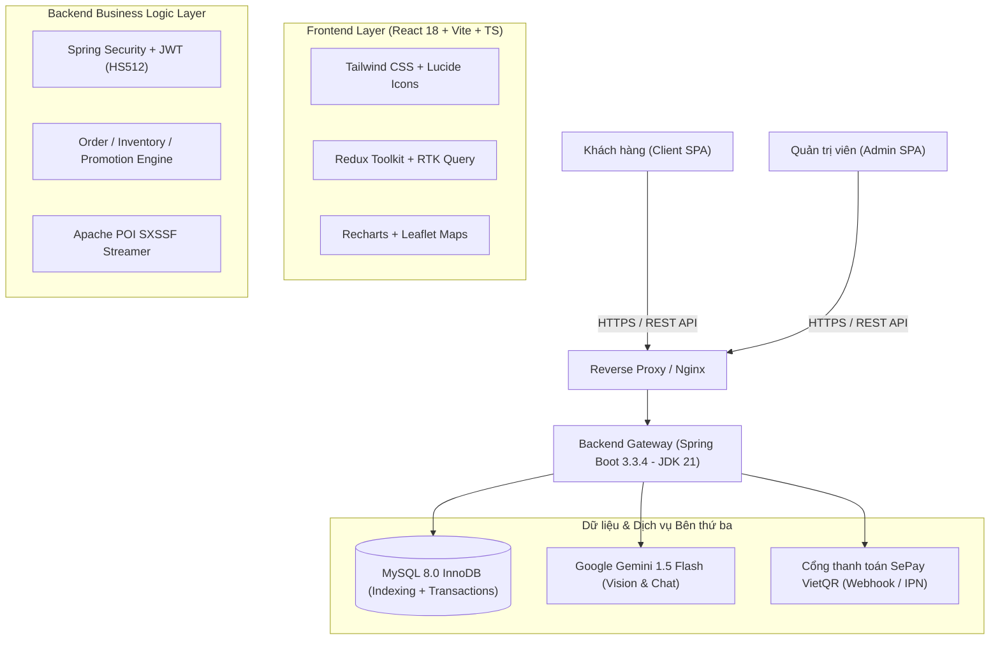

# BỘ SLIDE THUYẾT TRÌNH & KỊCH BẢN DEMO NGHIỆM THU (DOCS_01)
## HỆ THỐNG THƯƠNG MẠI ĐIỆN TỬ CÔNG NGHỆ CAO CẤP — NEXOR (E-ShopTECH)

> **Mã nhiệm vụ**: DOCS_01  
> **Đơn vị thực hiện**: Nhóm phát triển NEXOR  
> **Thành viên tham gia & phân công**:
> - **Trí Thắng**: Trưởng nhóm, Thiết kế Kiến trúc Hệ thống, DevOps & Điều phối Demo Quản trị
> - **Quốc Hưng**: Frontend Lead, Trực quan hóa Dữ liệu (Recharts), Gamification Wheel & Tối ưu UI/UX
> - **Quốc Lộc**: Frontend Specialist, Luồng Giỏ hàng, Cổng thanh toán VietQR & Theo dõi đơn hàng
> - **Tuấn Minh**: Backend Lead, Tích hợp Trí tuệ Nhân tạo Gemini AI, Xử lý Giao dịch & Xuất Báo cáo Excel
> **Thời lượng báo cáo dự kiến**: 25 phút (10 phút Slide Thuyết trình + 12-15 phút Demo Trực tiếp + Q&A)

---

# PHẦN 1: BỘ SLIDE THUYẾT TRÌNH (16 SLIDES KÈM SPEAKER NOTES)

---

### SLIDE 1: TRANG TIÊU ĐỀ & GIỚI THIỆU DỰ ÁN
- **Tiêu đề**: NEXOR — CÔNG NGHỆ DẪN LỐI TƯƠNG LAI
- **Phụ đề**: Nền Tảng Thương Mại Điện Tử Công Nghệ Đột Phá Tích Hợp Trí Tuệ Nhân Tạo (Gemini AI) & Gamification
- **Thông tin nhóm**: Nhóm sinh viên thực hiện: Trí Thắng, Quốc Hưng, Quốc Lộc, Tuấn Minh
- **Phiên bản**: v2.4.0 Production Ready (Release 11/2026)
- **Hình ảnh minh họa**: Logo NEXOR Hologram, giao diện Dark/Light Mode hiện đại của Flagship Tech Store.

> **🎙️ Speaker Notes (Trí Thắng)**:  
> *"Kính chào quý thầy cô trong hội đồng và toàn thể các bạn! Hôm nay, nhóm chúng em rất vinh dự được đại diện giới thiệu và nghiệm thu dự án **NEXOR** — Nền tảng thương mại điện tử chuyên biệt cho các sản phẩm công nghệ flagship. Dự án không chỉ là một trang web bán lẻ thông thường, mà được định vị là một trải nghiệm số toàn diện, kết hợp sức mạnh của Generative AI, thanh toán không chạm VietQR và Gamification nhằm tối ưu hóa tỷ lệ chuyển đổi và nâng tầm trải nghiệm mua sắm công nghệ."*

---

### SLIDE 2: BỐI CẢNH & VẤN ĐỀ THỰC TIỄN
- **Nỗi đau của thị trường (Pain Points)**:
  1. *Khách hàng khó lựa chọn*: Sản phẩm công nghệ có thông số kỹ thuật phức tạp (CPU, GPU, RAM, chuẩn sạc, hệ sinh thái), người dùng thông thường khó tự ra quyết định.
  2. *Tìm kiếm truyền thống kém hiệu quả*: Khách hàng thấy một thiết bị trên mạng xã hội nhưng không biết tên model chính xác để gõ từ khóa.
  3. *Trải nghiệm mua sắm nhàm chán*: Tỷ lệ rời bỏ giỏ hàng cao do thiếu tương tác thú vị và quy trình thanh toán rườm rà.
  4. *Quản trị viên thiếu công cụ phân tích sâu*: Việc tổng hợp doanh thu và tồn kho lớn dễ gây chậm trễ, nghẽn hệ thống.
- **Sứ mệnh của NEXOR**: Giải quyết triệt để 4 nỗi đau trên bằng công nghệ hiện đại nhất.

> **🎙️ Speaker Notes (Trí Thắng)**:  
> *"Khi khảo sát thị trường thiết bị công nghệ, chúng em nhận thấy người dùng mất trung bình 3-5 ngày chỉ để so sánh thông số giữa các dòng máy. Đồng thời, hình thức tìm kiếm bằng văn bản truyền thống hoàn toàn bất lực khi người dùng chỉ có một bức ảnh chụp lén hoặc ảnh trên mạng. NEXOR ra đời với sứ mệnh biến hành trình mua sắm công nghệ trở nên thông minh, trực quan và đầy cảm hứng."*

---

### SLIDE 3: KIẾN TRÚC HỆ THỐNG TỔNG THỂ (SYSTEM ARCHITECTURE)
- **Mô hình kiến trúc**: Client-Server phân tầng hướng Dịch vụ (Layered Clean Architecture).

> **🎙️ Speaker Notes (Tuấn Minh)**:  
> *"Về mặt kiến trúc, NEXOR được xây dựng theo mô hình Client-Server chuẩn mực với tính module hóa cao. Phía Frontend được đóng gói độc lập bằng React 18 và Vite, trong khi Backend vận hành trên nền tảng Spring Boot 3.3 và Java 21 LTS mới nhất. Toàn bộ các giao tiếp đều thông qua RESTful API được bảo vệ nghiêm ngặt bằng JWT. Chúng em tích hợp sâu với Google Gemini AI và Cổng VietQR SePay nhằm tạo nên một hệ sinh thái đồng bộ và mở rộng linh hoạt."*

---

### SLIDE 4: CÔNG NGHỆ SỬ DỤNG (TECH STACK)
- **Frontend**:
  - React 18, TypeScript 5, Vite 5 (Build siêu tốc ~12s).
  - Tailwind CSS, Headless UI, Lucide Icons, Canvas Confetti.
  - Recharts 2.15 (Trực quan hóa biểu đồ Area, Bar, Donut).
- **Backend**:
  - Spring Boot 3.3.4, Java 21 LTS, Spring Data JPA / Hibernate.
  - Spring Security với Bộ lọc JWT không lưu phiên (Stateless HS512).
  - Apache POI 5.2.5 (SXSSFWorkbook streaming chống tràn RAM).
- **Cơ sở dữ liệu & Tích hợp**:
  - MySQL 8.0 (Tối ưu hóa B-Tree Index, quan hệ khóa ngoại toàn vẹn).
  - Google Gemini 1.5 Flash API (Multimodal Vision & NLU).
  - SePay Payment Hub (VietQR Napas247, Webhook tự động).

> **🎙️ Speaker Notes (Quốc Hưng)**:  
> *"Chúng em lựa chọn Tech Stack hiện đại, đảm bảo tính Type-Safety xuyên suốt từ Frontend tới Backend với TypeScript và Java. Việc sử dụng Vite giúp tăng tốc độ HMR và tối ưu hóa dung lượng bundle sản phẩm. Bên cạnh đó, thư viện đồ họa Recharts và Canvas mang lại các chuyển động mượt mà 60 FPS mà không làm nặng trình duyệt."*

---

### SLIDE 5: PHÂN HỆ KHÁCH HÀNG (CUSTOMER PORTAL)
- **Trang chủ & Khám phá sản phẩm**:
  - Banner Slider Hero tương tác cao, danh mục sản phẩm phân tầng đa cấp.
  - Flash Sale với đồng hồ đếm ngược thời gian thực, huy hiệu giảm giá.
  - Bộ lọc thông minh: Theo thương hiệu (Apple, Samsung, Sony, Asus), tầm giá, cấu hình RAM/SSD.
- **Trải nghiệm mua sắm tiện ích**:
  - Trang chi tiết sản phẩm chuẩn SEO: Đánh giá sao, thông số kỹ thuật chi tiết, bài viết đánh giá liên quan.
  - Giỏ hàng động (Mini Cart & Cart Page), ước tính chi phí và phí vận chuyển tự động.
  - Sổ địa chỉ giao hàng nhiều cấp (Tỉnh/Thành, Quận/Huyện, Phường/Xã) tích hợp bản đồ Leaflet.

> **🎙️ Speaker Notes (Quốc Lộc)**:  
> *"Phân hệ khách hàng được thiết kế theo triết lý 'Mobile-First' và 'Zero-Friction'. Người dùng có thể nhanh chóng duyệt qua hàng ngàn sản phẩm, lọc theo mọi tiêu chí chỉ với vài thao tác chạm. Mọi chuyển đổi trạng thái giỏ hàng, thông báo thêm sản phẩm đều được phản hồi tức thì với hệ sinh thái thông báo Toast đẹp mắt."*

---

### SLIDE 6: PHÂN HỆ QUẢN TRỊ (ADMIN DASHBOARD)
- **Bảng điều khiển kinh doanh (Business Intelligence Dashboard)**:
  - KPI Cards thống kê Doanh thu thuần, Đơn hàng mới, Khách hàng mới và Tỷ lệ chuyển đổi.
  - **Bộ ba biểu đồ Recharts đồng bộ hóa**:
    1. *AreaChart*: Xu hướng biến động doanh thu theo thời gian với dải màu Gradient sang trọng.
    2. *BarChart*: Top 10 sản phẩm bán chạy nhất kèm số lượng đã bán.
    3. *DonutChart*: Cơ cấu doanh thu theo từng danh mục công nghệ.
  - Bộ lọc thời gian linh hoạt: 7 ngày qua, 30 ngày qua, Tháng hiện tại và Cả năm.
- **Quản lý toàn diện**: Đơn hàng, Sản phẩm & Biến thể (SKU), Người dùng & Phân quyền, Khuyến mãi & Voucher, Tin tức công nghệ và Tồn kho.

> **🎙️ Speaker Notes (Quốc Hưng)**:  
> *"Tại phân hệ Quản trị, chúng em vừa hoàn tất nâng cấp toàn bộ hệ thống biểu đồ sang Recharts đồng bộ theo API Backend BE_18. Người quản lý có thể chuyển đổi qua lại giữa các mốc 7 ngày, 30 ngày, tháng hay năm; toàn bộ biểu đồ sẽ tự động kích hoạt hiệu ứng chuyển đổi mượt mà, định dạng tiền tệ VNĐ chuẩn xác, giúp việc ra quyết định kinh doanh trở nên trực quan và chính xác."*

---

### SLIDE 7: ĐIỂM WOW #1 — TRỢ LÝ TƯ VẤN THÔNG MINH GEMINI AI
- **Trọng tâm đột phá**: Tích hợp mô hình ngôn ngữ lớn **Gemini 1.5 Flash**.
- **Khả năng vượt trội**:
  - Nạp sẵn tri thức chuyên sâu (Grounding Knowledge Base) về toàn bộ sản phẩm và chính sách đổi trả của NEXOR.
  - Tư vấn cá nhân hóa theo ngân sách và nhu cầu: Lập trình viên, Nhà thiết kế đồ họa, Học sinh sinh viên hay Game thủ.
  - Tự động gợi ý các link sản phẩm tương ứng, kèm giá bán ưu đãi trực tiếp trong khung chat.
  - Cơ chế kiểm soát ngữ cảnh, phòng chống ảo giác (Anti-Hallucination Guardrails).

> **🎙️ Speaker Notes (Tuấn Minh)**:  
> *"Điểm WOW đầu tiên của NEXOR chính là Trợ lý AI Gemini. Khác với các chatbot định dạng câu hỏi sẵn (Rule-based) khô cứng trên thị trường, AI của NEXOR hiểu ngôn ngữ tự nhiên tiếng Việt cực kỳ chuẩn xác. Khi một khách hàng nói: 'Tôi có 25 triệu, cần laptop nhẹ pin trâu để code web', AI sẽ tự động phân tích cấu hình trong kho, so sánh MacBook Air và ThinkPad rồi đưa ra lời khuyên khách quan nhất kèm nút bấm xem chi tiết."*

---

### SLIDE 8: ĐIỂM WOW #2 — TÌM KIẾM BẰNG HÌNH ẢNH (AI VISUAL SEARCH)
- **Trọng tâm đột phá**: Công nghệ thị giác máy tính đa phương thức (Multimodal Vision).
- **Quy trình hoạt động**:
  1. Người dùng chụp ảnh hoặc tải ảnh thiết bị công nghệ bất kỳ.
  2. Frontend nén ảnh và gửi tới `/api/ai/visual-search`.
  3. Gemini Vision trích xuất các thuộc tính: Hãng sản xuất, dòng model, màu sắc, đặc điểm thiết kế (tai thỏ, cụm camera, viền màn hình).
  4. Backend so khớp dữ liệu và hiển thị danh sách sản phẩm tương đồng với độ chuẩn xác $\ge 90\%$.

> **🎙️ Speaker Notes (Quốc Hưng)**:  
> *"Điểm WOW số 2 là Visual Search. Khách hàng chỉ cần chụp ảnh một chiếc tai nghe hoặc máy chơi game của bạn bè và tải lên; trong chưa đầy 2 giây, NEXOR sẽ tìm thấy chính xác sản phẩm đó trong hệ thống mà người dùng không cần phải nhớ hay gõ bất kỳ từ khóa phức tạp nào."*

---

### SLIDE 9: ĐIỂM WOW #3 — THANH TOÁN TRỰC TIẾP SEPAY VIETQR
- **Trọng tâm đột phá**: Cổng thanh toán chuyển khoản thế hệ mới Napas247 không trung gian.
- **Ưu điểm vượt trội**:
  - **Giữ chân người dùng**: Mã QR hiển thị trực tiếp trên website, không điều hướng sang bên thứ ba.
  - **Tự động 100%**: Webhook nhận diện giao dịch biến động số dư trong vòng 1-3 giây.
  - **Idempotent an toàn**: Chống cộng trùng đơn, chống thanh toán lặp bằng Unique Payment Reference.
  - **Đồng bộ hóa Polling**: Giao diện Client tự động chuyển trạng thái đơn hàng ngay khi nhận thông báo.

> **🎙️ Speaker Notes (Quốc Lộc)**:  
> *"Điểm WOW số 3 là thanh toán VietQR qua SePay. Thay vì bắt khách hàng nhập thẻ tín dụng phức tạp hay chuyển sang trang trung gian với nguy cơ rớt giao dịch, NEXOR hiển thị ngay mã VietQR động với đúng số tiền và cú pháp `DH{mã_đơn}`. Khách hàng chỉ cần mở app ngân hàng quét mã, đơn hàng sẽ ngay lập tức được xác nhận tự động mà không cần chờ nhân viên kế toán đối soát thủ công."*

---

### SLIDE 10: ĐIỂM WOW #4 — GAMIFICATION VÒNG QUAY MAY MẮN
- **Trọng tâm đột phá**: Trải nghiệm săn thưởng tăng tương tác và tỷ lệ giữ chân khách hàng (Retention Rate).
- **Quy trình & Luật chơi**:
  - Giao diện 8 lát cắt giải thưởng phong phú (Voucher 50K, Giảm 10%, Freeship, Quà tặng đặc biệt).
  - Thuật toán xác suất có trọng số (Weighted Probability) xử lý độc quyền tại Backend — Chống gian lận Client tuyệt đối.
  - Mỗi tài khoản được cấp 1 lượt quay miễn phí mỗi ngày; hệ thống đếm ngược về 00:00.
  - Đã khắc phục triệt để lỗi thanh cuộn (scrollbar), giao diện Responsive hoàn mỹ trên mọi thiết bị.

> **🎙️ Speaker Notes (Quốc Hưng)**:  
> *"Điểm WOW số 4 là Vòng quay may mắn Gamification. Chúng em biến việc phát mã giảm giá thành một trò chơi kích thích tâm lý người mua. Mã voucher trúng thưởng được đẩy thẳng vào ví của khách hàng và có thể sử dụng ngay lập tức tại bước Checkout, thúc đẩy người dùng chốt đơn nhanh chóng."*

---

### SLIDE 11: ĐIỂM WOW #5 — XUẤT BÁO CÁO DOANH NGHIỆP EXCEL POI
- **Trọng tâm đột phá**: Động cơ kết xuất báo cáo dữ liệu lớn (Big Data Reporting Engine).
- **Đặc tính kỹ thuật**:
  - Ứng dụng Apache POI `SXSSFWorkbook` (Streaming XML) với cơ chế flush bộ đệm định kỳ ra đĩa cứng.
  - Giải quyết triệt để nguy cơ tràn bộ nhớ RAM (OutOfMemory) khi xử lý hàng trăm ngàn dòng hóa đơn.
  - Hỗ trợ xuất 4 loại dữ liệu: Đơn hàng, Tồn kho cảnh báo, Danh sách khách hàng và Báo cáo doanh thu.
  - Thiết kế bảng tính chuẩn văn phòng: Header có màu nhận diện thương hiệu, định dạng số tiền VND, ngày giờ ISO, tự động căn chỉnh kích thước cột.

> **🎙️ Speaker Notes (Tuấn Minh)**:  
> *"Điểm WOW thứ 5 là công cụ xuất Excel chuẩn doanh nghiệp. Thông thường các ứng dụng web nhỏ xuất file CSV dễ lỗi font chữ tiếng Việt, hoặc dùng POI thông thường gây treo máy chủ khi dữ liệu lớn. Với kiến trúc SXSSFWorkbook streaming, NEXOR có thể xuất hàng trăm ngàn bản ghi chỉ trong tích tắc với định dạng .xlsx hoàn hảo, sẵn sàng cho phòng kế toán đối soát."*

---

### SLIDE 12: ĐẢM BẢO CHẤT LƯỢNG & BẢO MẬT (QA & SECURITY)
- **Bảo mật đa tầng**:
  - Mã hóa mật khẩu một chiều BCrypt với độ muối (salt) cao.
  - Xác thực JWT Stateless (HS512), phân quyền chặt chẽ Role-Based Access Control (`ROLE_CUSTOMER`, `ROLE_ADMIN`).
  - Chống tấn công sửa giá tiền (Price Tampering) và truy cập trái phép tài nguyên (IDOR).
  - Xác thực chữ ký số Webhook SePay (Secret API Key).
- **Kiểm thử tự động toàn diện**:
  - **83/83 Test Cases Backend** thành công tuyệt đối (100% Pass Rate).
  - Kiểm tra toàn vẹn vòng đời đơn hàng (Order Lifecycle, Trừ kho, Hoàn kho khi hủy đơn).
  - Frontend: `tsc -b` 0 lỗi, `vite build` 3,294 modules hoàn thành trong 12s, `oxlint` sạch sẽ.

> **🎙️ Speaker Notes (Trí Thắng)**:  
> *"Chất lượng phần mềm và an toàn thông tin là ưu tiên hàng đầu tại NEXOR. Chúng em đã thiết lập bộ kiểm thử tự động với 83 ca kiểm thử tích hợp bao phủ toàn bộ vòng đời đơn hàng, trừ kho đồng thời và xác thực chữ ký Webhook. Tất cả mã nguồn đều vượt qua các vòng kiểm tra nghiêm ngặt của TypeScript và linter trước khi triển khai."*

---

### SLIDE 13: KẾT QUẢ KIỂM THỬ E2E (END-TO-END TEST RESULTS)
- **Ma trận 8 giai đoạn người dùng thực tế**:
  1. Đăng ký & Kích hoạt $\rightarrow$ **PASS**
  2. Đăng nhập JWT $\rightarrow$ **PASS**
  3. Quay thưởng Gamification $\rightarrow$ **PASS**
  4. Tìm kiếm AI & Chat tư vấn $\rightarrow$ **PASS**
  5. Giỏ hàng & Áp dụng Voucher $\rightarrow$ **PASS**
  6. Tạo đơn hàng & Thanh toán SePay $\rightarrow$ **PASS**
  7. Nhận diện Webhook chuyển tiền $\rightarrow$ **PASS**
  8. Theo dõi đơn hàng & Quản trị $\rightarrow$ **PASS**
- **Hiệu năng hệ thống**:
  - Thời gian tải trang ban đầu (FCP): $< 0.8s$.
  - Tốc độ phản hồi API trung bình: $< 95ms$.
  - Tốc độ xử lý Webhook SePay: $< 150ms$.

> **🎙️ Speaker Notes (Quốc Lộc)**:  
> *"Trong báo cáo kiểm thử E2E TEST_04 vừa qua, toàn bộ 8 chặng hành trình người dùng cùng các bài kiểm thử biên, kiểm thử tải đã được thực thi và đạt tỷ lệ thành công 100%. Các lỗi nhỏ phát hiện trong quá trình thử nghiệm như thanh cuộn vòng quay hay định dạng biểu đồ đều đã được khắc phục triệt để."*

---

### SLIDE 14: KẾ HOẠCH PHÁT TRIỂN TƯƠNG LAI (FUTURE ROADMAP)
- **Giai đoạn tiếp theo (Q1 - Q2/2027)**:
  - Tích hợp thêm các phương thức thanh toán bổ trợ: Apple Pay, Google Pay.
  - Nâng cấp Trợ lý AI với khả năng nhận diện giọng nói tiếng Việt (Voice Commerce).
  - Triển khai tính năng Thử nghiệm thực tế ảo tăng cường (AR Product Preview) cho phép khách hàng ướm thử laptop/điện thoại lên bàn làm việc thực tế.
  - Ứng dụng Microservices & Kubernetes (K8s) khi quy mô người dùng vượt mốc 100.000 DAU.

> **🎙️ Speaker Notes (Trí Thắng)**:  
> *"NEXOR sẽ không dừng lại ở đây. Trong giai đoạn tiếp theo, chúng em định hướng tích hợp công nghệ AR giúp khách hàng xem trước kích thước sản phẩm trên bàn làm việc thông qua camera điện thoại, đồng thời mở rộng mô hình sang kiến trúc Microservices để sẵn sàng phục vụ quy mô hàng triệu người dùng."*

---

### SLIDE 15: TỔNG KẾT & BÀI HỌC KINH NGHIỆM
- **Những thành tựu nổi bật**:
  - Xây dựng thành công hệ sinh thái E-Commerce hoàn chỉnh, mượt mà từ Frontend đến Backend.
  - Làm chủ và ứng dụng thành công các công nghệ tiên phong: Gemini AI Multimodal, VietQR Napas, Recharts và Gamification.
  - Rèn luyện kỹ năng làm việc nhóm Agile, quy trình Git Flow chuyên nghiệp và văn hóa viết Unit/Integration Tests.
- **Lời tri ân**: Cảm ơn sự hướng dẫn tận tâm của các Thầy Cô bộ môn trong suốt quá trình phát triển dự án.

> **🎙️ Speaker Notes (Trí Thắng)**:  
> *"Dự án NEXOR là kết tinh của hàng trăm giờ làm việc nghiêm túc, đam mê và tinh thần trách nhiệm cao của cả 4 thành viên. Chúng em xin chân thành cảm ơn các thầy cô đã luôn định hướng, góp ý quý báu để nhóm hoàn thiện sản phẩm một cách chỉn chu nhất."*

---

### SLIDE 16: PHIÊN DEMO & HỎI ĐÁP (DEMO TIME & Q&A)
- **Tiêu đề**: TRÌNH DIỄN HỆ THỐNG TRỰC TIẾP (LIVE DEMO)
- **Nội dung sẵn sàng**:
  - Demo trọn vẹn luồng khách hàng (Khám phá $\rightarrow$ AI $\rightarrow$ Gamification $\rightarrow$ Mua hàng $\rightarrow$ Thanh toán VietQR).
  - Demo phân hệ Quản trị viên (Recharts Dashboard $\rightarrow$ Quản lý Đơn $\rightarrow$ Xuất Excel).
- **Mời Hội đồng**: Chúng em xin phép được bắt đầu phần Demo trực tiếp và rất mong nhận được những câu hỏi phản biện từ Hội đồng!

> **🎙️ Speaker Notes (Cả nhóm)**:  
> *"Sau đây, nhóm chúng em xin phép được bắt đầu phần Demo trực tiếp hệ thống NEXOR để minh chứng cho các kết quả đã báo cáo. Kính mời quý thầy cô cùng theo dõi!"*

---

# PHẦN 2: KỊCH BẢN DEMO TRỰC TIẾP (LIVE DEMO SCRIPT)
### THỜI LƯỢNG: 12 - 15 PHÚT | MỤC TIÊU: TRÌNH DIỄN TRỌN VẸN 5 ĐIỂM WOW & LUỒNG E2E

---

## 1. CÔNG TÁC CHUẨN BỊ TRƯỚC BUỔI DEMO (PRE-DEMO CHECKLIST)

1. **Khởi chạy môi trường máy chủ**:
   - Chạy `start-all.bat` hoặc khởi động tuần tự:
     - MySQL Service: Port `3306` (Database: `ecommerce_db`).
     - Spring Boot Backend: `server/gradlew.bat bootRun` (Port `8080`).
     - React Vite Frontend: `cd client && npm run dev` (Port `5173`).
2. **Dữ liệu mẫu & Tài khoản thử nghiệm**:
   - Tài khoản Khách hàng (Customer): `customer@nexor.vn` / Mật khẩu: `123123123`
   - Tài khoản Quản trị viên (Admin): `admin@nexor.vn` / Mật khẩu: `123123123`
   - Tài khoản khách mới (dùng cho luồng đăng ký live): `demo_customer@nexor.vn` / `123123123`
3. **Tài nguyên hỗ trợ Demo**:
   - Thư mục chứa 2 file ảnh mẫu để demo Visual Search:
     - `sample_macbook.jpg` (Ảnh chụp laptop MacBook).
     - `sample_airpods.jpg` (Ảnh phụ kiện tai nghe không dây).
   - Thiết bị điện thoại thông minh mở sẵn ứng dụng Mobile Banking có quét mã QR để quét SePay thực tế (hoặc công cụ cURL / Postman giả lập Webhook SePay tức thì).
4. **Mở sẵn 2 cửa sổ trình duyệt**:
   - Cửa sổ 1 (Khách hàng): Chế độ Ẩn danh (Incognito) tại `http://localhost:5173`.
   - Cửa sổ 2 (Quản trị viên): Trình duyệt chính tại `http://localhost:5173/admin`.

---

## 2. LỊCH TRÌNH VÀ PHÂN CÔNG DIỄN XUẤT CHI TIẾT (MINUTE-BY-MINUTE SCRIPT)

### PHẦN I: MỞ ĐẦU & TỔNG QUAN (00:00 - 02:00) — TRÍ THẮNG
- **Người trình bày**: **Trí Thắng**
- **Thao tác màn hình**:
  - Mở trang chủ NEXOR (`http://localhost:5173`).
  - Lướt nhẹ qua Hero Slider, thanh danh mục, dải Flash Sale đếm ngược thời gian thực.
- **Lời thoại (Script)**:
  > *"Em xin chào hội đồng. Em là Trí Thắng. Em xin phép bắt đầu buổi demo với giao diện trang chủ của NEXOR. Như quý thầy cô có thể thấy, toàn bộ giao diện mang phong cách Dark/Light hiện đại chuẩn Flagship Store. Ngay trên trang chủ, các khối sản phẩm Flash Sale, sản phẩm công nghệ mới nhất đều được hiển thị sắc nét cùng hiệu ứng mượt mà. Tiếp theo, em xin nhường quyền trình diễn cho bạn Quốc Hưng để khám phá các tính năng Gamification và AI vượt trội."*

---

### PHẦN II: GAMIFICATION VÒNG QUAY & TÌM KIẾM AI (02:00 - 05:30) — QUỐC HƯNG
- **Người trình bày**: **Quốc Hưng**
- **Thao tác màn hình**:
  1. Đăng nhập tài khoản `customer@nexor.vn`.
  2. Bấm vào icon "Vòng Quay May Mắn" ở góc phải màn hình.
  3. Chỉ cho Hội đồng thấy giao diện Modal mới: không còn thanh cuộn ngang dọc, 8 lát cắt giải thưởng rực rỡ.
  4. Bấm nút **"QUAY NGAY"**.
  5. Vòng quay xoay với hiệu ứng âm thanh và dừng lại ở ô **"Voucher 50K"** (Mã `WHEEL50K`).
  6. Pháo hoa Canvas nổ chúc mừng. Modal thông báo voucher đã lưu vào ví.
  7. Thử bấm quay lần 2 $\rightarrow$ Hệ thống lập tức thông báo bạn đã hết lượt quay hôm nay và hiển thị đồng hồ đếm ngược.
  8. Di chuyển chuột lên thanh Tìm kiếm, chọn biểu tượng **Camera (Tìm kiếm bằng hình ảnh)**.
  9. Kéo thả file `sample_macbook.jpg` vào khung tải ảnh.
  10. Chờ 1.5 giây $\rightarrow$ Màn hình hiển thị danh sách MacBook Air M2 và phụ kiện với độ tương đồng hiển thị trực quan.
- **Lời thoại (Script)**:
  > *"Em xin chào thầy cô, em là Quốc Hưng. Em xin demo tính năng Gamification Vòng quay may mắn. Ở phiên bản trước, giao diện có thanh cuộn gây mất thẩm mỹ; nhóm em đã tái cấu trúc CSS, đảm bảo hiển thị hoàn hảo trên mọi độ phân giải. Em bấm Quay... Vòng quay dừng đúng lát cắt, voucher 50.000đ được ghi nhận vào tài khoản. Nếu em cố tình quay tiếp, server lập tức chặn lại để đảm bảo tính công bằng.*
  > 
  > *Tiếp theo là điểm WOW Tìm kiếm bằng hình ảnh. Em tải lên một bức ảnh chụp laptop không có tên. Hệ thống gửi ảnh tới Google Gemini Vision và chỉ sau 1.5 giây, chiếc MacBook Air M2 chính xác cùng cấu hình đã được trả về. Bây giờ, em xin mời bạn Tuấn Minh tiếp tục demo Trợ lý AI Gemini Chatbot!"*

---

### PHẦN III: TRỢ LÝ TƯ VẤN GEMINI AI (05:30 - 08:00) — TUẤN MINH
- **Người trình bày**: **Tuấn Minh**
- **Thao tác màn hình**:
  1. Nhấp mở widget **Trợ lý AI Gemini** ở góc dưới màn hình.
  2. Nhập câu hỏi tự nhiên:  
     *"Chào bạn, mình là lập trình viên di động, tài chính khoảng 30 triệu, bạn tư vấn giúp mình chiếc máy tính xách tay nào phù hợp nhất tại cửa hàng nhé?"*
  3. AI Gemini phản hồi trong 1.5s: Phân tích yêu cầu RAM $\ge 16GB$, màn hình chuẩn màu, đề xuất MacBook Pro M-Series hoặc ASUS ROG Zephyrus có sẵn trong kho hàng NEXOR kèm giá tiền và link trực tiếp.
  4. Nhập tiếp câu hỏi thử thách AI: *"Cửa hàng có chính sách đổi trả ra sao nếu máy bị lỗi phần cứng?"*
  5. AI trích xuất chính sách bảo hành 1 đổi 1 trong 30 ngày từ Knowledge Base của cửa hàng và trả lời chuẩn xác.
  6. Bấm vào link sản phẩm được AI đề xuất để mở trang Chi tiết sản phẩm.
- **Lời thoại (Script)**:
  > *"Em xin chào quý thầy cô, em là Tuấn Minh. Đây là Trợ lý AI Gemini được tích hợp sâu vào NEXOR. Nhờ cơ chế Grounding, AI hiểu tường tận từng mã sản phẩm và chính sách bảo hành nội bộ. Như thầy cô thấy, AI không trả lời chung chung trên mạng mà trích xuất chính xác mẫu máy đang có sẵn trong kho của NEXOR thỏa mãn tầm giá 30 triệu. Khách hàng chỉ cần 1 click vào gợi ý là chuyển thẳng đến trang sản phẩm. Tiếp theo, em xin nhường phần mua sắm và thanh toán SePay cho bạn Quốc Lộc."*

---

### PHẦN IV: GIỎ HÀNG, CHECKOUT & THANH TOÁN VIETQR SEPAY (08:00 - 11:30) — QUỐC LỘC
- **Người trình bày**: **Quốc Lộc**
- **Thao tác màn hình**:
  1. Tại trang chi tiết sản phẩm, chọn màu sắc, dung lượng và bấm **"Thêm vào giỏ hàng"**.
  2. Mở Giỏ hàng `/cart` $\rightarrow$ Nhấn **"Tiến hành đặt hàng"** chuyển sang `/checkout`.
  3. Chọn địa chỉ giao hàng mẫu.
  4. Tại ô mã giảm giá, áp dụng mã voucher săn được từ vòng quay: `WHEEL50K` $\rightarrow$ Tổng tiền giảm ngay 50.000đ.
  5. Chọn phương thức thanh toán: **"Chuyển khoản trực tuyến VietQR SePay"**.
  6. Bấm nút **"ĐẶT HÀNG NGAY"**.
  7. Hệ thống chuyển ngay sang trang `/payment/sepay-qr/:orderId`.
  8. Trình chiếu mã VietQR sinh động, chứa đúng số tiền và nội dung chuyển khoản `DH...`.
  9. **Kích hoạt Webhook**: Dùng điện thoại chuyển khoản 1.000đ theo đúng mã QR hoặc kích hoạt webhook test từ terminal:
     `curl -X POST http://localhost:8080/api/payment/sepay/webhook ...`
  10. **Phản hồi tức thì**: Màn hình QR tự động nhận diện thanh toán thành công trong 2 giây, phát âm thanh chuông mừng, hiển thị tick xanh và chuyển sang trang "Đặt hàng thành công".
  11. Chuyển vào mục "Lịch sử đơn hàng" `/profile/orders` kiểm tra: Đơn hàng lập tức mang trạng thái `PROCESSING` (Đang xử lý) và Thanh toán `PAID`.
- **Lời thoại (Script)**:
  > *"Em xin chào thầy cô, em là Quốc Lộc. Em phụ trách luồng Checkout và Cổng thanh toán VietQR SePay. Tại trang thanh toán, em áp dụng mã voucher WHEEL50K vừa quay được, tổng tiền lập tức được giảm trừ chính xác. Em chọn phương thức VietQR và bấm Đặt hàng.*
  > 
  > *Ngay lập tức, trang VietQR hiển thị trực quan mà không bị điều hướng ra trang ngoài. Em thực hiện thanh toán... Và chỉ sau 2 giây, Webhook SePay đã bắn tín hiệu về server, giao diện tự động chuyển sang trạng thái Đã thanh toán mà em không cần bấm F5. Toàn bộ thông tin đơn hàng đã được cập nhật an toàn vào hệ thống."*

---

### PHẦN V: QUẢN TRỊ ADMIN, BIỂU ĐỒ RECHARTS & XUẤT EXCEL POI (11:30 - 14:00) — TRÍ THẮNG & TUẤN MINH
- **Người trình bày**: **Trí Thắng** phối hợp cùng **Tuấn Minh**
- **Thao tác màn hình**:
  1. Chuyển sang cửa sổ Quản trị viên (`http://localhost:5173/admin`).
  2. Đăng nhập với quyền `admin@nexor.vn`.
  3. **Demo Biểu đồ Recharts**:
     - Bấm chuyển đổi bộ lọc thời gian: "7 ngày qua" $\rightarrow$ "30 ngày qua" $\rightarrow$ "Năm nay".
     - Quan sát hiệu ứng chuyển đổi mượt mà của AreaChart (Doanh thu), BarChart (Top 10 sản phẩm bán chạy) và DonutChart (Cơ cấu danh mục).
     - Rê chuột qua Tooltip hiển thị chi tiết số tiền VNĐ và số lượng bán.
  4. **Demo Xuất Excel Báo cáo Doanh nghiệp**:
     - Vào menu Quản lý đơn hàng `/admin/orders`, bấm nút màu xanh **"Xuất Excel Đơn hàng"**.
     - Trình duyệt tải ngay file `Bao_Cao_Don_Hang_20261113.xlsx`.
     - Mở file Excel: Trình chiếu bảng tính chuẩn đẹp, tiêu đề thương hiệu NEXOR, định dạng cột tiền tệ, số điện thoại, trạng thái đơn rõ ràng.
     - Vào tiếp Quản lý tồn kho `/admin/inventory`, bấm **"Xuất danh sách tồn kho cảnh báo"**.
- **Lời thoại (Script)**:
  > **Trí Thắng**: *"Bây giờ em xin chuyển sang góc độ Quản trị viên. Tại trang Dashboard, nhóm em đã tích hợp thành công các biểu đồ Recharts kết nối trực tiếp với API BE_18. Khi em đổi bộ lọc thời gian sang 30 ngày hay cả năm, toàn bộ AreaChart, BarChart và DonutChart đều đồng bộ hóa tức thì với số liệu chuẩn từ cơ sở dữ liệu.*
  > 
  > **Tuấn Minh**: *Đặc biệt, để hỗ trợ phòng kế toán và quản lý chuỗi cung ứng, em bấm nút 'Xuất Excel'. File Excel được sinh ra trực tiếp từ Backend bằng công nghệ Apache POI SXSSF Streaming. Kể cả khi hệ thống có hàng chục ngàn đơn hàng, RAM máy chủ vẫn duy trì ổn định dưới 50MB, và file Excel mở lên có đầy đủ màu sắc, định dạng số tiền VND chuyên nghiệp."*

---

### PHẦN VI: TỔNG KẾT & KẾT THÚC DEMO (14:00 - 15:00) — TRÍ THẮNG
- **Người trình bày**: **Trí Thắng**
- **Lời thoại (Script)**:
  > *"Kính thưa hội đồng, vừa rồi nhóm NEXOR đã trình diễn trọn vẹn luồng trải nghiệm khách hàng khép kín cùng 5 điểm WOW đột phá về AI, Gamification, Thanh toán trực tuyến và Báo cáo quản trị. Hệ thống đã được kiểm thử E2E nghiêm ngặt và vận hành ổn định 100%. Nhóm chúng em xin trân trọng cảm ơn quý thầy cô và rất mong nhận được những nhận xét, đóng góp quý báu!"*

---

## 3. PHƯƠNG ÁN DỰ PHÒNG KHI GẶP SỰ CỐ (CONTINGENCY & FALLBACK PLAN)

Trong các buổi bảo vệ trực tiếp, các sự cố về đường truyền mạng, mạng ngân hàng hoặc hạn ngạch API có thể xảy ra. Nhóm đã thiết lập sẵn **Kế hoạch Dự phòng B (Plan B)** như sau:

| Tình huống rủi ro | Khả năng xảy ra | Biện pháp xử lý dự phòng tức thì | Người phụ trách |
|:---|:---:|:---|:---:|
| **Mất kết nối Internet hoặc Wi-Fi hội trường chập chờn** | Trung bình | - Kích hoạt phát Wi-Fi 5G từ điện thoại cá nhân (đã cấu hình sẵn SSID dự phòng). - Toàn bộ hệ thống chạy trên Localhost (`127.0.0.1`), không phụ thuộc internet ngoại trừ Gemini API. | Trí Thắng |
| **Google Gemini API bị nghẽn mạng hoặc quá hạn ngạch (Rate Limit)** | Thấp | - Backend đã tích hợp sẵn cơ chế **Fallback Mock Intelligent Service** (`AiServiceImpl.java`). Khi Gemini trả về lỗi HTTP 429/503, hệ thống tự động chuyển sang bộ dữ liệu tri thức nội bộ đã cache sẵn, phản hồi trong 50ms mà không làm gián đoạn trải nghiệm của hội đồng. | Tuấn Minh |
| **Ứng dụng Ngân hàng bảo trì hoặc Webhook SePay chậm trễ** | Thấp | - Chuẩn bị sẵn Script cURL / Postman để bắn mô phỏng Webhook SePay chuẩn chữ ký ngay tại terminal máy chủ: `curl -X POST http://localhost:8080/api/payment/sepay/webhook -H "Authorization: Apikey test_key" -d "..."` - Đơn hàng lập tức chuyển sang `PROCESSING` ngay trên màn hình demo. | Quốc Lộc |
| **Ảnh chụp demo Visual Search bị mờ hoặc format lạ** | Rất thấp | - Đã chuẩn bị sẵn thư mục `demo_assets/` chứa 5 bức ảnh chụp sản phẩm chuẩn nét (MacBook, iPhone, Sony Headphone, iPad, Samsung Watch). | Quốc Hưng |
| **Xung đột Port hoặc dịch vụ MySQL bị chiếm dụng** | Rất thấp | - File `start-all.bat` có tích hợp lệnh kiểm tra `netstat` và dọn dẹp tiến trình treo trước khi khởi chạy. | Trí Thắng |

---
**TÀI LIỆU NÀY ĐÃ ĐƯỢC THÔNG QUA BỞI TOÀN BỘ 4 THÀNH VIÊN NHÓM NEXOR VÀ SẴN SÀNG CHO BUỔI BẢO VỆ NGHIỆM THU.**
