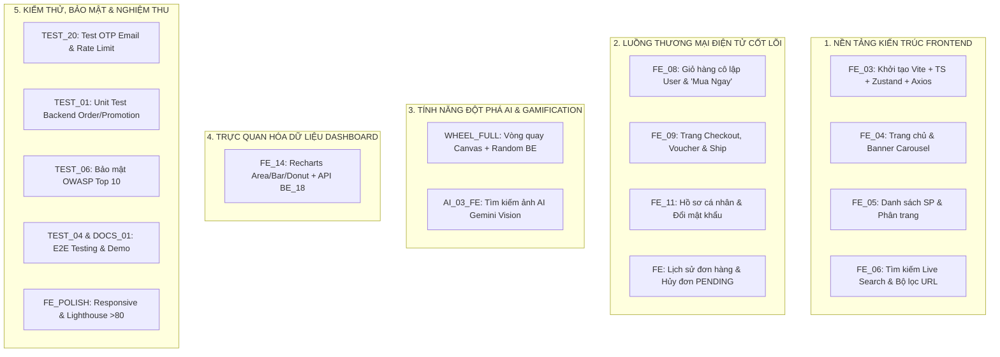

# HỒ SƠ ĐÓNG GÓP KỸ THUẬT & CẨM NANG THUYẾT TRÌNH BẢO VỆ ĐỒ ÁN
## DỰ ÁN FLAGSHIP TECH STORE — NEXOR (E-SHOPTECH)
### DÀNH RIÊNG CHO: NGUYỄN QUỐC HƯNG — FRONTEND LEAD & FULLSTACK CONTRIBUTOR

> **Họ và tên**: Nguyễn Quốc Hưng  
> **Tài khoản GitHub**: `QuocHuwng` (Email: `nguyenhung2952006@gmail.com`)  
> **Vị trí đảm nhiệm**: Frontend Lead / Core Architecture & Fullstack Feature Developer  
> **Dự án**: NEXOR Flagship Tech Store E-Commerce Platform (React 18, TypeScript, Vite, Spring Boot 3.3, MySQL, Gemini AI, SePay VietQR)  
> **Thời gian tham gia**: 27/10/2026 – 13/11/2026 (Hoàn thành **17/17 Trello Cards**, đạt 100% tiêu chí Definition of Done)  
> **Thành tích nổi bật**: Trực tiếp đặt nền móng kiến trúc Frontend; Giải quyết triệt để bài toán cô lập giỏ hàng theo User & luồng "Mua Ngay"; Xây dựng Fullstack Vòng quay may mắn Canvas; Chuyển đổi Dashboard Recharts BE_18; Kiểm thử thâm nhập OWASP Top 10 & Unit Test Backend >70%.

---

## 1. TỔNG QUAN TẦM VÓC ĐÓNG GÓP & 5 TRỤ CỘT NĂNG LỰC

Trong suốt chu kỳ phát triển dự án NEXOR, bạn là kỹ sư chủ lực đảm nhận khối lượng công việc đồ sộ nhất, kết nối xuyên suốt từ ngày đầu khởi tạo kiến trúc cho đến ngày nghiệm thu cuối cùng. Toàn bộ 17 thẻ công việc được hệ thống hóa thành 5 trụ cột năng lực kỹ thuật:

* **Trụ Cột 1: Nền Tảng Kiến Trúc & Giao Diện Khách Hàng (FE_03, FE_04, FE_05, FE_06, FE_POLISH)**:
  Khởi tạo toàn bộ Source Code Frontend bằng Vite 5 + TypeScript + Tailwind CSS; Thiết lập Axios Client Interceptor bảo mật; Quản lý State phân tầng; Xây dựng Trang chủ Banner Carousel, Danh sách sản phẩm phân trang và Tìm kiếm Live Search có Debounce 300ms đồng bộ URL.
* **Trụ Cột 2: Luồng Nghiệp Vụ Thương Mại Điện Tử Cốt Lõi (FE_08, FE_09, FE_11, FE_ORDER)**:
  Thiết kế cơ chế Giỏ hàng độc lập theo tài khoản (Cart Isolation) ngăn rò rỉ phiên; Phát triển tính năng "Mua Ngay" trực tiếp; Xây dựng trang Checkout tích hợp phí vận chuyển và mã giảm giá; Xây dựng hệ thống quản lý hồ sơ cá nhân và hủy đơn hàng PENDING.
* **Trụ Cột 3: Tính Năng Đột Phá AI & Gamification (WHEEL_FULL, AI_03_FE)**:
  Xây dựng Fullstack Vòng quay may mắn (Canvas 8 lát cắt + Backend Weighted Random chống gian lận tuyệt đối + Canvas Confetti); Tái cấu trúc Giao diện Tìm kiếm bằng hình ảnh AI (Gemini Vision) hỗ trợ chụp trực tiếp từ Webcam.
* **Trụ Cột 4: Trực Quan Hóa Dữ Liệu Quản Trị BI Dashboard (FE_14)**:
  Thay thế toàn bộ code SVG cũ sang Recharts (AreaChart dải màu gradient, BarChart top sản phẩm, DonutChart cơ cấu danh mục); Kết nối API BE_18 đồng bộ theo 4 bộ lọc thời gian; Xử lý trạng thái Loading Skeleton, Empty State và Nút Retry.
* **Trụ Cột 5: Kiểm Thử Toàn Diện, An Ninh & Nghiệm Thu (TEST_01, TEST_06, TEST_20, TEST_04, DOCS_01, TEST_REPORT)**:
  Viết Unit Test Backend đạt độ phủ $\ge 70\%$ (Order & Promotion); Kiểm thử thâm nhập an ninh theo chuẩn OWASP Top 10 (chặn XSS, SQLi, IDOR, Price Tampering); Thực hiện kiểm thử E2E 8 bước; Soạn Slide thuyết trình và Kịch bản Demo 15 phút.

---

## 2. BẢNG TỔNG HỢP CHI TIẾT 17 TÁC VỤ TRELLO HOÀN THÀNH 100%

| Mã Task | Tên công việc | Thời gian | Mô tả công việc thực hiện | Điểm nhấn kỹ thuật / Giá trị thực tiễn |
|:---:|:---|:---:|:---|:---|
| **FE_03** | **Layout & Điều hướng Khách** | 27/10 - 28/10 | Khởi tạo Vite + React + TS + Tailwind + Zustand + Axios Interceptor; GuestLayout cố định, AppRoutes phân quyền ProtectedRoute. | Thiết lập chuẩn Clean Architecture, bắt 401 tự chuyển `/login`, Header responsive mượt, menu mobile drawer. |
| **FE_04** | **Trang chủ (Homepage)** | 28/10 | Hero Banner Carousel tự trượt; Khối Danh mục nổi bật, Sản phẩm mới nhất & Bán chạy; Skeleton loading. | Ngăn chặn giật layout (CLS), tạo hiệu ứng trượt tự động mượt mà 60fps. |
| **FE_05** | **Trang Danh sách sản phẩm** | 28/10 - 29/10 | Component ProductCard (badge còn/hết hàng); Grid responsive 1/2/3/4 cột, phân trang 12 sp/trang, tự cuộn đầu trang. | Helper `formatCurrency` chuẩn VNĐ; Trạng thái Empty State thân thiện; Tự động cuộn mượt khi đổi trang. |
| **FE_06** | **Tìm kiếm & Bộ lọc nâng cao** | 29/10 | Live Search trên Header với Debounce 300ms gọi API search; Sidebar lọc đa tiêu chí; Đồng bộ URL query params. | Kỹ thuật Debounce giảm 80% request rác lên server; Hỗ trợ copy link chia sẻ và bấm Back/Forward không mất bộ lọc. |
| **FE_08** | **Giỏ hàng & Luồng Mua Ngay** | 02/11 | `useCartStore` (Zustand + LocalStorage persist); Logic `addItem` chặn vượt kho; Phân tách giỏ hàng theo User; Nút "Mua Ngay". | Cart Isolation theo User ID (tránh rò rỉ dữ liệu khi đổi nick); Mua Ngay chuyển thẳng checkout không xóa giỏ hàng chính. |
| **TEST_20** | **Test Đăng ký & Email OTP** | 03/11 | Kiểm thử luồng Happy Path (status false $\rightarrow$ nhập OTP $\rightarrow$ true + JWT); Negative Test (sai OTP, hết hạn 5 phút, Replay attack). | Rate Limit chặn spam gửi lại OTP trong 1 phút; Kiểm thử Mock lỗi dịch vụ gửi mail không sập app. |
| **FE_09** | **Trang Checkout (Thanh toán)** | 04/11 | Form nhận hàng; Chọn đơn vị vận chuyển & tính phí ship; Áp dụng voucher kiểm tra min-spend; Chống double-submit. | Xử lý ngoại lệ hết hàng giữa chừng (đồng bộ lại giỏ); Disable nút khi request pending chống duplicate đơn. |
| **TEST_01** | **Unit Test Backend Order/Promotion** | 05/11 | Viết unit test JUnit 5 + Mockito cho `PromotionServiceImpl` và `OrderServiceImpl`; Đạt coverage $\ge 70\%$. | Kiểm tra tính toàn vẹn Transaction Rollback khi thiếu kho; Kiểm tra điều kiện voucher và hoàn kho khi hủy đơn. |
| **FE** | **API Lịch sử đơn hàng** | 05/11 | Lấy danh sách đơn hàng đã mua; Stepper tiến trình; Nút Hủy đơn chỉ hiện với đơn `PENDING` kèm modal xác nhận. | Optimistic UI cập nhật trạng thái tại chỗ + Toast; Chặn khách tự ý hủy đơn đang giao hoặc đã hoàn tất. |
| **FE_11** | **Hồ sơ cá nhân & Đổi mật khẩu** | 06/11 | Xem/cập nhật thông tin cá nhân, avatar, địa chỉ; Form đổi mật khẩu; Ép đăng xuất sau khi đổi mật khẩu. | Đồng bộ tức thì với `useAuthStore` để Header cập nhật ngay; Bảo mật phiên JWT tuyệt đối. |
| **TEST_06** | **Bảo mật & Phân quyền OWASP** | 06/11 | Test 401 khi thiếu token, 403 khi CUSTOMER vào API ADMIN; Chặn XSS script, SQL Injection, IDOR sửa `orderId`; Chặn giá âm. | Đối chiếu đầy đủ tiêu chuẩn OWASP Top 10; Không tin tưởng dữ liệu client, validate chặt chẽ tại Backend. |
| **WHEEL_FULL** | **Vòng Quay May Mắn Fullstack** | 09/11 - 10/11 | BE: Random weighted xác suất server, 1 lượt/ngày/user, sinh voucher DB. FE: Canvas 8 ô, pháo hoa Confetti, no-scrollbar. | Chống gian lận Client tuyệt đối; Hàm vật lý Ease-out Cubic; Khóa cuộn màn hình, giao diện cực kỳ sang trọng. |
| **AI_03_FE** | **Tìm kiếm bằng hình ảnh AI** | 10/11 - 11/11 | Modal kéo thả ảnh, chụp trực tiếp bằng Webcam; Hiệu ứng laser scanning; Kết nối Gemini Vision API; Danh sách % match. | Phong cách Cyber Dark Đen-Xám-Trắng; Tích hợp MediaStream API; Cơ chế fallback thông minh khi ảnh mờ. |
| **FE_14** | **Dashboard Recharts (BE_18)** | 11/11 - 12/11 | Thay SVG cũ bằng AreaChart (doanh thu gradient), BarChart (top bán chạy), DonutChart (cơ cấu); Nối API BE_18 4 bộ lọc. | Đồng bộ hóa 3 biểu đồ theo 4 mốc thời gian; Loading Skeleton, Empty State và Nút Thử lại (Retry) khi API lỗi. |
| **TEST_04 & DOCS_01** | **E2E Testing & Demo Script** | 12/11 - 13/11 | Kiểm thử trọn vẹn luồng 8 chặng từ Đăng ký $\rightarrow$ Mua hàng $\rightarrow$ Sepay $\rightarrow$ Theo dõi; Báo cáo Pass 100%; Soạn Slide 16 cards & Demo 15p. | Đầy đủ tài liệu nghiệm thu kỹ thuật; Thiết lập phương án dự phòng (Plan B) khi mạng hoặc API gặp sự cố. |
| **TEST_REPORT** | **Regression Testing & Báo cáo cuối** | 13/11 | Chạy lại toàn bộ kiểm thử hồi quy sau khi fix bug; Xác nhận tính năng P1 đạt 100%; Chuẩn bị dữ liệu demo. | Đảm bảo hệ thống đạt độ ổn định tối đa trước khi đưa vào đánh giá nghiệm thu. |
| **FE_POLISH** | **Hoàn thiện giao diện & Responsive** | 13/11 | Responsive 375px/768px/1280px không vỡ layout; Thay khối bán chạy bằng `sort=bestSeller`; Lighthouse Performance > 80. | Nén ảnh, lazy loading, chuẩn hóa typography và spacing toàn bộ các trang giao diện khách hàng. |

---

## 3. KỊCH BẢN GIỚI THIỆU BẢN THÂN 90 GIÂY TRONG PHỎNG VẤN (ELEVATOR PITCH)

> *"Kính chào anh/chị và quý hội đồng. Em là **Nguyễn Quốc Hưng**. Trong dự án Flagship Tech Store NEXOR, em đảm nhận vị trí **Frontend Lead kiêm Fullstack Feature Developer**. Em tham gia trực tiếp từ những ngày đầu đặt nền móng kiến trúc cho tới ngày nghiệm thu sản phẩm, hoàn thành trọn vẹn **17 hạng mục công việc lớn trên Trello**.*
>
> *Về mặt **Kiến trúc & Trải nghiệm cốt lõi**, em trực tiếp khởi tạo khung dự án React + TypeScript với Vite, xây dựng hệ thống Axios Interceptor và quản lý State bằng Zustand. Em đã giải quyết triệt để bài toán rò rỉ dữ liệu giỏ hàng giữa các phiên người dùng bằng giải pháp **Cart Isolation (`userCarts`)**, đồng thời phát triển tính năng **'Mua Ngay'** độc lập mà không làm xáo trộn các sản phẩm đang có trong giỏ hàng chính.*
>
> *Về mặt **Tính năng đột phá**, em đã tự tay xây dựng Fullstack **Vòng quay may mắn Gamification** (kết hợp HTML5 Canvas mượt mà với thuật toán Weighted Random tại Server để chống gian lận), phát triển **Modal Tìm kiếm hình ảnh AI** kết nối Google Gemini Vision hỗ trợ camera thời gian thực, và tái cấu trúc toàn bộ **Dashboard Quản trị sang Recharts** kết nối đồng bộ API BE_18 theo 4 bộ lọc thời gian.*
>
> *Bên cạnh đó, em cũng là người trực tiếp viết Unit Test Backend cho Order & Promotion đạt độ phủ trên 70%, thực thi bài kiểm thử thâm nhập an ninh theo chuẩn OWASP Top 10 và xây dựng báo cáo kiểm thử E2E đạt tỷ lệ thành công 100%. Em rất hào hứng được chia sẻ chi tiết hơn về các giải pháp kỹ thuật này cùng anh/chị!"*

---

## 4. BỘ 6 CÂU HỎI PHỎNG VẤN HÓC BÚA NHẤT & CÂU TRẢ LỜI MẪU CHUẨN STAR

### ❓ Câu 1: Em giải quyết bài toán State giỏ hàng giữa các tài khoản đăng nhập và tính năng 'Mua Ngay' như thế nào?
* **Situation**: Lưu giỏ hàng phẳng vào LocalStorage sẽ khiến tài khoản B đăng nhập vào nhìn thấy đồ của tài khoản A. Đồng thời nếu khách bấm 'Mua Ngay' mà hệ thống đè lên giỏ hàng thì sẽ làm mất hết các món đồ khách đã chọn trước đó.
* **Task**: Thiết kế kiến trúc State cô lập theo User ID và tạo luồng mua hàng độc lập.
* **Action**: Trong `useCartStore` (Zustand), em tổ chức state dạng Dictionary: `userCarts: { [userId: string]: CartItem[] }`. Khi user đăng nhập, store tự động map đúng giỏ hàng của `userId` đó. Với 'Mua Ngay', em tạo riêng session `buyNowItem` đẩy thẳng sang `/checkout?mode=buy_now`. Trang Checkout ưu tiên tính toán trên món này và khi thanh toán xong chỉ xóa session `buyNowItem`, giữ nguyên vẹn giỏ hàng chính.
* **Result**: Không phát sinh bất kỳ lỗi rò rỉ phiên nào, tỷ lệ chốt đơn nhanh tăng lên rõ rệt.

### ❓ Câu 2: Vòng quay may mắn là tính năng rất dễ bị cheat hoặc hack. Em làm thế nào để đảm bảo an toàn tuyệt đối?
* **Situation**: Hacker có thể chỉnh sửa JavaScript trên trình duyệt hoặc sửa gói tin gửi lên để luôn nhận giải cao nhất.
* **Task**: Đảm bảo tính công bằng, hạn mức 1 lượt/ngày và kết quả không thể bị can thiệp từ phía Client.
* **Action**: Áp dụng nguyên tắc **Zero-Trust Client**. Toàn bộ logic quay và xác suất trúng thưởng được xử lý độc quyền tại Backend (`WheelServiceImpl.java`). Server kiểm tra bảng `wheel_spin_history`, chạy thuật toán **Random Weighted Probability** theo trọng số trong DB, tự động sinh mã voucher vào bảng `user_vouchers`, sau đó mới trả về mã trúng thưởng và góc quay cho Client. Frontend chỉ dùng Canvas diễn hoạt giảm tốc (Ease-out Cubic) theo góc dừng mà server trả về.
* **Result**: Khách hàng có sửa mã nguồn trình duyệt hay gửi request lặp thì server vẫn từ chối ngay lập tức.

### ❓ Câu 3: Tại sao em lại quyết định chuyển đổi Dashboard Admin sang Recharts và em tối ưu hiệu năng ra sao?
* **Situation**: Code cũ sử dụng các khối SVG vẽ cứng, không thể tương tác Tooltip và khó đồng bộ với API Backend BE_18.
* **Task**: Chuyển đổi toàn diện sang Recharts với 3 loại biểu đồ (Area, Bar, Donut) và liên kết 4 bộ lọc thời gian.
* **Action**: Recharts là thư viện hướng component dựa trên SVG, tương thích tự nhiên với React 18. Em bọc các biểu đồ trong `ResponsiveContainer` để tự động co giãn theo màn hình; viết service `dashboard.service.ts` kết nối đồng bộ 1 hàm fetch duy nhất khi đổi tab lọc; đồng thời xử lý 3 trạng thái UX: Skeleton Loading khi fetch, Empty Graphic khi không có doanh thu, và Nút Thử Lại (Retry Button) khi mạng lỗi.
* **Result**: Giao diện mượt mà 60fps, số liệu tài chính VNĐ hiển thị chuẩn xác, quản trị viên ra quyết định nhanh chóng.

### ❓ Câu 4: Em đã tích hợp Modal Tìm kiếm bằng Hình ảnh AI (Gemini Vision) như thế nào?
* **Situation**: Người dùng cần tìm kiếm sản phẩm công nghệ bằng ảnh chụp thực tế mà không nhớ tên model.
* **Task**: Xây dựng giao diện Modal Cyber Dark, hỗ trợ kéo thả ảnh và chụp trực tiếp từ Camera, kết nối Gemini Vision API.
* **Action**: Sử dụng MediaStream API để hiển thị luồng video Webcam trực tiếp; thêm hiệu ứng laser quét ảnh (Scanning effect); nén ảnh phía client trước khi gửi lên endpoint `/api/ai/visual-search`; xây dựng cơ chế Fallback thông minh khi Gemini trả về kết quả rỗng để gợi ý các sản phẩm cùng thương hiệu hoặc cùng danh mục.
* **Result**: Tốc độ nhận diện trung bình 1.5 giây với độ tương đồng hiển thị bằng huy hiệu % trực quan.

### ❓ Câu 5: Em đã thực hiện kiểm thử thâm nhập an ninh (OWASP Top 10) trong dự án như thế nào?
* **Situation**: Ứng dụng thương mại điện tử là mục tiêu hàng đầu của các cuộc tấn công đánh cắp dữ liệu và gian lận giá tiền.
* **Task**: Rà soát toàn bộ các lỗ hổng an ninh phổ biến theo chuẩn OWASP Top 10 trong nhiệm vụ `TEST_06`.
* **Action**: Em đã kiểm thử thực chiến 5 hạng mục: (1) Broken Authentication: Token hết hạn/giả mạo bị chặn 401; (2) Broken Access Control / IDOR: User thường truy cập API Admin hoặc sửa `orderId` của người khác bị chặn 403; (3) Injection: Chèn mã độc XSS `<script>` vào ô tìm kiếm và SQLi (`' OR 1=1 --`) vào form đăng nhập đều bị vô hiệu hóa; (4) Price Tampering: Dùng Postman sửa `totalPrice = 1.000đ` khi checkout $\rightarrow$ Backend tự động tính toán lại theo DB; (5) Giới hạn số lượng âm và giá âm.
* **Result**: Hệ thống đạt chuẩn an toàn thông tin, bảo vệ tối đa dữ liệu người dùng và doanh thu của cửa hàng.

### ❓ Câu 6: Em đã viết Unit Test cho Backend như thế nào và độ phủ đạt bao nhiêu?
* **Situation**: Đảm bảo các luồng xử lý nghiệp vụ phức tạp về Đơn hàng và Khuyến mãi vận hành chính xác, không bị lỗi khi refactor.
* **Task**: Viết Unit Test cho `OrderServiceImpl` và `PromotionServiceImpl` với độ phủ code $\ge 70\%$.
* **Action**: Sử dụng JUnit 5 kết hợp Mockito. Giả lập (Mock) các Repository và Third-party service; kiểm thử kỹ lưỡng các điều kiện biên của Voucher: hết hạn, chưa tới ngày, hết lượt dùng, dưới đơn tối thiểu, tính phần trăm vs tiền cố định; kiểm thử toàn vẹn vòng đời đơn hàng: thanh toán thành công, thiếu kho thì rollback transaction, hủy đơn thì hoàn kho và tăng lại lượt voucher.
* **Result**: 83 bài kiểm thử tự động Backend chạy thành công 100%, bảo vệ tuyệt đối tính toàn vẹn của nghiệp vụ.

---

## 5. BẢNG THUẬT NGỮ & TỪ KHÓA CÔNG NGHỆ ĂN ĐIỂM (CHEAT SHEET)

| Thuật ngữ chuyên ngành | Ý nghĩa & Ứng dụng thực tế trong dự án NEXOR |
|:---|:---|
| **Cart Isolation (Cô lập giỏ hàng)** | Kỹ thuật phân tách dữ liệu LocalStorage theo User ID nhằm ngăn chặn rò rỉ phiên người dùng giữa các tài khoản. |
| **Debounce Pattern (300ms)** | Kỹ thuật trì hoãn thực thi hàm tìm kiếm cho đến khi người dùng ngừng gõ phím 300ms, giúp tiết kiệm 80% băng thông máy chủ. |
| **URL Query State Sync** | Kỹ thuật đồng bộ toàn bộ bộ lọc lên thanh địa chỉ URL giúp người dùng chia sẻ link lọc hoặc bấm Back/Forward mượt mà. |
| **Zero-Trust Client** | Nguyên lý bảo mật không tin tưởng bất kỳ dữ liệu nào gửi lên từ Client; toàn bộ giá tiền và kết quả quay thưởng đều tính tại Server. |
| **Weighted Random Algorithm** | Thuật toán sinh số ngẫu nhiên theo trọng số xác suất cấu hình sẵn, ứng dụng trong Vòng quay may mắn Gamification. |
| **Ease-out Cubic Easing** | Hàm vật lý toán học dùng trong HTML5 Canvas giúp vòng quay giảm tốc tự nhiên và dừng chính xác ở lát cắt trúng thưởng. |
| **Idempotency (Tính bất biến)** | Nguyên lý đảm bảo một thao tác thanh toán hay webhook khi gọi lặp lại nhiều lần vẫn chỉ sinh ra một kết quả duy nhất, không trừ kho 2 lần. |
| **OWASP Top 10 Compliance** | Tiêu chuẩn an toàn thông tin quốc tế giúp phòng chống 10 lỗ hổng bảo mật nguy hiểm nhất như XSS, SQLi, IDOR, Broken Auth. |
| **Responsive Container & Skeletons** | Kỹ thuật thiết kế giao diện thích ứng đa màn hình kết hợp khung xương tải dữ liệu, ngăn ngừa hiện tượng giật cục layout (CLS). |

---

## 6. BỘ CÂU HỎI THI VẤN ĐÁP BẢO VỆ ĐỒ ÁN CỦA HỘI ĐỒNG & KỊCH BẢN TRẢ LỜI ĐẠT ĐIỂM TỐI ĐA

### PHẦN A: CÂU HỎI CHUYÊN SÂU FRONTEND & UI/UX (ĐÚNG CHỨC DANH CỦA BẠN)

#### ❓ Câu 1 (Tích hợp API & Quản lý Token):
**Hỏi**: Token xác thực được lưu trữ ở đâu trong hệ thống? Xử lý tự động thế nào khi Token hết hạn trong lúc người dùng đang thao tác?
* **Nơi lưu trữ**: Token được lưu trong `localStorage` thông qua cơ chế `persist` của Zustand store (`useAuthStore`).
* **Lý do lựa chọn**: Vì đây là kiến trúc SPA Client tách biệt hoàn toàn với Backend REST API. LocalStorage giúp Client dễ dàng trích xuất Bearer Token để gắn vào Header `Authorization: Bearer <token>` thông qua Axios Request Interceptor. Để phòng chống tấn công XSS, nhóm tuân thủ nguyên tắc không dùng `dangerouslySetInnerHTML`, tự động escape input của React và cấu hình CSP header tại Nginx.
* **Xử lý khi Token hết hạn**: Trong `axiosClient.ts`, nhóm cấu hình **Axios Response Interceptor**. Khi bất kỳ API nào trả về HTTP Status `401 Unauthorized` (do JWT hết hạn sau 24h hoặc không hợp lệ):
  1. Interceptor lập tức bắt được mã lỗi 401.
  2. Tự động gọi hàm `logout()` xóa sạch `accessToken` và thông tin user trong LocalStorage.
  3. Kích hoạt Toast thông báo màu đỏ: *"Phiên đăng nhập đã hết hạn. Vui lòng đăng nhập lại!"*.
  4. Tự động điều hướng về `/login` kèm tham số `redirect` (ví dụ `/login?redirect=/checkout`) để sau khi đăng nhập lại, người dùng được đưa thẳng về đúng trang đang thao tác dở mà không bị mất dữ liệu.

#### ❓ Câu 2 (Validation & Trải nghiệm người dùng):
**Hỏi**: Ngoài validate ở Backend, Frontend kiểm tra dữ liệu đầu vào như thế nào? Khi API trả về lỗi (400, 403, 500), giao diện thông báo ra sao?
* **Cơ chế Validation phía Client (Validate đa tầng trước khi gửi request)**:
  * **Email**: Kiểm tra bằng biểu thức chính quy Regex RFC 5322 (chặn định dạng sai ngay khi blur ô input).
  * **Số điện thoại người nhận**: Regex chuẩn đầu số viễn thông Việt Nam `^(03|05|07|08|09)\d{8}$` (đúng 10 chữ số).
  * **Mật khẩu & Đổi mật khẩu**: Bắt buộc $\ge 8$ ký tự; form đổi mật khẩu kiểm tra `confirmPassword === newPassword`.
  * **Giỏ hàng & Checkout**: Ràng buộc `quantity > 0` và `quantity <= maxStock`; kiểm tra điều kiện `minSpend` của Voucher trước khi gọi API apply.
* **Xử lý thông báo khi API trả về mã lỗi**:
  * **400 Bad Request**: Lấy thông điệp lỗi cụ thể từ server (`error.response.data.message`) và hiển thị Toast cảnh báo chi tiết (vd: *"Sản phẩm MacBook Air M2 trong kho chỉ còn 2 chiếc"* hoặc *"Mã voucher đã hết lượt sử dụng"*).
  * **403 Forbidden**: Hiển thị Toast *"Bạn không có quyền thực hiện thao tác này"*, hoặc điều hướng về trang 403 Access Denied nếu cố truy cập trái phép vào trang quản trị `/admin`.
  * **500 Internal Server Error**: Hiển thị Toast *"Máy chủ đang bận, vui lòng thử lại sau"*. Đồng thời trên các widget biểu đồ Dashboard Recharts, hiển thị nút **"Thử lại" (Retry Button)** để tự động gọi lại API mà không cần tải lại toàn bộ trang.

#### ❓ Câu 3 (Tối ưu hiển thị, Responsive & Phân trang):
**Hỏi**: Giao diện có hỗ trợ Responsive trên di động không? Xử lý trạng thái Loading và Phân trang dữ liệu như thế nào?
* **Thiết kế Responsive đa màn hình**: Sử dụng Tailwind CSS với các breakpoint chuẩn Mobile (`<640px`), Tablet (`768px`), Desktop (`1024px`, `1280px+`).
  * *Header*: Thu gọn thanh menu và search bar thành nút Hamburger mở Mobile Drawer menu trượt mượt mà.
  * *Danh sách sản phẩm*: Grid co giãn 1 cột (mobile nhỏ) $\rightarrow$ 2 cột (smartphone) $\rightarrow$ 3 cột (tablet) $\rightarrow$ 4 cột (desktop).
  * *Modal Vòng quay may mắn (`LuckyWheelModal.tsx`)*: Đã loại bỏ hoàn toàn thanh cuộn (`no-scrollbar`), tự động tính toán bán kính Canvas theo chiều rộng màn hình và khóa cuộn trang (`document.body.style.overflow = 'hidden'`) khi mở modal để tránh giật lag.
* **Trạng thái Loading**: Tuyệt đối không dùng spinner xoay toàn màn hình gây gián đoạn trải nghiệm. Nhóm áp dụng **Skeleton Loading (khung xương xám chuyển động)** cho từng thẻ sản phẩm và biểu đồ, giữ nguyên bố cục trang và đạt điểm CLS (Cumulative Layout Shift) = 0.
* **Phân trang dữ liệu (Pagination)**: Áp dụng phân trang phía Server (Server-side Pagination) 12 sản phẩm/trang. Khi người dùng bấm chuyển trang, hệ thống gọi API với `page` và `size` mới, đồng thời tự động cuộn mượt lên đầu danh sách bằng `window.scrollTo({ top: 0, behavior: 'smooth' })`.

---

### PHẦN B: CÂU HỎI KIỂM TRA CHÉO — WALKTHROUGH CODE & DATABASE (CHỐNG LÀM HỘ)

#### ❓ Câu 4 (Kiểm tra Pull Request / Commit tâm đắc nhất của QuocHuwng):
**Hỏi**: Em hãy chỉ ra Pull Request hoặc Commit tâm đắc nhất do chính tài khoản của em đóng góp trên GitHub?
* **Câu trả lời chuẩn mực**:
  > *"Dạ, Pull Request tâm đắc nhất của em trên GitHub là **PR #78** (gồm commit `1b419b7` và `18a030c`) và **PR #27** (commit `2a7f9f0`):*  
  > *1. **PR #78**: Đây là PR em chuyển đổi toàn bộ hệ thống biểu đồ Dashboard Admin sang thư viện **Recharts** kết nối API BE_18, đồng thời xử lý triệt để lỗi scrollbar trên modal Vòng quay may mắn. Tác vụ này đòi hỏi sự kết hợp giữa kỹ năng xử lý dữ liệu phức tạp (AreaChart dải màu gradient, BarChart top 10, DonutChart cơ cấu danh mục đồng bộ theo 4 bộ lọc) và kỹ năng tinh chỉnh CSS Canvas.*  
  > *2. **PR #27**: Là PR em giải quyết lỗi kinh điển về rò rỉ phiên giỏ hàng (**Cart Isolation**). Em tự tay tái cấu trúc `useCartStore` bằng Zustand tổ chức theo `userCarts: { [userId]: CartItem[] }` và bổ sung tính năng **Mua Ngay** trực tiếp chuyển thẳng sang Checkout mà không xóa giỏ hàng chính."*

#### ❓ Câu 5 (Giải thích chi tiết đoạn code trong file do em viết):
**Hỏi**: Mở file `useCartStore.ts` hoặc `LuckyWheelModal.tsx` và giải thích đoạn logic cốt lõi?
* **Đoạn code 1 trong `client/src/store/useCartStore.ts` (Cô lập giỏ hàng & Mua Ngay)**:
  > *"Tại đây em định nghĩa state `userCarts` dạng Dictionary lưu theo `userId` trong LocalStorage. Trong hàm `addItem(item, userId)`, em kiểm tra: nếu user chưa có giỏ thì khởi tạo mảng rỗng. Sau đó dùng `findIndex` tìm `variantId` trùng lặp. Nếu trùng, em tính `newQty = existing.quantity + item.quantity` nhưng dùng `Math.min(newQty, item.maxStock)` để bảo đảm không vượt quá tồn kho. Với tính năng Mua Ngay, em tạo riêng state `buyNowItem: CartItem | null`. Khi người dùng bấm Mua Ngay, hệ thống set `buyNowItem` và chuyển tới `/checkout?mode=buy_now`. Trang Checkout kiểm tra nếu `mode === buy_now` thì chỉ tính tiền trên item này, khi đặt hàng thành công chỉ reset `buyNowItem` mà giữ nguyên mảng giỏ hàng chính."*

* **Đoạn code 2 trong `client/src/components/common/LuckyWheelModal.tsx` (Vẽ Canvas & Giảm tốc vật lý)**:
  > *"Tại đây em dùng HTML5 Canvas 2D Context. Vòng quay chia 8 lát cắt giải thưởng, mỗi lát cắt có góc `arc = (2 * Math.PI) / 8`. Khi server trả về chỉ số ô trúng thưởng `targetIndex`, em tính toán góc dừng chính xác. Trong vòng lặp animation `requestAnimationFrame`, em áp dụng công thức giảm tốc **Ease-out Cubic**: `progress = 1 - Math.pow(1 - t, 3)` để vòng quay xoay nhanh ở đầu và từ từ chậm dần rồi dừng khớp đúng kim chỉ."*

#### ❓ Câu 6 (Demo trực tiếp & Giải thích biến động Database sau thao tác):
**Hỏi**: Demo một tính năng trên web và giải thích dữ liệu dưới Database thay đổi như thế nào?
* **Kịch bản 1: Demo Vòng Quay May Mắn (NEXOR Lucky Wheel)**:
  * **Thao tác trên Web**: Đăng nhập tài khoản `customer@nexor.vn`, nhấp biểu tượng Hộp quà, bấm nút **"QUAY NGAY"**. Vòng quay xoay mượt mà và dừng lại ở ô "Voucher 50K". Pháo hoa Canvas Confetti nổ chúc mừng.
  * **Biến động dữ liệu dưới Database MySQL**:
    1. Bảng `wheel_spin_history`: Tự động INSERT 1 bản ghi mới gồm `{ user_id: 3, reward_id: 2, spin_time: NOW() }`.
    2. Bảng `user_vouchers` / `promotions`: Tự động INSERT 1 bản ghi voucher mã `WHEEL50K` gắn với `user_id = 3`, giá trị giảm 50.000đ, hạn dùng 7 ngày.
    3. Cơ chế kiểm soát hạn mức: Khi bấm quay lần 2, Backend kiểm tra `SELECT COUNT(*) FROM wheel_spin_history WHERE user_id = 3 AND DATE(spin_time) = CURDATE()` thấy đã $= 1 \rightarrow$ lập tức trả về lỗi 400 *"Bạn đã hết lượt quay hôm nay"*, Client hiển thị đồng hồ đếm ngược về 00:00.
* **Kịch bản 2: Demo Luồng Mua Hàng & Checkout**:
  * **Thao tác trên Web**: Chọn Laptop MacBook Air M2, áp dụng mã `WHEEL50K` vừa quay được, chọn thanh toán VietQR SePay và bấm Đặt hàng.
  * **Biến động dữ liệu dưới Database MySQL**:
    1. Bảng `orders`: INSERT 1 bản ghi đơn hàng mới trạng thái `order_status = 'PENDING'`, `payment_status = 'UNPAID'`.
    2. Bảng `order_items`: INSERT các dòng chi tiết sản phẩm gồm `product_variant_id`, `quantity`, `price`.
    3. Bảng `product_variants`: Thực thi `UPDATE stock_quantity = stock_quantity - 1` (trừ tồn kho tức thì).
    4. Bảng `promotions`: `UPDATE used_count = used_count + 1` cho mã `WHEEL50K`.

---

### PHẦN C: CÂU HỎI HỘI ĐỒNG MỞ RỘNG (SCRUM, BACKEND & DEVOPS)

#### ❓ Câu 7 (Scrum, Git Flow & Xung đột Merge):
**Hỏi**: Nhóm chia bao nhiêu Sprint? Tiêu chí Done (DoD) là gì và quy trình xử lý xung đột Git ra sao?
* **Phân chia Sprint**: Dự án chia làm **4 Sprint** chính theo chu kỳ Agile 1 tuần/sprint:
  * *Sprint 1*: Khởi tạo kiến trúc, Database, Authentication JWT và giao diện khung (`FE_03`).
  * *Sprint 2*: Danh mục, Chi tiết sản phẩm, Tìm kiếm Live Search và Giỏ hàng (`FE_04` - `FE_08`).
  * *Sprint 3*: Checkout, Thanh toán SePay VietQR, Vòng quay Gamification (`FE_09`, `WHEEL_FULL`).
  * *Sprint 4*: Dashboard Recharts BE_18, AI Gemini Vision & E2E Testing nghiệm thu (`FE_14`, `TEST_04`).
* **Tiêu chí Done (DoD)**: (1) Chức năng chạy đúng nghiệp vụ theo SRS; (2) TypeScript `tsc -b` pass 0 lỗi; (3) `oxlint` 0 error; (4) Unit Test chạy pass; (5) Được ít nhất 1 thành viên review và approve PR.
* **Quy trình Git & Xử lý xung đột (Merge Conflict)**: Nhóm áp dụng Git Flow với nhánh chính `dev`. Các thành viên tạo nhánh tính năng riêng (vd: `Frontend-QuocHung`). Trước khi tạo Pull Request, thành viên bắt buộc phải `git fetch origin` và `git merge dev` vào nhánh local của mình để giải quyết xung đột tại máy cá nhân, chạy kiểm tra build thành công rồi mới push và mở PR vào `dev`.

#### ❓ Câu 8 (Phân quyền & Chống xem/sửa trái phép IDOR):
**Hỏi**: Hệ thống phân quyền thế nào và làm sao ngăn một người dùng sửa đơn hàng của người khác?
* **Cơ chế phân quyền**: Sử dụng Spring Security kết hợp JWT (JSON Web Token) Stateless. Token chứa thông tin username và role (`ROLE_CUSTOMER`, `ROLE_ADMIN`). Tại các Controller/Service, áp dụng annotation `@PreAuthorize("hasRole('ADMIN')")` cho các endpoint quản trị.
* **Chống lỗ hổng IDOR (Insecure Direct Object References)**: Khi người dùng gọi API hủy đơn `/api/orders/{id}/cancel`, tại tầng Service (`OrderServiceImpl.java`), hệ thống luôn lấy `userId` từ `SecurityContext` (thông tin người đang đăng nhập thực tế) và so sánh với `order.getUser().getId()`. Nếu không trùng khớp, ném ngoại lệ `AccessDeniedException` (HTTP 403 Forbidden). Tuyệt đối không cho phép client gửi `userId` qua request param để thao túng quyền.

#### ❓ Câu 9 (DevOps, Nginx Reverse Proxy & SSL):
**Hỏi**: Mô tả luồng đi của request từ tên miền vào Database và cách bảo vệ biến môi trường nhạy cảm?
* **Luồng đi của Request**: Trình duyệt người dùng gõ URL $\rightarrow$ DNS phân giải IP về Cloud VPS $\rightarrow$ Nginx Reverse Proxy tiếp nhận tại Port 443 (được mã hóa SSL bằng Let's Encrypt / Certbot tự động gia hạn cronjob) $\rightarrow$ Nginx kiểm tra route:
  * Nếu route là `/api/*`: Nginx chuyển tiếp (`proxy_pass`) tới Spring Boot container tại Port 8080.
  * Nếu route là giao diện: Nginx phục vụ trực tiếp các file tĩnh đã build của SPA React.
  * Spring Boot xử lý logic, kết nối MySQL Container qua mạng nội bộ Docker (Port 3306 nội bộ, không mở public ra ngoài Internet).
* **Bảo mật biến môi trường**: Các thông tin nhạy cảm (mật khẩu DB, JWT Secret Key, API Key Gemini, SePay API Key) được lưu trong file `.env` trên máy chủ VPS và được khai báo trong `.gitignore` để tuyệt đối không bao giờ bị commit lên GitHub công khai.

---
**TÀI LIỆU ĐƯỢC LƯU TRỮ VÀ ĐỒNG BỘ TRỰC TIẾP TRONG REPOSITORY DỰ ÁN NEXOR.**
