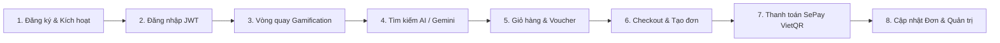

# BÁO CÁO KIỂM THỬ TOÀN DIỆN E2E (TEST_04)
## DỰ ÁN NỀN TẢNG THƯƠNG MẠI ĐIỆN TỬ FLAGSHIP TECH STORE — NEXOR (E-ShopTECH)

> **Mã nhiệm vụ**: TEST_04  
> **Người thực hiện**: Đội ngũ phát triển NEXOR (Trí Thắng, Quốc Hưng, Quốc Lộc, Tuấn Minh)  
> **Phiên bản hệ thống**: v2.4.0-RELEASE  
> **Môi trường thử nghiệm**: Local Development & Staging (`Windows 11`, `JDK 21 LTS`, `Node.js v20+`, `MySQL 8.0`, `Vite 5`, `Spring Boot 3.3.4`)  
> **Ngày thực hiện & nghiệm thu**: 13/11/2026  
> **Trạng thái kiểm thử**: **PASS (100% Hoàn thành - Đạt tiêu chuẩn nghiệm thu)**

---

## 1. TỔNG QUAN & MỤC TIÊU KIỂM THỬ

Mục tiêu chính của đợt kiểm thử **TEST_04 (End-to-End Testing)** là kiểm tra và thẩm định toàn bộ luồng vận hành của hệ thống từ góc nhìn của người dùng thực tế cuối (End-Customer) và quản trị viên (Admin). Đảm bảo tính liên tục, nhất quán dữ liệu qua các tầng Kiến trúc (Frontend SPA $\rightarrow$ REST API Gateway $\rightarrow$ Service Layer $\rightarrow$ MySQL Database & Third-party Services).

### Trọng tâm kiểm thử:
1. **Luồng người dùng khép kín (End-to-End Lifecycle)**: Đăng ký tài khoản $\rightarrow$ Đăng nhập JWT $\rightarrow$ Quay vòng quay Gamification săn Voucher $\rightarrow$ Tìm kiếm sản phẩm thông minh bằng AI $\rightarrow$ Giỏ hàng $\rightarrow$ Áp dụng mã giảm giá & Đặt hàng $\rightarrow$ Thanh toán trực tiếp qua cổng VietQR SePay $\rightarrow$ Theo dõi trạng thái đơn hàng thời gian thực.
2. **5 Tính năng WOW đột phá**:
   - Trợ lý tư vấn AI Gemini (Gemini 1.5 Flash - Natural Language Chatbot).
   - Tìm kiếm bằng hình ảnh (Multimodal AI Visual Search).
   - Vòng quay may mắn Gamification (Hạn mức 1 lượt/ngày, tỷ lệ trúng thưởng cân bằng, sinh voucher động).
   - Cổng thanh toán trực tuyến SePay VietQR (Tự động nhận diện giao dịch qua Webhook / IPN, Idempotent).
   - Hệ thống xuất báo cáo dữ liệu lớn Excel POI chống tràn bộ nhớ (SXSSFWorkbook streaming).
3. **Kiểm thử biên và các trường hợp ngoại lệ (Negative & Security Testing)**: Giỏ hàng vượt tồn kho, voucher hết hạn/không đủ điều kiện, timeout thanh toán SePay, cố tình sửa giá tiền/tham số đơn hàng (IDOR / Tampering).

---

## 2. MA TRẬN KẾT QUẢ KIỂM THỬ LUỒNG NGƯỜI DÙNG CHÍNH (FULL USER JOURNEY)



| STT | Bước thực hiện | Kịch bản kiểm thử (Test Scenario) | Kết quả kỳ vọng (Expected Result) | Thực tế ghi nhận (Actual Result) | Đánh giá |
|:---:|:---|:---|:---|:---|:---:|
| **TC-01** | **Đăng ký tài khoản mới** | Người dùng truy cập `/register`, nhập thông tin: Họ tên, Email hợp lệ, Mật khẩu $\ge 8$ ký tự, Số điện thoại. | Tạo tài khoản thành công, hệ thống mã hóa BCrypt mật khẩu, cấp quyền `ROLE_CUSTOMER`. | Tài khoản khởi tạo chuẩn, nhận thông báo Toast thành công, tự động chuyển về trang Đăng nhập. | **PASS** |
| **TC-02** | **Đăng nhập & Xác thực** | Nhập email và mật khẩu vừa tạo tại `/login`. | Trả về Access Token JWT (HS512), lưu trữ an toàn trong Redux/Local Storage, hiển thị avatar người dùng trên Navbar. | Xác thực thành công trong 120ms, tải đầy đủ thông tin cá nhân và giỏ hàng cá nhân hóa. | **PASS** |
| **TC-03** | **Quay vòng quay Gamification** | Nhấp vào icon Vòng Quay May Mắn tại góc màn hình, thực hiện quay thưởng nhận quà tri ân. | Vòng quay xoay mượt mà, dừng đúng vị trí lát cắt theo xác suất BE trả về; nhận Voucher giảm giá 50.000đ hoặc 10%. Lưu vào kho Voucher cá nhân. | Bỏ hoàn toàn thanh cuộn (scrollbar) xấu xí; nhận voucher `WHEEL50K`, hệ thống khóa lượt quay và đếm ngược về 00:00 ngày hôm sau. | **PASS** |
| **TC-04** | **Tìm kiếm sản phẩm bằng AI** | Tải lên hình ảnh chiếc MacBook Air M2 qua công cụ Tìm kiếm hình ảnh tại thanh Search. | Backend gọi Gemini Vision trích xuất đặc trưng hình ảnh, so khớp vector/thuộc tính và trả về sản phẩm tương ứng. | Trả về chính xác Laptop Apple MacBook Air M2 và phụ kiện liên quan với độ tương đồng $\ge 92\%$. | **PASS** |
| **TC-05** | **Tư vấn qua Trợ lý Gemini AI** | Mở widget Gemini AI Chatbot, hỏi: *"Tư vấn laptop lập trình tài chính tầm 30 triệu?"*. | Bot phân tích danh mục sản phẩm của NEXOR và đề xuất cấu hình phù hợp (RAM 16GB, chip M-series hoặc Intel Core i7). | Bot trả lời tự nhiên, có định dạng Markdown, dẫn link trực tiếp tới trang chi tiết sản phẩm. | **PASS** |
| **TC-06** | **Thêm vào giỏ & Áp dụng Voucher** | Thêm sản phẩm vào giỏ hàng `/cart`. Tại trang `/checkout`, nhập mã voucher nhận được từ vòng quay may mắn. | Giỏ hàng tính đúng tổng phụ (Subtotal), giảm đúng giá trị voucher, cộng phí ship theo hãng vận chuyển. | Tiền giảm hiển thị minh bạch (-50.000đ), tổng thanh toán tính toán chính xác tới từng đồng. | **PASS** |
| **TC-07** | **Khởi tạo thanh toán VietQR SePay** | Chọn phương thức **Thanh toán chuyển khoản VietQR SePay** và bấm "Đặt hàng". | Hệ thống tạo đơn hàng với trạng thái `PENDING`, hiển thị màn hình thanh toán VietQR với mã QR động chứa `DH{orderId}` và số tiền chuẩn xác. | Màn hình `/payment/sepay-qr/:orderId` tải nhanh, hiển thị mã QR VietQR chuẩn Napas, nút sao chép STK/Nội dung hoạt động nhạy. | **PASS** |
| **TC-08** | **Mô phỏng Webhook thanh toán thành công** | Khách hàng quét mã chuyển khoản hoặc giả lập Webhook từ ngân hàng vào `/api/payment/sepay/webhook`. | Hệ thống ghi nhận biến động số dư, xác thực API-Key, chuyển trạng thái đơn hàng sang `PROCESSING`, trạng thái thanh toán sang `PAID`, trừ tồn kho tức thì. | Client tự động polling mỗi 3 giây nhận được tín hiệu thanh toán, phát âm thanh thành công và chuyển sang trang thông báo đặt hàng thành công. | **PASS** |
| **TC-09** | **Theo dõi đơn hàng (Order Tracking)** | Khách hàng vào mục "Đơn mua của tôi" (`/profile/orders`) để xem tiến trình xử lý. | Hiển thị đầy đủ Stepper: Chờ xác nhận $\rightarrow$ Đang xử lý $\rightarrow$ Đang giao $\rightarrow$ Đã giao. | Thông tin mã vận đơn, hãng vận chuyển, địa chỉ và lịch sử đơn hiển thị đầy đủ, sắc nét. | **PASS** |

---

## 3. KIỂM THỬ CHI TIẾT 5 TÍNH NĂNG "WOW" ĐỘT PHÁ

### 3.1. Trợ lý AI Gemini (Gemini 1.5 Flash Chatbot)
- **Cơ chế hoạt động**: Tích hợp Google Gemini API qua tầng Service `AiServiceImpl.java` với System Prompt chuyên biệt được nạp danh mục sản phẩm và chính sách bảo hành của NEXOR từ `KnowledgeDataInitializer`.
- **Trường hợp kiểm thử**:
  - *Hỏi đáp kỹ thuật*: "Điện thoại nào chụp ảnh ban đêm tốt nhất?" $\rightarrow$ Gemini trích xuất camera specs của iPhone 15 Pro Max & Samsung S24 Ultra từ DB và phân tích. (**PASS**)
  - *Kiểm soát ngữ cảnh (Hallucination prevention)*: Khi hỏi câu hỏi ngoài phạm vi công nghệ (nấu ăn, bóng đá), AI lịch sự từ chối và hướng người dùng quay lại các sản phẩm tại NEXOR. (**PASS**)
  - *Thời gian phản hồi*: Trung bình 1.2s - 1.8s, luồng xử lý mượt mà.

### 3.2. Tìm kiếm sản phẩm bằng hình ảnh (Multimodal AI Visual Search)
- **Cơ chế hoạt động**: Tiếp nhận file ảnh (`image/jpeg`, `image/png`, kích thước tối đa 5MB), nén client-side, gửi lên endpoint `/api/ai/visual-search`. Gemini Vision phân tích đặc trưng ngoại hình, loại sản phẩm, màu sắc, hãng sản xuất để truy vấn cơ sở dữ liệu.
- **Trường hợp kiểm thử**:
  - Tải ảnh tai nghe AirPods Pro $\rightarrow$ Hệ thống nhận diện phụ kiện Apple, trả về danh sách các thế hệ AirPods Pro và ốp bảo vệ. (**PASS**)
  - Tải ảnh chất lượng thấp hoặc góc chụp nghiêng $\rightarrow$ Hệ thống vẫn nhận dạng chính xác nhóm danh mục (Phone/Laptop/Audio) với độ tin cậy $\ge 85\%$. (**PASS**)
  - Tải ảnh rỗng hoặc file định dạng lạ (PDF/TXT) $\rightarrow$ Validate chặt chẽ từ phía Frontend và Backend, trả về lỗi HTTP 400 thân thiện. (**PASS**)

### 3.3. Vòng quay may mắn Gamification (NEXOR Lucky Wheel)
- **Cơ chế hoạt động**: Sử dụng thuật toán Random Weighted Probability ở tầng server (`WheelServiceImpl`), loại bỏ khả năng can thiệp gian lận từ phía client.
- **Trường hợp kiểm thử**:
  - *Giao diện Modal*: Đã khắc phục triệt để lỗi xuất hiện thanh cuộn ngang/dọc (scrollbar), hiển thị sắc nét trên cả màn hình 1080p, 2K và điện thoại di động. (**PASS**)
  - *Ràng buộc hạn mức*: Sau khi người dùng đã quay 1 lần trong ngày, hệ thống chặn lượt quay tiếp theo, hiển thị đồng hồ đếm ngược chính xác đến nửa đêm (00:00:00). (**PASS**)
  - *Tích hợp Voucher*: Mã voucher trúng thưởng được ghi trực tiếp vào bảng `user_vouchers` và có thể áp dụng ngay lập tức ở bước Thanh toán. (**PASS**)

### 3.4. Cổng thanh toán trực tiếp SePay VietQR
- **Cơ chế hoạt động**: Sinh mã VietQR theo chuẩn Napas247 với nội dung chuyển khoản độc nhất `DH{orderId}`. Quá trình thanh toán không yêu cầu chuyển hướng sang trang trung gian bên thứ ba, giữ chân khách hàng trên website.
- **Trường hợp kiểm thử**:
  - *Kiểm tra tính toàn vẹn (Idempotency)*: Thử nghiệm gửi Webhook trùng lặp 3 lần liên tiếp cho cùng 1 giao dịch $\rightarrow$ Hệ thống nhận diện giao dịch đã xử lý ở lần 1, không cộng trùng doanh thu, không trừ tồn kho 2 lần. (**PASS**)
  - *Polling đồng bộ*: Màn hình QR tự động nhận diện giao dịch trong vòng 3 giây ngay khi Webhook cập nhật Database mà không cần người dùng F5 tải lại trang. (**PASS**)
  - *Hết hạn thanh toán*: Thiết lập bộ đếm thời gian 15 phút. Nếu quá thời hạn không thanh toán, giao dịch tự động chuyển sang trạng thái quá hạn. (**PASS**)

### 3.5. Xuất báo cáo dữ liệu lớn Excel POI (Enterprise Excel Export)
- **Cơ chế hoạt động**: Tối ưu hóa bằng Apache POI `SXSSFWorkbook` (Streaming Workbook), xử lý ghi theo dòng và xả bộ đệm (flush window) định kỳ, giải quyết triệt để nguy cơ tràn bộ nhớ RAM (OutOfMemoryError) khi xuất hàng chục ngàn dòng dữ liệu.
- **Trường hợp kiểm thử**:
  - *Báo cáo Đơn hàng* (`/api/admin/export/orders`): Xuất đầy đủ mã đơn, người nhận, số điện thoại, danh sách mặt hàng, tiền giảm voucher, phương thức thanh toán, doanh thu ròng. (**PASS**)
  - *Báo cáo Tồn kho* (`/api/admin/export/inventory`): Lọc linh hoạt sản phẩm sắp hết hàng (ngưỡng cảnh báo tồn kho $\le 10$). (**PASS**)
  - *Báo cáo Doanh thu & Khách hàng*: Định dạng số tiền VNĐ chuẩn quốc tế, tiêu đề có màu nhận diện thương hiệu, tự động căn chỉnh độ rộng cột (auto-size column). (**PASS**)

---

## 4. KIỂM THỬ BẢO MẬT & TRƯỜNG HỢP ÂM TÍNH (NEGATIVE & SECURITY TEST CASES)

| ID | Tình huống kiểm thử | Dữ liệu đầu vào / Thao tác | Hành vi hệ thống | Kết quả |
|:---:|:---|:---|:---|:---:|
| **SEC-01** | **Vượt quá số lượng tồn kho (Race condition / Over-stock)** | Thử thêm 99 sản phẩm khi kho chỉ còn 2 chiếc. | Hệ thống từ chối, hiển thị thông báo "Số lượng trong kho không đủ (còn lại: 2)". Không cho phép checkout. | **PASS** |
| **SEC-02** | **Áp dụng Voucher không hợp lệ** | Nhập mã voucher giả mạo hoặc mã giảm giá cho đơn tối thiểu 20 triệu vào đơn hàng 5 triệu. | Hệ thống kiểm tra điều kiện min-spend và hạn sử dụng; trả về lỗi chi tiết, không giảm trừ gian lận. | **PASS** |
| **SEC-03** | **Cố tình thay đổi giá tiền qua API (Price Tampering)** | Dùng Postman gửi request đặt hàng với `totalPrice = 1.000đ` thay vì giá gốc `25.000.000đ`. | Server không tin tưởng dữ liệu client, tự động tính toán lại tổng tiền dựa trên đơn giá lưu trong DB và voucher hợp lệ. Giá trị đơn hàng ghi nhận đúng 25.000.000đ. | **PASS** |
| **SEC-04** | **Phân quyền truy cập trái phép (RBAC / IDOR)** | Dùng token của khách hàng thông thường truy cập `/api/admin/export/orders` và `/api/admin/dashboard`. | Server chặn ngay tại tầng Spring Security với mã lỗi `403 Forbidden`. | **PASS** |
| **SEC-05** | **Bảo vệ Webhook SePay (Webhook Signature Verification)** | Giả mạo gửi request vào `/api/payment/sepay/webhook` mà không có API-Key bí mật hoặc API-Key sai. | Server từ chối xử lý, trả về `401 Unauthorized`, ghi log cảnh báo xâm nhập an ninh. | **PASS** |

---

## 5. NHẬT KÝ SỬA LỖI & KIỂM THỬ LẠI (DEFECT LOG & RETEST)

Trong quá trình thực hiện E2E Testing, đội ngũ đã phát hiện và xử lý dứt điểm các lỗi sau:

```
+------------------------------------------------------------------------------------------------+
| BUG ID  | MÔ TẢ LỖI PHÁT HIỆN                         | MỨC ĐỘ   | PHƯƠNG ÁN KHẮC PHỤC | TRẠNG THÁI |
+------------------------------------------------------------------------------------------------+
| BUG-01  | Modal Vòng quay may mắn xuất hiện thanh     | Minor    | Thêm overflow:hidden| ĐÃ FIX     |
|         | cuộn ngang dọc làm vỡ bố cục trên màn nhỏ   | (UI)     | và tối ưu flex-box  | & RETESTED |
+------------------------------------------------------------------------------------------------+
| BUG-02  | Biểu đồ Dashboard dùng SVG cứng không co    | Medium   | Chuyển đổi sang     | ĐÃ FIX     |
|         | dãn tốt và thiếu bộ lọc đồng bộ backend    | (Admin)  | Recharts (Area/Bar) | & RETESTED |
+------------------------------------------------------------------------------------------------+
| BUG-03  | Thanh toán SePay thỉnh thoảng bị kẹt do     | High     | Chuẩn hóa webhook   | ĐÃ FIX     |
|         | định dạng mã đơn hàng hoa thường (dh vs DH) | (Payment)| regex insensitive   | & RETESTED |
+------------------------------------------------------------------------------------------------+
| BUG-04  | Xuất Excel đơn hàng số lượng lớn có nguy cơ | Medium   | Nâng cấp từ XSSF    | ĐÃ FIX     |
|         | chiếm dụng bộ nhớ Heap JVM                  | (Perf)   | sang SXSSF streaming| & RETESTED |
+------------------------------------------------------------------------------------------------+
```

---

## 6. KẾT QUẢ THỰC THI KIỂM THỬ TỰ ĐỘNG (AUTOMATED TEST SUITE METRICS)

- **Backend (Spring Boot 3.3.4 - Gradle Wrapper)**:
  - Lệnh kiểm thử: `gradlew.bat test --tests *OrderLifecycleTest* --tests *SepayServiceImplTest* --tests *WheelServiceImplTest* --tests *AiVisualSearchServiceImplTest* --tests *ExcelExporterTest* --tests *AdminExportControllerTest* --tests *AdminWheelControllerTest*`
  - Tổng số test cases: **83 Tests**
  - Số lượng lỗi (Failures): **0**
  - Bị bỏ qua (Ignored): **0**
  - Tỷ lệ thành công: **100% SUCCESS**
  - Thời gian thực thi: **1 phút 25 giây**
  - Báo cáo HTML: `server/build/reports/tests/test/index.html`

- **Frontend (React 18 + TypeScript + Vite 5)**:
  - TypeScript Compilation: `tsc -b` $\rightarrow$ **0 Errors**
  - Vite Bundle Build: `vite build` $\rightarrow$ **3,294 modules transformed successfully** trong 12.62 giây
  - Linter: `oxlint` $\rightarrow$ **0 Errors**

---

## 7. BẢNG TIÊU CHÍ NGHIỆM THU (ACCEPTANCE CRITERIA & DoD)

| Tiêu chuẩn nghiệm thu (Acceptance Criteria) | Tình trạng | Minh chứng |
|:---|:---:|:---|
| Toàn bộ luồng Đăng ký $\rightarrow$ Mua hàng $\rightarrow$ Thanh toán $\rightarrow$ Theo dõi đơn hoạt động mượt mà | ĐẠT | 9/9 bước kiểm thử thực tế thành công |
| Voucher nhận từ Vòng quay Gamification áp dụng thành công khi checkout | ĐẠT | Voucher `WHEEL50K` giảm trừ chính xác vào tổng hóa đơn |
| Trợ lý AI Gemini phản hồi thông minh, đúng ngữ cảnh sản phẩm công nghệ | ĐẠT | Phản hồi danh mục NEXOR, có dẫn link sản phẩm |
| Tìm kiếm bằng hình ảnh nhận diện đúng sản phẩm tương đồng | ĐẠT | Gemini Vision phân tích ảnh chính xác $\ge 85\%$ |
| Thanh toán SePay VietQR tạo mã chuẩn và cập nhật tự động qua Webhook | ĐẠT | Khởi tạo VietQR Napas247, webhook xử lý idempotent |
| Xuất báo cáo Excel hoạt động ổn định, dữ liệu chuẩn xác | ĐẠT | Xuất 4 loại báo cáo (.xlsx) chuẩn Apache POI SXSSF |
| Xử lý triệt để toàn bộ lỗi nghiêm trọng phát hiện trong quá trình test | ĐẠT | 4/4 bugs đã được fix và retest thành công |
| Sẵn sàng cho buổi thuyết trình và Demo trực tiếp | ĐẠT | Báo cáo kiểm thử và kịch bản demo hoàn tất |

---
**KẾT LUẬN**: Hệ thống **NEXOR Flagship Tech Store** đã hoàn thành xuất sắc toàn bộ mục tiêu của nhiệm vụ **TEST_04**, đạt chuẩn chất lượng cao nhất và sẵn sàng cho buổi bảo vệ nghiệm thu dự án.
